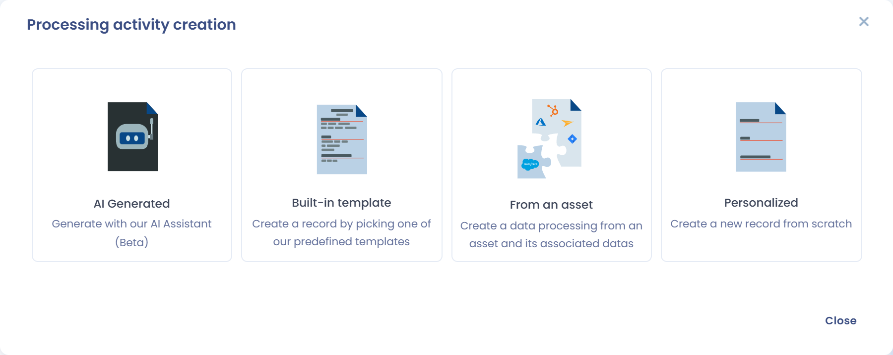
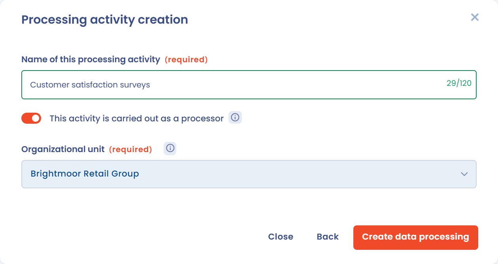

# Een verwerkingsactiviteit aanmaken

## Definitie van een gegevensverwerking

Een verwerkingsactiviteit is een bewerking of geheel van bewerkingen met persoonsgegevens, zoals het beheer van de loonadministratie. Alle verwerkingsactiviteiten samen vormen het verwerkingsregister.

## Een verwerkingsactiviteit aanmaken

Om een verwerkingsactiviteit aan te maken, opent u het verwerkingsregister en klikt u op **Maak een gegevensverwerking**. Het venster **Een gegevensverwerking maken** biedt vier opties:

* **Genereren met A.I.**: beschrijf uw verwerkingsactiviteit in een paar woorden en laat onze AI-assistent (bèta) ze genereren, wanneer deze functie in uw werkruimte is ingeschakeld. De AI-knop naast **Maak een gegevensverwerking** opent deze optie rechtstreeks.
* **Ingebouwde sjabloon**: begin vanuit een van onze voorgedefinieerde sjablonen (zie [Een sjabloon voor verwerkingsactiviteiten gebruiken](templates.md)).
* **Vanuit een actief**: maak een verwerkingsactiviteit aan vanuit een activum en de bijbehorende gegevens.
* **Gepersonaliseerd**: maak een nieuwe verwerkingsactiviteit vanaf nul aan.

<figure><figcaption>
Kiezen hoe u de nieuwe verwerkingsactiviteit aanmaakt
</figcaption></figure>

Bij **Gepersonaliseerd** vult u de **Naam gegevensverwerking** in, selecteert u de **Organisatie-eenheid** en klikt u op **Maak een gegevensverwerking**. U gaat dan naar de vragenlijst, waar u alle vereiste informatie kunt toevoegen.

## Een verwerkingsactiviteit aanmaken als verwerker

Een verwerkingsactiviteit als verwerker maakt u op dezelfde manier aan: schakel bij het aanmaken met **Gepersonaliseerd** (of **Genereren met A.I.**) de schakelaar **Activiteit als verwerker** in.

<figure><figcaption>
Een verwerkingsactiviteit als verwerker aanmaken
</figcaption></figure>

U komt dan rechtstreeks bij de documentatie van een verwerkingsactiviteit als verwerker, waar u uw verwerkingsverantwoordelijken (meestal uw klanten) opgeeft in de sectie **Klanten**.

## Een gegevensverwerking wijzigen

Om een bestaande verwerkingsactiviteit te wijzigen, klikt u op de rij in het register of opent u het menu aan het einde van de rij en kiest u **Bewerken**:

<figure><figcaption>
Een verwerkingsactiviteit openen om te bewerken
</figcaption></figure>

De secties van de vragenlijst staan links op het scherm: klik op een sectie om er rechtstreeks naartoe te gaan, of gebruik onderaan de pagina de knoppen **Terug**, **Ga naar sectie** en **Volgende**. Klik op **Opslaan** om uw werk op te slaan.

Doorloop daarna elke stap van de vragenlijst, te beginnen met de volgende sectie:


[Een verwerkingsactiviteit invullen](activity/README.md)

