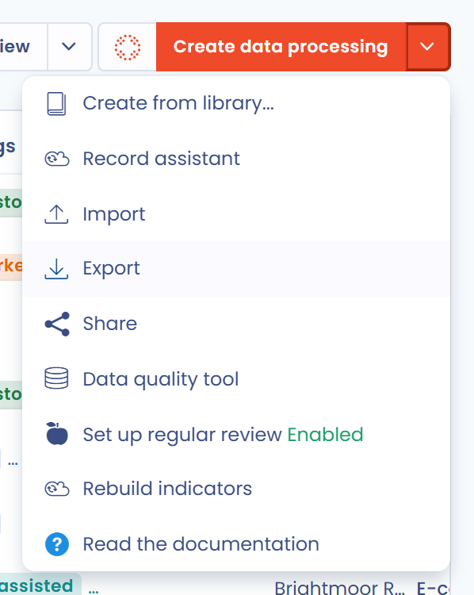
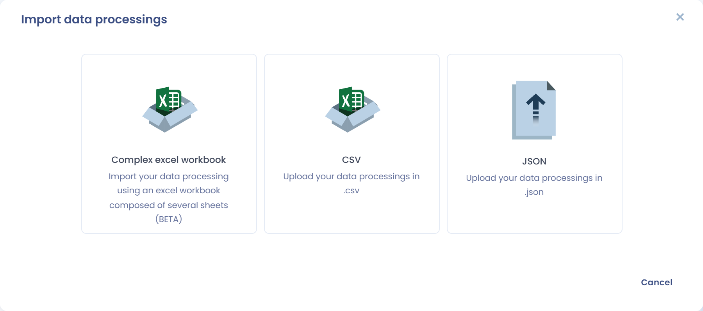
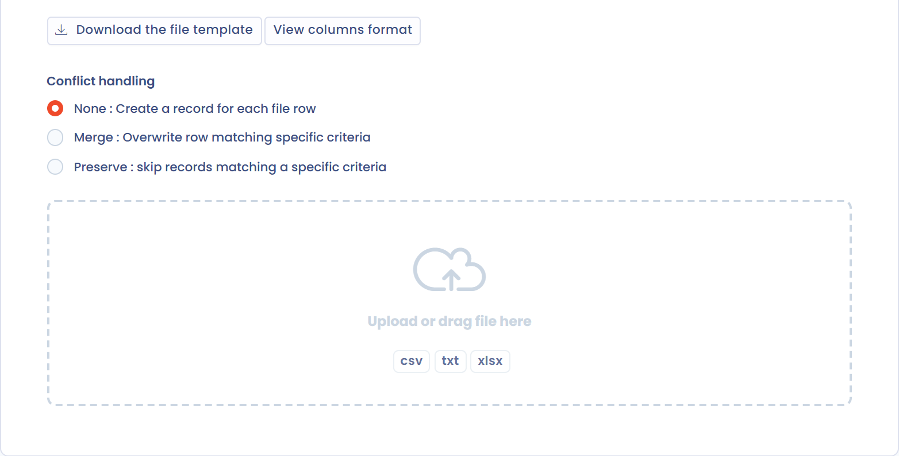

# Het register exporteren en importeren

## Het register exporteren

Om het volledige register te exporteren, opent u het verwerkingsregister, klikt u op de pijl rechts van de knop **Maak een gegevensverwerking** en selecteert u **Exporteren**.

<figure><figcaption>
Uitklapmenu van het register met de exportfunctie
</figcaption></figure>

In het venster dat opent, kiest u bij **Kies het gewenste exportformaat** PDF, Word, HTML, CSV, Excel, JSON of Markdown. Voor PDF, Word en HTML kiest u ook een exporttype bij **Selecteer een exporttype**: **Compleet**, **GDPR (artikel 30)**, **Standaard mededeling** of **Beleid voor het bewaren van gegevens**. Klik daarna op **Bestand downloaden**.

Afhankelijk van het formaat zijn extra opties beschikbaar, bijvoorbeeld:

* **Groepeer per organisatie-eenheid** (PDF, Word, HTML) om de verwerkingsactiviteiten per organisatorische eenheid te groeperen
* **Indicatoren voor voortgang, kwaliteit en exportgevoeligheid toevoegen** en **Gerelateerde taken exporteren** (PDF en HTML, type Compleet)
* **Complex spreadsheet (meerdere bladen)** (Excel)
* **Native kolomnamen gebruiken (handig voor het importeren van gegevens)** en **Specifieke kolommen exporteren**, waarmee u de te exporteren kolommen kiest (CSV en Excel)
* **Exporteren voor klant/gegevensbeheerder** om een export te maken voor één van uw klanten, zonder de gegevens van de andere klanten

PDF-, Word- en HTML-exports bevatten maximaal 500 verwerkingsactiviteiten, CSV-, Excel-, JSON- en Markdown-exports maximaal 10.000. Is uw selectie groter, dan verschijnt een waarschuwing in het venster.

Bij een groot register wordt de JSON-export op de achtergrond voorbereid: u kunt blijven werken, een melding houdt u op de hoogte van de voortgang en het bestand wordt gedownload zodra het klaar is.

### Formaat GDPR (artikel 30)

Het formaat GDPR (artikel 30) komt overeen met wat de AVG vereist: de export bevat alleen de velden die artikel 30 verplicht stelt in het verwerkingsregister. De opgenomen informatie is:

* Naam van de verwerkingsactiviteit en identiteit van de verwerkingsverantwoordelijke (of verwerker), zijn vertegenwoordiger en zijn FG
* Doeleinden (zonder wettelijke basis)
* Categorieën van betrokkenen en van persoonsgegevens, en bewaartermijnen
* Ontvangers en eventuele doorgiften buiten de EU
* Beveiligingsmaatregelen

### Formaat Compleet

Het formaat Compleet is het eigen formaat van Dastra: u exporteert alle velden waaruit de verwerkingsactiviteit bestaat.


U kunt ook slechts één of enkele verwerkingsactiviteiten van het register exporteren in plaats van het hele register. Vink daarvoor de vakjes links van de betreffende verwerkingsactiviteiten aan, klik op **Kies een bulkactie** en vervolgens op **Exporteren**. Om één verwerkingsactiviteit te exporteren, gebruikt u ook **Exporteren** in het menu aan het einde van de rij.


## Het register importeren

Klik op de pijl rechts van de knop **Maak een gegevensverwerking** en selecteer **Importeren**. Het venster **Importeer verwerkingen** biedt drie formaten:

* **Complexe Excel-werkmap**: importeer uw verwerkingsactiviteiten uit een Excel-werkmap met meerdere bladen (bèta)
* **Excel**: importeer uw verwerkingsactiviteiten uit een CSV-bestand
* **JSON**: importeer verwerkingsactiviteiten die u eerder in JSON-indeling uit Dastra hebt geëxporteerd, bijvoorbeeld uit een andere werkruimte

<figure><figcaption>
Het importformaat kiezen
</figcaption></figure>

### Importeren met de complexe Excel-werkmap

Een bestaand register importeren is omslachtig als u veel verwerkingsactiviteiten hebt. Met de complexe Excel-werkmap importeert u uw verwerkingsactiviteiten in één keer. Dastra herkent de gegevens in de werkmap om de verwerkingsactiviteiten en de bijbehorende repositories aan te maken.

1. Kies **Complexe Excel-werkmap**.
2. Klik op **Het bestandssjabloon downloaden** en vul het in met uw gegevens.
3. Selecteer de **Organisatie-eenheid** waarin de verwerkingsactiviteiten worden aangemaakt.
4. Sleep uw ingevulde bestand naar het venster om de import te starten.


Tijdens de import wordt geen organisatorische eenheid aangemaakt. Gegevens uit velden die geen deel uitmaken van het sjabloon komen terecht in de HTML-beschrijvingsvelden.


### Standaardimport, stap voor stap

Om niet elke verwerkingsactiviteit met de hand in te vullen en om elk mogelijk registerformaat te verwerken, heeft Dastra een methode ontworpen die uitgaat van het opsplitsen van het register in gegevensdomeinen. Zeven stappen worden aanbevolen om een volledig bestaand register in Dastra te importeren.


Deze stappen zijn niet verplicht, maar ze worden sterk aanbevolen, vooral wanneer het register veel verwerkingsactiviteiten bevat.


Raadpleeg ook onze bibliotheek met sjablonen voor gegevensverwerking: [https://www.dastra.eu/en/data-processing/referentials](https://www.dastra.eu/en/data-processing/referentials)

De importpagina werkt bij elke stap op dezelfde manier. Ze wordt in detail beschreven in [Uw gegevens importeren (Excel, CSV)](../general/import.md).

### Stap 1: labels van verwerkingsactiviteiten importeren

Om uw bestaande labels van verwerkingsactiviteiten te importeren, klikt u op de pijl rechts van **Maak een gegevensverwerking**, selecteert u **Importeren** en kiest u daarna de optie voor CSV-bestanden (in de app **Excel** genoemd). De pagina **Gegevens importeren** opent.

Klik op **Het bestandssjabloon downloaden** om een voorbeeldbestand te krijgen, en op **Zie kolomindeling** om de lijst van verwachte kolommen, hun regels en hun mogelijke waarden te zien.

<figure><figcaption>
Het bestandssjabloon downloaden
</figcaption></figure>

Vul het bestand in met uw verwerkingsactiviteiten. De belangrijkste kolommen zijn:

| Kolom            | Beschrijving                                         | Mogelijke waarden                                   |
| ---------------- | ---------------------------------------------------- | --------------------------------------------------- |
| Label            | Naam van de verwerkingsactiviteit (verplicht)        |                                                     |
| Ref              | Interne referentie                                   |                                                     |
| Processing state | Status van de verwerkingsactiviteit                  | "Study", "BeingDeployed", "InProduction", "Stopped" |
| Description      | Korte beschrijving van de verwerkingsactiviteit      |                                                     |

Selecteer de **Organisatie-eenheid** en sleep daarna uw bestand naar het venster:

<figure><figcaption>
De organisatie-eenheid kiezen voordat u het bestand uploadt
</figcaption></figure>

Koppel in de stap **Correspondentie** de kolommen van uw bestand aan de Dastra-velden en klik op **Ga verder** om de import uit te voeren.

### Stap 2: de repository van activa importeren

Om uw bestaande toepassingen en activa te importeren, gaat u naar de module **Referenties**, tabblad **Activa**, klikt u op de pijl rechts van **Een app toevoegen** en selecteert u **Importeren**:

<figure><figcaption>
Activa importeren
</figcaption></figure>

Download vervolgens het bestandssjabloon, vul het in met uw activa (gebruik **Zie kolomindeling** voor de lijst van kolommen) en importeer het zoals in stap 1.

### Stap 3: de repository van stakeholders importeren

Herhaal dezelfde procedure vanuit de module **Referenties**, tabblad **Actoren**.

Uw repository van stakeholders bevat alle partijen die bij een verwerkingsactiviteit betrokken zijn: rechtspersonen zoals verwerkers, klanten of gezamenlijke verwerkingsverantwoordelijken, of natuurlijke personen zoals de contactpersonen voor een verwerkingsactiviteit.

Deze repository dient als intern adresboek van de werkruimte. Voor elke stakeholder kunt u een type vastleggen dat hem kenmerkt. Wilt u bijvoorbeeld uw verwerkers toevoegen, dan voegt u ze allemaal toe als stakeholder en koppelt u daarna elke verwerker aan de betreffende verwerkingsactiviteiten.

### Stap 4: de repository van beveiligingsmaatregelen importeren

Herhaal dezelfde procedure vanuit de module **Referenties**, tabblad **Maatregelen**.

### Stap 5: de verklarende woordenlijst voor gegevens importeren

Herhaal dezelfde procedure vanuit de module **Referenties**, tabblad **Verklarende woordenlijst voor gegevens**.

### Stap 6: de repository van datasets importeren

Herhaal dezelfde procedure vanuit de module **Referenties**, tabblad **Gegevenssets**.

#### Datasets met hun gegevensvelden exporteren en importeren

U kunt uw datasets exporteren en importeren, inclusief de bijbehorende gegevensvelden. Zo migreert u gemakkelijker een bestaande datamap of werkt u uw verklarende woordenlijst voor gegevens in bulk bij.

##### Datasets met hun velden exporteren

Vanuit de module **Referenties**, tabblad **Gegevenssets**:

1. Selecteer de te exporteren datasets, of exporteer de volledige lijst
2. Klik op **Exporteren**
3. Kies het formaat CSV of Excel en klik op **Bestand downloaden**

Het geëxporteerde bestand bevat voor elke dataset de naam, de beschrijving, de bewaarregel en de lijst van de gegevensvelden. In deze kolom wordt elk gegevensveld geschreven als `naam#gevoeligheid#categorie`, en de gegevensvelden worden gescheiden door `|`. Schakel **Native kolomnamen gebruiken (handig voor het importeren van gegevens)** in als u van plan bent het bestand opnieuw te importeren.

##### Datasets met hun velden importeren

Het importbestand heeft hetzelfde formaat als de export. Vul voor elke dataset de gegevensvelden in de daarvoor bestemde kolom in, bijvoorbeeld `Last name#Current#CivilStatus|Salary#HighlyPersonalNature#EconomicFinancialData`. Tijdens de import:

* worden gegevensvelden die nog niet in de verklarende woordenlijst voor gegevens bestaan automatisch aangemaakt
* worden gegevensvelden die al bestaan (zelfde naam) aan de dataset gekoppeld, zonder duplicaten


Deze functie is vooral nuttig om de datamap van meerdere werkruimten op elkaar af te stemmen, of om een nieuwe werkruimte te initialiseren vanuit een bestaande datamap.


### Stap 7: koppelingen leggen

Nu alle repositories zijn geïmporteerd, bewerkt u elke verwerkingsactiviteit en vult u de informatie aan op basis van de geïmporteerde gegevens, aan de hand van de onderstaande handleiding:


[Een verwerkingsactiviteit invullen](activity/README.md)

