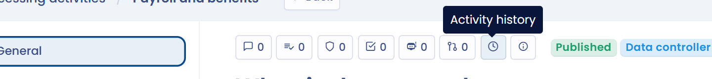
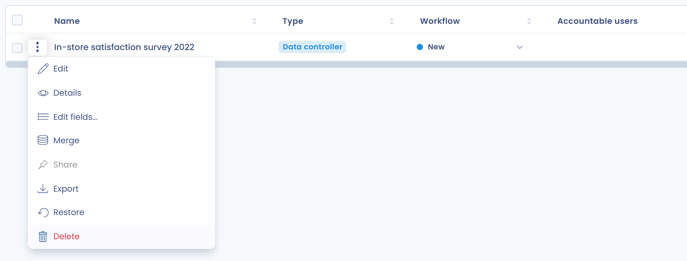

# FAQ

## Hoe toont u de wijzigingsgeschiedenis van een verwerkingsactiviteit?

Voor alle verwerkingsactiviteiten kunt u de wijzigingsgeschiedenis en de details van de wijzigingen weergeven.

Klik op het klokpictogram (**Historisch**) bovenaan de pagina van de verwerkingsactiviteit.

<figure><figcaption>
Knop voor toegang tot de geschiedenis
</figcaption></figure>

Klik bij een vermelding op **Gegevens wijzigen** om de versies te vergelijken. Daar kunt u met de knop **Herstellen** terugkeren naar die versie, als uw rol dat toestaat.

Wijzigingen in organisatorische eenheden worden niet bijgehouden.

## Kunt u automatisch elementen toevoegen aan het veld "stakeholders" in een nieuwe verwerkingsactiviteit?

Nee, stakeholders kunnen niet automatisch worden bijgewerkt via een geautomatiseerde workflow.

U kunt wel een aangepast veld aanmaken op het niveau van de stakeholder, dat via de geautomatiseerde workflow kan worden gewijzigd.

## Hoe verwijdert u een verwerkingsactiviteit?

Om een verwerkingsactiviteit te verwijderen, verplaatst u ze eerst naar de prullenbak met **Verplaats naar de prullenbak**. Daarna kunt u de verwerkingsactiviteit definitief verwijderen door de prullenbak weer te geven via de filters. Zo voorkomt u overhaaste verwijderingen.

Om een verwerkingsactiviteit naar de prullenbak te verplaatsen, opent u het menu aan het einde van de rij en kiest u **Verplaats naar de prullenbak**.

<figure><figcaption>
Een verwerkingsactiviteit naar de prullenbak verplaatsen
</figcaption></figure>

Geef daarna de prullenbak weer: klik op **Filters** en vink **Bekijk prullenbak** aan.

<figure><figcaption>
De prullenbak weergeven
</figcaption></figure>

Open ten slotte het menu aan het einde van de rij en kies **Verwijderen**. U kunt ook **Herstellen** kiezen om de verwerkingsactiviteit terug in het register te zetten.

<figure><figcaption>
Een verwerkingsactiviteit definitief verwijderen
</figcaption></figure>

## Hoe kunnen gebruikers met datasets werken zonder ze te mogen wijzigen?

Uw DPO-relais moeten mogelijk de datasets gebruiken die u beschikbaar stelt in hun verwerkingsactiviteiten, zonder nieuwe aan te maken of de gegevensvelden erin te wijzigen, zodat de koppelingen met andere verwerkingsactiviteiten consistent blijven.

Maak in dat geval een aangepaste rol aan. Ga naar de rollen: [https://app.dastra.eu/general-settings/roles](https://app.dastra.eu/general-settings/roles) (zie [Rollen en rechten](../settings/roles.md)).

Maak daarna een aangepaste rol met de volgende rechten:

* **Register- en gegevensverwerking**: Lezing, Schrijven
* **Gegevenstoewijzing en opslagplaatsen**: Lezing

Wijs deze rol vervolgens toe aan de betreffende gebruikers. Zij kunnen de datasets gebruiken in hun verwerkingsactiviteiten, maar de elementen van de datamap niet wijzigen.

## Hoe voegt u stakeholders of ontvangers toe aan meerdere verwerkingsactiviteiten?

Met bulkacties voegt u stakeholders of ontvangers in één keer toe aan meerdere verwerkingsactiviteiten.

Selecteer in de weergave **Tabel** de verwerkingsactiviteiten met de selectievakjes. De knop **Kies een bulkactie** verschijnt.

Kies **Actoren koppelen**, selecteer **Toevoegen**, kies de stakeholders en daarna hun **Type** (bijvoorbeeld stakeholder of ontvanger) en hun categorie, en bevestig. Bevat uw selectie zowel activiteiten als verwerkingsverantwoordelijke als activiteiten als verwerker, dan is alleen het type stakeholder beschikbaar.

In hetzelfde venster verwijdert u met **Verwijderen** stakeholders van de geselecteerde verwerkingsactiviteiten.

## Hoe krijgt u de lijst van activa per organisatorische eenheid?

U krijgt de lijst van activa per organisatorische eenheid via de koppelingen tussen activa en verwerkingsactiviteiten.

Gebruik de Excel-export van de verwerkingsactiviteiten: filter het register op organisatorische eenheid, selecteer de verwerkingsactiviteiten en exporteer ze. Schakel in het exportvenster **Specifieke kolommen exporteren** in en bewaar alleen de kolom met de activa: zo krijgt u de activa van die organisatorische eenheid. U kunt ook alleen de kolommen met de organisatorische eenheid en de activa bewaren om de activa van alle organisatorische eenheden tegelijk te krijgen.

De [datamap van het register](visualization/data-map.md) toont deze informatie ook grafisch.

## Hoe dupliceert u een register in een andere werkruimte?

U kunt een register en zijn verwerkingsactiviteiten op verschillende manieren dupliceren:

* door de verwerkingsactiviteiten in JSON-indeling te [exporteren en opnieuw te importeren](export-import.md),
* of door naar de doelwerkruimte te gaan en de verwerkingsactiviteiten aan te maken met **Maak vanuit de bibliotheek**: selecteer bij **Gegevensbron van de bibliotheek** de werkruimte die het oorspronkelijke register bevat.

## Hoe wijzigt u het type van een verwerkingsactiviteit (van een activiteit als verwerkingsverantwoordelijke naar een activiteit als verwerker, en omgekeerd)?

Open de verwerkingsactiviteit, klik op de pijl rechts van **Opslaan** en klik daarna op **Schakel over naar processorrecord** of **Schakel over naar verantwoordelijke voor de verwerking**:

<figure><figcaption>
Het type van een verwerkingsactiviteit wijzigen
</figcaption></figure>

Zet u een activiteit als verwerker terug naar een activiteit als verwerkingsverantwoordelijke, dan worden de eraan gekoppelde klanten verwijderd. Vooraf wordt om bevestiging gevraagd.

## Foutmelding: "Label field is required."

Deze melding verschijnt meestal wanneer een veld leeg blijft bij het beantwoorden van een vragenlijst.

## Foutmelding: "Wees voorzichtig, verboden HTML-inhoud is aanwezig in een veld!"

<figure><figcaption>
Verboden HTML-inhoud is aanwezig in een veld
</figcaption></figure>

Deze melding betekent dat HTML-code (meestal tussen punthaken `< >`) aanwezig is in een veld waarin HTML om veiligheidsredenen niet is toegestaan.

De volgende melding wijst het betreffende veld aan:

<figure><figcaption>
Verboden HTML-inhoud is aanwezig in een veld
</figcaption></figure>

## Foutmelding: "De gebruikers-ID bestaat niet in uw organisatie." bij het opslaan van een gegevensverwerking

Deze melding betekent dat een gebruiker die uit uw werkruimte is verwijderd, nog steeds als verantwoordelijke gebruiker is ingesteld bij de stakeholders van de gegevensverwerking.

Verwijder de verwijderde gebruiker uit de stakeholders van de gegevensverwerking om dit probleem op te lossen.


Vindt u het antwoord niet in deze gids, dan kunt u [contact opnemen met onze support](../../getting-started/support/request.md).

