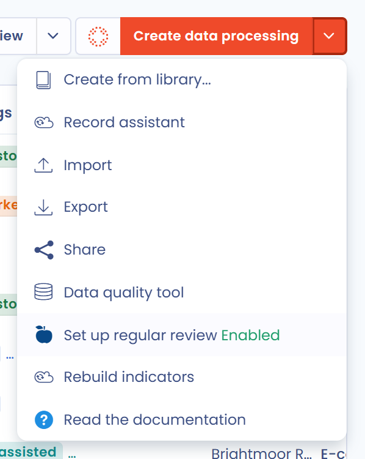
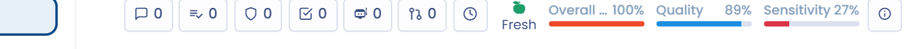

# Frisheid van verwerkingsactiviteiten

De frisheid van een verwerkingsactiviteit geeft aan wanneer ze voor het laatst is beoordeeld. Zodra regelmatige beoordelingen zijn ingeschakeld, legt elke beoordeling een volgende beoordelingsdatum vast en neemt de frisheid af naarmate die datum nadert. Zo controleert u of de informatie in uw verwerkingsregister regelmatig wordt beoordeeld en actueel blijft.


Regelmatige beoordelingen zijn ook beschikbaar voor andere items, zoals stakeholders, activa, contracten of AI-systemen. Het gemeenschappelijke mechanisme staat beschreven in [Terugkerende beoordeling (frisheid)](../regular-review.md). Deze pagina beschrijft hoe het werkt voor verwerkingsactiviteiten.


## De optie voor de frisheid van verwerkingsactiviteiten activeren

De frisheid van verwerkingsactiviteiten is optioneel en standaard uitgeschakeld. U stelt ze in voor de hele werkruimte, in de instellingen van de werkruimte, onder **Terugkerende beoordelingen**.

Om deze instelling vanuit uw register te openen, klikt u op de pijl naast de knop **Maak een gegevensverwerking** en daarna op **Activeer regelmatige beordeling van verwerkingen (frisheid)**. Het menu-item toont ook of de optie momenteel **Actief** of **Uitgeschakeld** is.

<figure><figcaption>
De optie voor regelmatige beoordeling in het menu van Maak een gegevensverwerking
</figcaption></figure>

In de instellingen **Terugkerende beoordelingen**:

1. Selecteer **Gegevensverwerking** in de keuzelijst met itemtypen.
2. Schakel **Schakel regelmatige beoordelingen in** in.
3. Voer bij **Selecteer het gewenste interval tussen elke beoordeling** het interval tussen twee beoordelingen in, in jaren, maanden of dagen.
4. Klik op **Opslaan**.

Alleen gebruikers met het recht **Geavanceerde configuratie** kunnen deze instelling wijzigen.

<figure><figcaption>
De instellingen voor regelmatige beoordelingen van verwerkingsactiviteiten
</figcaption></figure>

Het interval geldt voor alle verwerkingsactiviteiten van de werkruimte. De volgende beoordelingsdatum van een verwerkingsactiviteit is de datum van haar laatste beoordeling plus dit interval, tenzij tijdens de beoordeling een specifieke datum is gekozen (zie [Een verwerkingsactiviteit beoordelen](#een-verwerkingsactiviteit-beoordelen)).

Wanneer u een nieuw interval opslaat, vraagt Dastra of het moet gelden voor de reeds geregistreerde beoordelingen:

* **Toepassen op alle bestaande beoordelingen**: de reeds geplande beoordelingsdatums worden herberekend met het nieuwe interval, waarbij ze worden overschreven;
* **Alleen toepassen op de volgende beoordelingen**: de reeds geplande beoordelingsdatums blijven behouden en het nieuwe interval wordt gebruikt vanaf de volgende beoordeling.

<figure><figcaption>
Kies of het nieuwe interval geldt voor bestaande beoordelingen
</figcaption></figure>


Voorbeeld: u stelt een interval van 1 jaar in. Een verwerkingsactiviteit die op 15 januari 2026 is beoordeeld, heeft als volgende beoordelingsdatum 15 januari 2027. Ze wordt het grootste deel van het jaar weergegeven als **Fris**, tijdens de laatste 10% van het interval (iets meer dan een maand) als **binnenkort**, en als **Verouderd** zodra haar volgende beoordelingsdatum is verstreken, tot ze opnieuw wordt beoordeeld.


## De optie voor de frisheid van verwerkingsactiviteiten uitschakelen

Om de optie te deactiveren, gaat u terug naar de instellingen **Terugkerende beoordelingen**, selecteert u **Gegevensverwerking**, schakelt u **Schakel regelmatige beoordelingen in** uit en klikt u op **Opslaan**.

De frisheidsindicatoren worden dan niet meer weergegeven. Elke verwerkingsactiviteit behoudt haar beoordelingsgeschiedenis en haar laatste beoordelingsdatum, die opnieuw worden gebruikt als u de optie later weer activeert.

## Frisheidsindicatoren

Frisheid wordt alleen weergegeven voor gepubliceerde verwerkingsactiviteiten die minstens één keer zijn beoordeeld. Een verwerkingsactiviteit kan zich in een van de volgende toestanden bevinden:

| Toestand                  | Betekenis                                                                                                      |
| ------------------------- | -------------------------------------------------------------------------------------------------------------- |
| Fris (groen)              | De verwerkingsactiviteit is onlangs beoordeeld en vraagt geen onmiddellijke aandacht.                          |
| binnenkort (oranje)       | De laatste 10% van het interval tussen twee beoordelingen is begonnen: de beoordeling moet worden gepland.     |
| Verouderd (rood)          | De volgende beoordelingsdatum is verstreken: de verwerkingsactiviteit voldoet niet meer aan het beoordelingsbeleid. |
| Beordeling in wacht       | De verwerkingsactiviteit is gepubliceerd maar nooit beoordeeld.                                                |

Een verwerkingsactiviteit die nog een concept is, wordt in de lijst weergegeven als **niet gepubliceerd** en in haar dossier als **In afwachting van publicatie**.

### In het dossier van de verwerkingsactiviteit

Op een breed scherm staat de frisheidsindicator bovenaan het rechterpaneel van het dossier van de verwerkingsactiviteit. Hij toont de balk **Frisheid**, die korter wordt naarmate de volgende beoordelingsdatum nadert, de toestand en haar kleur, een link **Beoordeling** en het aantal resterende of te late dagen.

Op een kleiner scherm is het rechterpaneel verborgen: de toestand (bijvoorbeeld **Fris**) wordt weergegeven in de kop van het dossier, naast de indicatoren **Voortgang**, **Kwaliteit** en **Gevoeligheid**. Klik erop om het venster **Beoordeling** te openen.

<figure><figcaption>
Op een kleiner scherm staat de frisheidsindicator in de kop van het dossier
</figcaption></figure>

### In de lijst van uw register

De kolom **Frisheid** toont de frisheidstoestand van elke verwerkingsactiviteit en de datum van haar laatste beoordeling. Beweeg de muisaanwijzer over de toestand om het aantal resterende of te late dagen te zien. Deze kolom wordt aan uw lijstweergave toegevoegd wanneer u de optie activeert; u kunt ze ook op elk moment toevoegen aan de weergegeven kolommen.

<figure><figcaption>
De kolom met de laatste beoordelingsdatum
</figcaption></figure>

U kunt ook de kolom **Voorlopige beoordelingsdatum** weergeven, die de volgende geregistreerde beoordelingsdatum van elke verwerkingsactiviteit toont, en uw register filteren met het filter **Frisheid** (beschikbaar onder **Filters**), met de waarden **Vergoedingen** (Fris), **In afwachting** (gepubliceerd maar nooit beoordeeld) of **Verouderd**.

## Een verwerkingsactiviteit beoordelen

U kunt een verwerkingsactiviteit op elk moment beoordelen, zonder te wachten op haar volgende beoordelingsdatum. Voor beoordelen is schrijftoegang tot het verwerkingsregister vereist. Open het venster **Beoordeling**:

* vanuit het dossier van de verwerkingsactiviteit: klik op de frisheidsindicator, op de link **Beoordeling** van het rechterpaneel, of op **Beoordeling** in het menu naast de knop **Opslaan**;
* vanuit de lijst: klik op de cel van de kolom **Frisheid**.

Om meerdere verwerkingsactiviteiten tegelijk te beoordelen, selecteert u ze in de lijst en kiest u **Beoordeling** bij **Kies een bulkactie**.

<figure><figcaption>
Het venster Beoordeling
</figcaption></figure>

Vul op het tabblad **Nieuwe recensie** in:

* **Recensent** (verplicht): de gebruiker die de beoordeling heeft uitgevoerd, standaard uzelf;
* **Beoordelingsdatum** (verplicht): standaard vandaag;
* **Beschrijving van de versie:** (optioneel): een korte beschrijving van wat is gecontroleerd of gewijzigd;
* **Datum voor volgende beoordeling**: berekend op basis van de beoordelingsdatum en het interval dat voor de werkruimte is ingesteld. Om een specifieke datum toe te passen op deze verwerkingsactiviteit, schakelt u **De volgende beoordelingsdatum wijzigen** in en selecteert u een nieuwe datum (op zijn vroegst de volgende dag).

Klik op **Beoordeling** om op te slaan. Er begint een nieuwe frisheidscyclus vanaf de beoordelingsdatum tot de volgende beoordelingsdatum.

Wanneer het venster voor één verwerkingsactiviteit is geopend, toont het tabblad **Oude recensies** haar eerdere beoordelingen. Dit tabblad biedt ook de knop **Delete all reviews**, waarmee u de beoordelingsgeschiedenis wist: na bevestiging worden de laatste en de volgende beoordelingsdatum gewist en wordt de frisheidsindicator niet meer weergegeven. Deze actie kan niet ongedaan worden gemaakt.

## Belangrijke informatie over de werking van frisheid

Het opslaan van een verwerkingsactiviteit telt niet als beoordeling: de datum van de laatste beoordeling staat los van de datum waarop het dossier voor het laatst is bijgewerkt. Om de frisheidscyclus van een verwerkingsactiviteit te (her)starten, moet u ze beoordelen.

Een verwerkingsactiviteit verplaatsen naar de laatste stap van haar workflow kan ook een beoordeling registreren: het venster voor de stapwijziging toont dan een schakelaar **Beoordeling**, die standaard is ingeschakeld.
