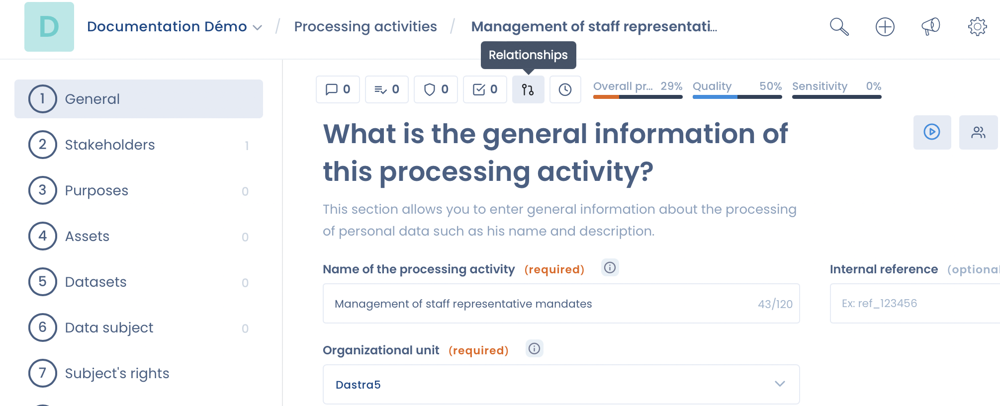

# Relaties tussen verwerkingsactiviteiten aanmaken

In Dastra maakt u relaties tussen uw verwerkingsactiviteiten aan om ze beter te beheren.

Deze relaties zijn mogelijk tussen verwerkingsactiviteiten die in dezelfde werkruimte staan.

## Het nut van relaties tussen verwerkingsactiviteiten

Met relaties tussen verwerkingsactiviteiten legt u de verantwoordelijkheidsrelaties vast tussen de verschillende entiteiten die voor verwerkingen verantwoordelijk zijn.

In een groep van bedrijven koppelt u bijvoorbeeld een verwerkingsactiviteit van het moederbedrijf aan de verwerkingsactiviteiten van de dochterondernemingen. Dat komt vaak voor bij verwerkingsactiviteiten rond het algemene beheer van de groep, zoals personeelsbeheer, boekhouding of leveranciersbeheer.

> Een moederbedrijf X beheert de salarisadministratie namens zijn dochterondernemingen Y en Z. In entiteit X maakt u een verwerkingsactiviteit "Salarisadministratie" (P1) aan als verwerker. Vanuit P1 maakt u een relatie **Strikt overnemen (sterke erfenis)** aan met twee verwerkingsactiviteiten (C1 en C2) in Y en Z, aangemaakt als verwerkingsactiviteiten van een verwerkingsverantwoordelijke.
>
> Elke wijziging in P1 wordt dan automatisch doorgegeven aan C1 en C2.

## Een relatie toevoegen

Klik in een verwerkingsactiviteit op de knop **Relaties** in de werkbalk boven aan de activiteit. De knop toont het aantal bestaande relaties.

<figure><figcaption>
Het paneel Relaties van een verwerkingsactiviteit
</figcaption></figure>

Het paneel **Relaties** toont de bestaande relaties, gegroepeerd per type, met de organisatie-eenheid van elke gekoppelde verwerkingsactiviteit en de datum waarop de relatie is aangemaakt. Klik op een verwerkingsactiviteit om die in een nieuw tabblad te openen, of klik op het prullenbakpictogram om de relatie te verwijderen.

Om een relatie aan te maken klikt u op **Voeg een relatie toe** en doet u daarna het volgende:

1. Selecteer het **Type relatie**. Onder het veld verschijnt een beschrijving van het geselecteerde type.
2. Kies **Bestaande verwerking** om reeds bestaande verwerkingsactiviteiten te koppelen, of **Nieuwe verwerking** om de gekoppelde verwerkingsactiviteit meteen aan te maken.
3. Selecteer voor een bestaande verwerkingsactiviteit eerst de **Organisatie-eenheid** en daarna de verwerkingsactiviteit bij **Bijgevoegde object (en) selecteren**.
4. Vul voor een nieuwe verwerkingsactiviteit de **Naam van de nieuwe verwerking** in, schakel zo nodig **Activiteit als verwerker** in en selecteer de organisatie-eenheid.
5. Klik op **Toevoegen**.

<figure><figcaption>
Het venster Voeg een relatie toe
</figcaption></figure>

U kunt in één keer relaties met meerdere verwerkingsactiviteiten aanmaken:

* bij **Strikt overnemen (sterke erfenis)** of **Overgebracht (zwakke erfenis)** selecteert u meerdere bestaande verwerkingsactiviteiten;
* bij **Is de ouder van**, **Is relatief ten opzichte van**, **Strikt overnemen (sterke erfenis)** of **Overgebracht (zwakke erfenis)** kunt u met de optie **Nieuwe verwerking** meerdere organisatie-eenheden selecteren: in elk daarvan wordt een nieuwe verwerkingsactiviteit aangemaakt.

U selecteert maximaal 50 verwerkingsactiviteiten of organisatie-eenheden per keer.


U kunt alleen relaties aanmaken met verwerkingsactiviteiten in dezelfde werkruimte.


## Soorten relaties

Er zijn twee soorten relaties:

1. Declaratieve relaties: ze leggen een eenvoudige koppeling tussen twee verwerkingsactiviteiten, zonder functionele afhankelijkheid.
2. Functionele relaties: ze geven velden door van de ene verwerkingsactiviteit aan de andere, of laten een verwerkingsactiviteit ze erven.

### Declaratieve relaties

#### Is het kind van

Hiërarchische relatie voor een gestructureerde weergave van de verwerkingsactiviteiten, zonder functionele afhankelijkheid tussen de velden.

> Verwerkingsactiviteit A is hiërarchisch ondergeschikt aan verwerkingsactiviteit B.

#### Is de ouder van

Hiërarchische relatie voor een gestructureerde weergave van de verwerkingsactiviteiten, zonder functionele afhankelijkheid tussen de velden.

> Verwerkingsactiviteit A staat hiërarchisch boven verwerkingsactiviteit B.

#### Is relatief ten opzichte van

Logische koppeling tussen twee verwerkingsactiviteiten, zonder enige afhankelijkheid tussen hun velden.

> Verwerkingsactiviteit A is gerelateerd aan verwerkingsactiviteit B.

#### Wordt gekopieerd door

Deze relatie houdt de kopieën bij die van deze verwerkingsactiviteit zijn gemaakt. Ze wordt automatisch aangemaakt wanneer u **Dupliceren** gebruikt op een verwerkingsactiviteit.

> Verwerkingsactiviteit A is de bron (van de kopie) van verwerkingsactiviteit B.

#### Is een kopie van

Deze relatie houdt bij van welke verwerkingsactiviteit een kopie is gemaakt. Ze wordt automatisch aangemaakt wanneer u **Dupliceren** gebruikt op een verwerkingsactiviteit.

> Verwerkingsactiviteit A is een kopie van verwerkingsactiviteit B.


**Wordt gekopieerd door** en **Is een kopie van** worden alleen automatisch aangemaakt: u kunt ze niet selecteren in het venster **Voeg een relatie toe**.


### Functionele relaties

Functionele relaties geven velden door van de ene verwerkingsactiviteit aan de andere, of laten een verwerkingsactiviteit ze erven.

#### Strikt overnemen (sterke erfenis)

De bronverwerkingsactiviteit A geeft haar velden door aan de afhankelijke verwerkingsactiviteit B.


Met uitzondering van de velden van tabblad 1 **Algemeen** en de documenten die u in tabblad 11 **Documentatie** aan de verwerkingsactiviteit hebt toegevoegd.


Dit maakt een strikte relatie tussen A (bron) en B (afhankelijk):

* de bestaande velden van B worden verwijderd wanneer de relatie wordt aangemaakt;
* de van A geërfde velden kunnen in B niet worden gewijzigd of verwijderd, en er kunnen geen nieuwe velden aan B worden toegevoegd;
* elke wijziging in A wordt automatisch doorgevoerd in B.

Als u de relatie verwijdert, kunt u de geërfde velden weer bewerken en worden de oorspronkelijke velden van B hersteld (de items van uw repositories blijven bewaard).

#### Strikt erven van (Strong Legacy)

Verwerkingsactiviteit A hangt af van verwerkingsactiviteit B en erft haar velden.


Met uitzondering van de velden van tabblad 1 **Algemeen** en de documenten die u in tabblad 11 **Documentatie** aan de verwerkingsactiviteit hebt toegevoegd.


Dit maakt een strikte relatie tussen B (bron) en A (afhankelijk):

* de bestaande velden van A worden verwijderd wanneer de relatie wordt aangemaakt;
* de van B geërfde velden kunnen in A niet worden gewijzigd of verwijderd, en er kunnen geen nieuwe velden aan A worden toegevoegd;
* elke wijziging in B wordt automatisch doorgevoerd in A.

Als u de relatie verwijdert, kunt u de geërfde velden weer bewerken en worden de oorspronkelijke velden van A hersteld (de items van uw repositories blijven bewaard).

Een verwerkingsactiviteit die in strikte erfenis van een andere afhangt, toont een banner **Overerven van gegevensverwerking** met een link naar haar bron, en de geërfde tabbladen zijn vergrendeld.


Een verwerkingsactiviteit kan maar van één bronverwerkingsactiviteit tegelijk afhangen.


#### Overgebracht (zwakke erfenis)

De bronverwerkingsactiviteit A geeft haar velden automatisch door aan de afhankelijke verwerkingsactiviteit B.


Met uitzondering van de velden van tabblad 1 **Algemeen** en de documenten die u in tabblad 11 **Documentatie** aan de verwerkingsactiviteit hebt toegevoegd.


Dit maakt een relatie met zwakke erfenis tussen A (bron) en B (afhankelijk):

* de van A geërfde velden kunnen in B niet worden gewijzigd;
* B kan zijn eigen velden toevoegen, wijzigen of verwijderen;
* elke wijziging in A wordt automatisch doorgevoerd in B.

Als u de relatie verwijdert, kunt u de geërfde velden weer bewerken en blijven de bestaande velden van B behouden.

#### Overgeërfd van (Weak Legacy)

Verwerkingsactiviteit A hangt af van verwerkingsactiviteit B en erft haar velden automatisch.


Met uitzondering van de velden van tabblad 1 **Algemeen** en de documenten die u in tabblad 11 **Documentatie** aan de verwerkingsactiviteit hebt toegevoegd.


Dit maakt een relatie met zwakke erfenis tussen B (bron) en A (afhankelijk):

* de van B geërfde velden kunnen in A niet worden gewijzigd;
* A kan zijn eigen velden toevoegen, wijzigen of verwijderen;
* elke wijziging in B wordt automatisch doorgevoerd in A.

Als u de relatie verwijdert, kunt u de geërfde velden weer bewerken en blijven de bestaande velden van A behouden.


Een verwerkingsactiviteit kan maar van één bronverwerkingsactiviteit tegelijk afhangen.


## Overzichtstabel van de relaties

| Type relatie | Tabblad 1, Algemeen | Tabbladen 2 tot 10 (inhoudelijke velden) | Documenten in tabblad 11, Documentatie | Velden die specifiek zijn voor de afhankelijke verwerkingsactiviteit |
| --- | --- | --- | --- | --- |
| Declaratieve relaties (Is het kind van, Is de ouder van, Is relatief ten opzichte van, Wordt gekopieerd door, Is een kopie van) | Geen effect | Geen effect | Geen effect | Geen effect |
| **Strikt overnemen (sterke erfenis)** | Niet doorgegeven | Doorgegeven | Niet doorgegeven | Kunnen niet worden toegevoegd, gewijzigd of verwijderd |
| **Strikt erven van (Strong Legacy)** | Niet geërfd | Geërfd | Niet geërfd | Kunnen niet worden toegevoegd, gewijzigd of verwijderd |
| **Overgebracht (zwakke erfenis)** | Niet doorgegeven | Doorgegeven | Niet doorgegeven | Kunnen worden toegevoegd, gewijzigd of verwijderd |
| **Overgeërfd van (Weak Legacy)** | Niet geërfd | Geërfd | Niet geërfd | Kunnen worden toegevoegd, gewijzigd of verwijderd |
