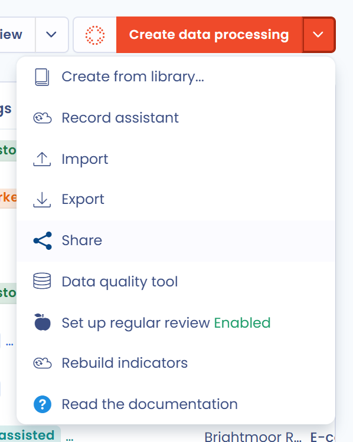
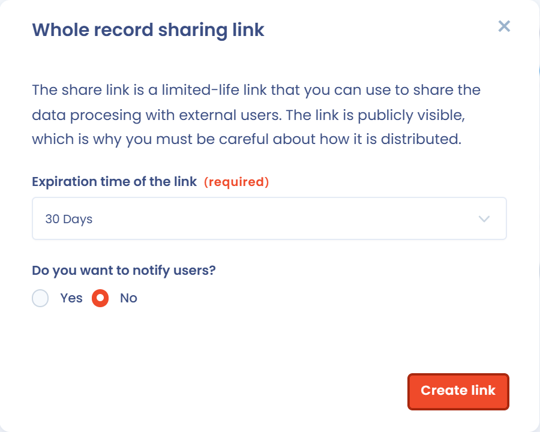

# Het verwerkingsregister delen

Met een deellink krijgen externe gebruikers zonder Dastra-account leestoegang tot uw verwerkingsregister of tot een deel van de verwerkingsactiviteiten. Voor het delen is het recht **Geavanceerde configuratie** vereist.


De deellink is openbaar zichtbaar: iedereen die de link heeft, kan hem openen tot hij verloopt. Let op hoe u de link verspreidt en houd om veiligheidsredenen de deellinks in uw werkruimte in de gaten.


## Het volledige register delen

Klik in de module **Verwerkingsregister** op de pijl naast de knop **Maak een gegevensverwerking** en daarna op **Delen**.

<figure><figcaption>
De optie Delen in het menu van Maak een gegevensverwerking
</figcaption></figure>

Het venster **Alle items delen** opent:

1. Selecteer de **Vervaldatum link**.
2. Kies bij **Wil je de link e-mailen naar andere gebruikers?** voor **Ja** om de link per e-mail te versturen, en vul dan de **e-mails van ontvangers** in en eventueel een **Gepersonaliseerd bericht**.
3. Klik op **Maak een link**.

Het delen omvat alleen de verwerkingsactiviteiten met de status "Gepubliceerd". Verwerkingsactiviteiten in concept worden met deze functie niet gedeeld: om een verwerkingsactiviteit in concept te delen, deelt u ze afzonderlijk (zie hieronder).

<figure><figcaption>
Het venster voor de deellink van het volledige register
</figcaption></figure>

De beschikbare geldigheidsduren van de links zijn:

* 2 dagen
* 30 dagen (standaard)
* 120 dagen
* Onbeperkt

Zodra de link is aangemaakt, wordt hij naar uw klembord gekopieerd. Het venster biedt dan twee delen:

* **Directe link**: kopieer de link met **Link kopiëren** of open hem met **Link**;
* **Integratie (insluiten)**: stel de **Breedte** en de **Hoogte** in en kopieer daarna de code om het gedeelde register in een andere website, zoals uw intranet, in te sluiten.

Klik op **Sluiten** om het venster te sluiten.

<figure><figcaption>
De deellink na het aanmaken
</figcaption></figure>

## Een deellink genereren voor een verwerkingsactiviteit

Om één verwerkingsactiviteit te delen, opent u het actiemenu aan het einde van de rij in de lijst en klikt u op **Delen**. Het venster **Genereer een share link voor 1 item** opent: ga verder zoals hierboven beschreven.

<figure><figcaption>
De optie Delen in het actiemenu van een verwerkingsactiviteit
</figcaption></figure>

U kunt een verwerkingsactiviteit ook delen vanuit haar dossier: klik op de pijl naast de knop **Opslaan** en daarna op **Delen**.

Om meerdere verwerkingsactiviteiten te delen, selecteert u ze in de lijst, klikt u op **Kies een bulkactie** en daarna op **Delen**.

Op deze manier gedeelde verwerkingsactiviteiten kunnen worden gedeeld ongeacht hun status (gepubliceerd of concept). Verwerkingsactiviteiten in de prullenbak kunnen niet worden gedeeld.

## Deellinks beheren

Alle deellinks die in uw werkruimte zijn aangemaakt, staan gebundeld in de instellingen van de werkruimte, onder **Links delen**.

Voor elke link toont de lijst de link zelf (die u kunt kopiëren), de gebruiker die hem heeft aangemaakt, het type gedeelde items en hun aantal (**Alles** voor een volledig register), de aanmaakdatum, de vervaldatum en de e-mailadressen van de ontvangers. U kunt de lijst filteren op **Type** en op **Verwijderen** klikken om een link te verwijderen die niet meer gebruikt mag worden.

<figure><figcaption>
De instellingen voor Links delen
</figcaption></figure>
