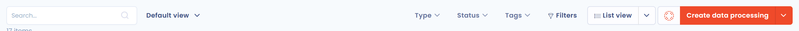
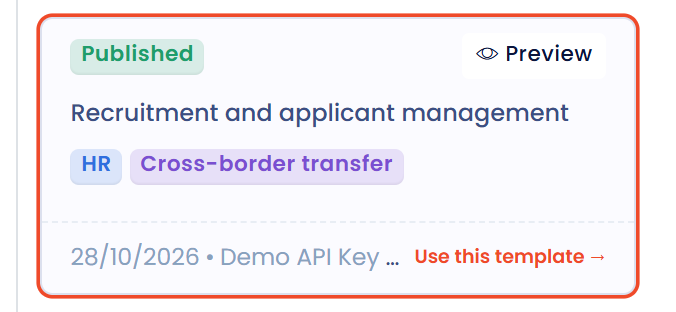
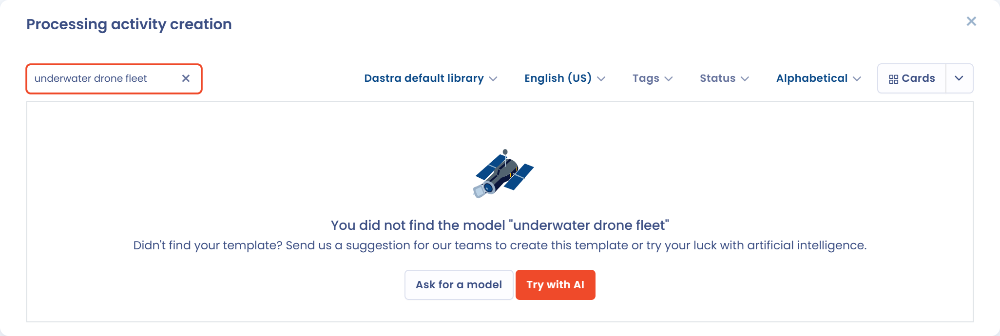
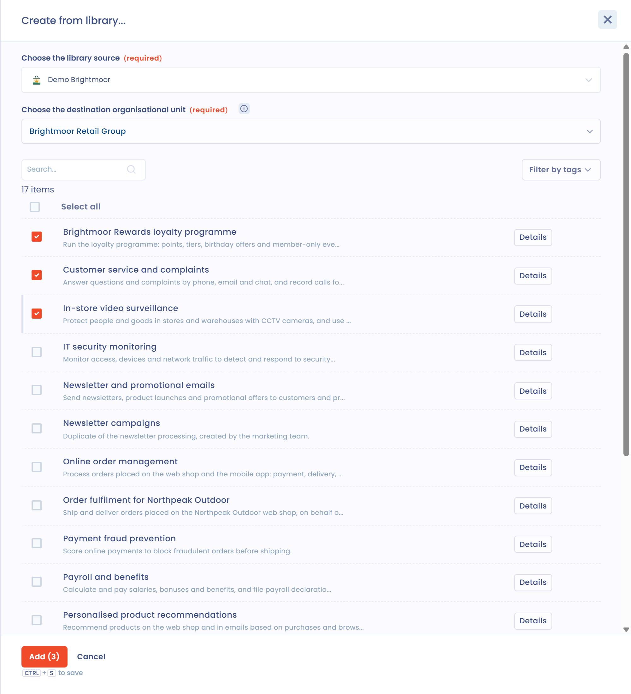

# Een sjabloon voor verwerkingsactiviteiten gebruiken

Met Dastra stelt u uw verwerkingsregister samen op basis van sjablonen die door onze experts zijn ontworpen.

Sjablonen voor verwerkingsactiviteiten besparen tijd bij het invoeren van veelvoorkomende verwerkingsactiviteiten.

## Een verwerkingsactiviteit aanmaken op basis van een sjabloon

Klik op **Maak een gegevensverwerking**

<figure><figcaption>
De knop Maak een gegevensverwerking
</figcaption></figure>

en selecteer **Ingebouwde sjabloon**.

<figure><figcaption>
De optie Ingebouwde sjabloon
</figcaption></figure>

U kunt vervolgens met de zoekbalk zoeken naar sjablonen voor verwerkingsactiviteiten.

<figure><figcaption>
Zoeken in de sjablonenbibliotheek
</figcaption></figure>

Met verschillende filters vindt u het juiste sjabloon:

* **Gegevensbron van de bibliotheek** laat u de te doorzoeken bibliotheek kiezen: de bibliotheek **Sjablonen gemaakt door Dastra**, of de bibliotheek van uw partner als uw organisatie er een heeft.
* Met de taalkeuze ziet u de sjablonen van de standaardbibliotheek van Dastra in andere talen.
* Met **Labels** filtert u de sjablonen per sector.
* **Status** en **Sorteer op** (**De nieuwste**, **Meest populair**, **Alfabetische volgorde**) verfijnen en ordenen de resultaten.

U kunt de resultaten weergeven als lijst of als kaarten.

Om de inhoud van een sjabloon te bekijken voordat u het gebruikt, klikt u op de knop **Overzicht** van het sjabloon.

<figure><figcaption>
Een sjabloon bekijken voordat u het gebruikt
</figcaption></figure>

Klik op het sjabloon dat u wilt gebruiken, controleer de **Naam gegevensverwerking**, kies de **Organisatie-eenheid** en klik op **Maak een gegevensverwerking**. U gaat naar de nieuwe verwerkingsactiviteit, waar u die kunt aanpassen aan uw organisatie.

## Een sjabloon voor een verwerkingsactiviteit voorstellen

Levert uw zoekopdracht geen sjabloon op uit de standaardbibliotheek van Dastra, dan kunt u op **Vraag om een model** klikken om het aan ons team voor te stellen: vul de **Gewenste sjabloonnaam** in, voeg eventueel **Aanvullende informatie** toe en klik op **Verzenden**. U kunt ook op **Probeer het eens met AI** klikken om de verwerkingsactiviteit te laten genereren door onze AI-assistent.

<figure><figcaption>
Een nieuw sjabloon voorstellen
</figcaption></figure>

## Meerdere verwerkingsactiviteiten tegelijk aanmaken op basis van sjablonen

U kunt meerdere sjablonen voor verwerkingsactiviteiten selecteren en ze via de bibliotheek in één keer importeren.

Open het menu van de knop **Maak een gegevensverwerking** (de pijl rechts ervan) en kies **Maak vanuit de bibliotheek**.

<figure><figcaption>
De optie Maak vanuit de bibliotheek
</figcaption></figure>

Kies in het paneel dat opent de bron bij **Gegevensbron van de bibliotheek** en de organisatie-eenheid bij **Kies de organisatie-eenheid van bestemming**, vink een of meer sjablonen aan en klik op **Toevoegen**.

<figure><figcaption>
Meerdere sjablonen selecteren in de bibliotheek
</figcaption></figure>

Met de knop **Details** bekijkt u een sjabloon vooraf.

Uw verwerkingsactiviteiten worden daarna op de achtergrond aangemaakt.

## Een sjabloon aanbieden

U kunt een van uw verwerkingsactiviteiten, vragenlijstsjablonen of activasjablonen indienen bij de Dastra-bibliotheken, zodat alle Dastra-gebruikers het kunnen gebruiken zodra ons team het goedkeurt.

1. Open de verwerkingsactiviteit of het sjabloon en klik op **Draag bij**.
2. Voer de **Naam van de bijdrage** in. Voeg bij **Jouw commentaar** zo nodig een opmerking voor ons team toe om de beoordeling te vergemakkelijken.
3. Kies of u wilt worden vermeld: wanneer u **Wil je gecrediteerd worden voor deze bijdrage?** met ja beantwoordt en de bijdrage wordt goedgekeurd, worden uw avatar en gebruikersnaam bij het sjabloon weergegeven.
4. Ga akkoord met het delen van het volledige sjabloon voor publicatie in de Dastra-bibliotheek en dien daarna in.

Om uw bijdragen op te volgen, opent u **Instellingen voor werkruimte** > **Bijdragen**. Deze pagina vereist de machtiging om bijdragen te schrijven. Ze toont voor elke bijdrage de naam, de gebruiker, de **Status**, of ze **Gepubliceerd** is en het type. Filter de lijst op status en type, open een bijdrage om het **Resultaat van je bijdrage** te lezen, het commentaar van ons team, of klik op **Deze bijdrage verwijderen** om te vragen ze uit de bibliotheek te verwijderen.
