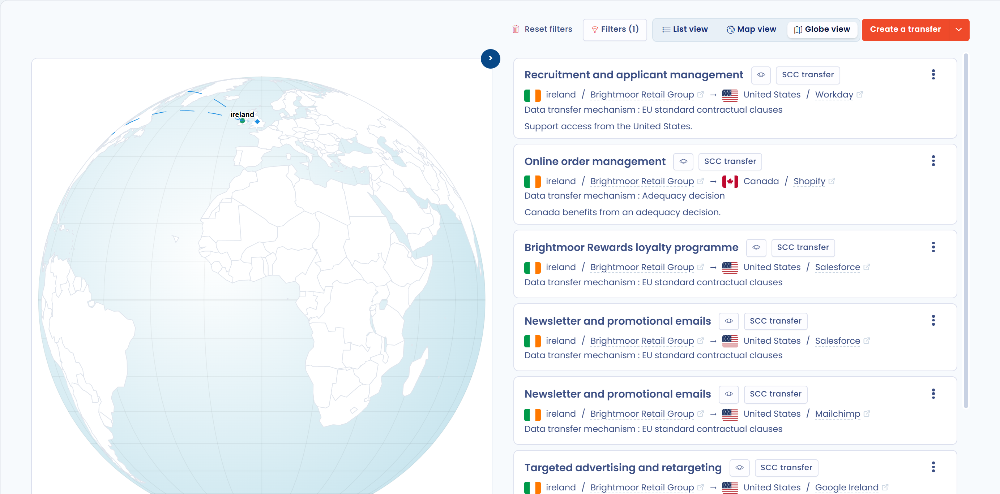

# De doorgiftekaart weergeven

## Inleiding

In Dastra kunt u gegevens op verschillende manieren visualiseren. Eén daarvan is de kaart van de gegevensdoorgiften.

In deze weergave verkent, analyseert en begrijpt u de geografische doorgiften van de gegevens van uw register.

## De doorgiftekaart weergeven

Ga naar de module **Register voor gegevensverwerking** en klik op het tabblad **Doorgiften** boven uw lijst met verwerkingsactiviteiten om de doorgiftekaart te bekijken.

<figure><figcaption>
Tabblad Doorgiften boven de verwerkingsactiviteiten
</figcaption></figure>

U ziet dan de doorgiftekaart. Met de knoppen in de werkbalk zijn drie weergaven beschikbaar:

* **Wereldbol weergave** (standaard): de doorgiften op een wereldbol;
* **Kaartweergave**: de doorgiften op een platte wereldkaart;
* **Lijstweergave**: de doorgiften als tabel.

In de kaartweergaven staat de lijst met doorgiften naast de kaart. Met de pijlknop aan de rand van de kaart verbergt of toont u die lijst. Met de filters in de werkbalk beperkt u de weergegeven doorgiften, en met het menu naast de knop **Een gegevensdoorgifte toevoegen buiten de EU/EER** drukt u de kaart af of exporteert u de doorgiften.

<figure><figcaption>
Voorbeeld van gegevensdoorgiften
</figcaption></figure>


Klik op het punt van een land om de details van de doorgiften ervan te openen.


Het venster **Details van inkomende/uitgaande overboekingen vanuit dit land** toont de status van het land (Europees land, land met adequaat beschermingsniveau, land met gedeeltelijk adequaat beschermingsniveau of land zonder adequaat beschermingsniveau) en somt de doorgiften **Ingang** en **Uitgang** op.

## Verder lezen


[Risicobeheer](../../risks/README.md)

