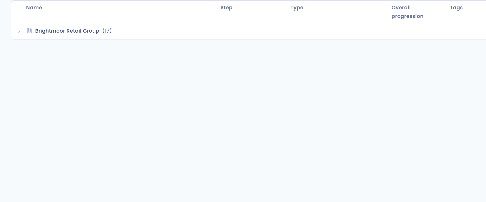

# De boomstructuur van de verwerkingsactiviteiten weergeven

## Inleiding

In Dastra kunt u gegevens op verschillende manieren visualiseren. Eén daarvan is de boomstructuur van de verwerkingsactiviteiten, georganiseerd per entiteit en afdeling.

Deze weergave toont onder meer aan welke entiteiten en afdelingen uw verwerkingsactiviteiten zijn gekoppeld.

## De boomstructuur van de verwerkingsactiviteiten weergeven

Ga naar de module **Register voor gegevensverwerking**, klik op de pijl rechts van de knop **Tabel** en selecteer **Boomstructuur** om de boomstructuur van de verwerkingsactiviteiten te bekijken.

<figure><figcaption>
Pijl rechts van de knop Tabel en keuzemenu
</figcaption></figure>

U ziet dan de boomstructuur van uw verwerkingsactiviteiten.

<figure><figcaption>
De boomstructuur van de verwerkingsactiviteiten in Dastra
</figcaption></figure>

Elke entiteit en afdeling wordt getoond met het aantal verwerkingsactiviteiten dat eraan is gekoppeld. Als het adres en de vertegenwoordiger zijn ingevuld, vindt u ze via het hulppictogram naast de naam. Klik op de pijl aan het begin van een rij om een organisatie-eenheid uit te klappen en de onderliggende eenheden en verwerkingsactiviteiten te tonen, met hun **Stap**, **Type**, **Algemene progressie** en **Labels**.

Klik op een verwerkingsactiviteit om de details ervan te tonen. Via het actiemenu, dat verschijnt wanneer u over de rij beweegt, bewerkt, kopieert, exporteert of deelt u de activiteit, of verplaatst u die naar de prullenbak.


Met de filters boven de boomstructuur past u de weergave aan uw behoeften aan. Gebruikers die de organisatie-eenheden beheren, kunnen via het actiemenu ook een eenheid bewerken of een onderliggende eenheid toevoegen, en **Maak een afdeling** gebruiken in het menu naast de knop **Maak een gegevensverwerking**.


## Verder lezen


[Organisatorische eenheden aanmaken en instellen](../../../getting-started/setup/organizational-units.md)

