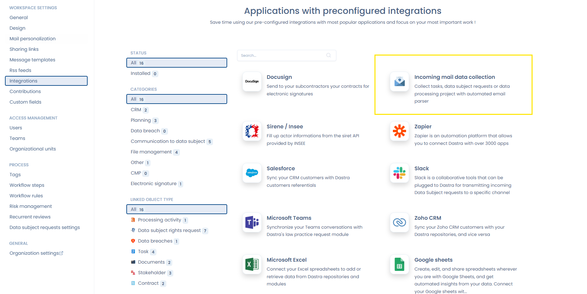
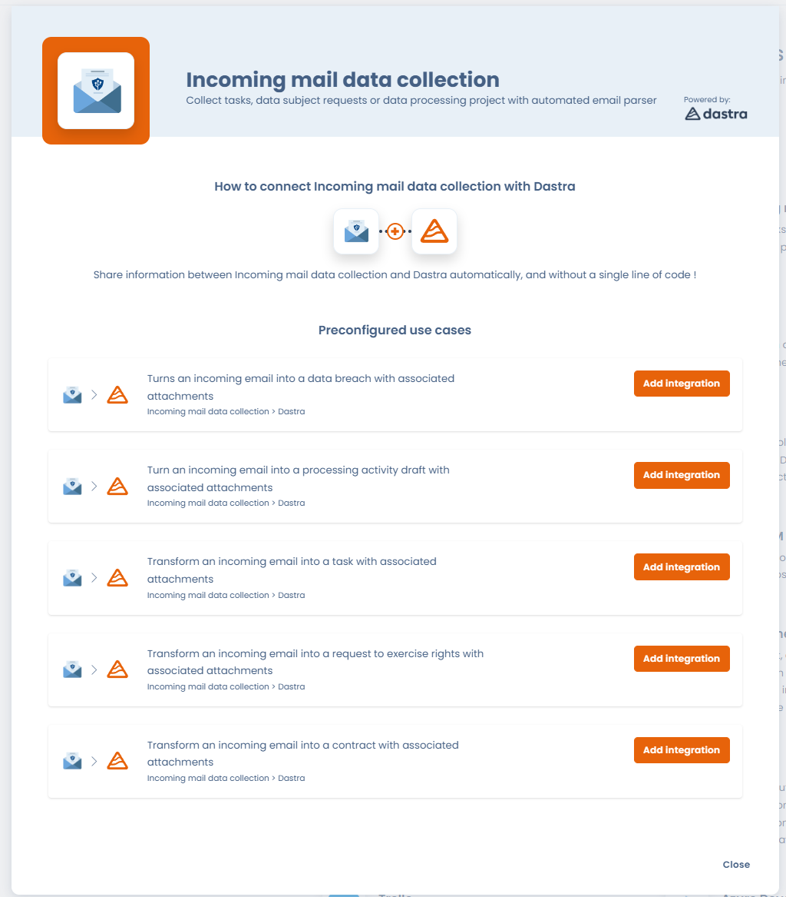
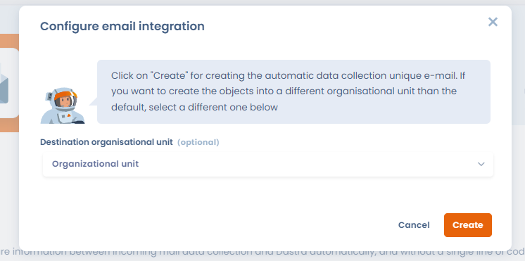
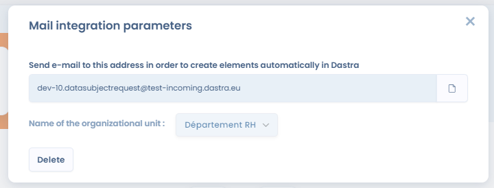

# Gegevens verzamelen via inkomende e-mail

## Inleiding

Met deze integratie maakt u automatisch objecten aan in Dastra op basis van e-mails die op speciale e-mailadressen binnenkomen. Dastra levert deze e-mailboxen en zet de inkomende e-mails automatisch om in objecten in de Dastra-toepassing.

Aan deze verzamelmailboxen kunt u vijf soorten objecten koppelen:

* Taken
* Gegevensverwerkingen
* Verzoeken van betrokkenen
* Contracten
* Datalekken

## Een verzameladres instellen

Ga voor een van bovenstaande objecten naar de instellingen van uw werkruimte, kies het tabblad **Integraties** en selecteer de kaart **Incoming mail data collection**.

<figure><figcaption></figcaption></figure>

Kies daarna het type object waarvoor u de integratie wilt instellen door op **Integratie toevoegen** te klikken. U kunt per werkruimte slechts één verzameladres per type object hebben.

<figure><figcaption></figcaption></figure>

Bij het instellen van de integratie kunt u de organisatorische eenheid opgeven waarin de via dit adres aangemaakte objecten terechtkomen. Laat u dit veld leeg, dan worden de objecten aangemaakt in de standaard organisatorische eenheid.

<figure><figcaption></figcaption></figure>

Met **Creëren** rondt Dastra de configuratie af en toont het e-mailadres dat u moet gebruiken.

<figure><figcaption></figcaption></figure>

## Werking

* Automatisch objecten aanmaken: elke e-mail die op een gekoppeld adres binnenkomt, maakt een bijbehorend object aan in Dastra.
* Organisatorische eenheid: u kunt bij de configuratie een bestemmingseenheid opgeven. Is die ingevuld, dan wordt het object in die eenheid aangemaakt.
* Velden van het object:
  * Label: het onderwerp van de e-mail wordt de naam van het aangemaakte object.
  * Beschrijving: de tekst van de e-mail wordt de beschrijving van het aangemaakte object.
  * Bijlagen: de bijlagen van de e-mail worden aan het object toegevoegd, onder de voorwaarden hieronder.

## Bijlagen

De bijlagen van de e-mail worden aan het object toegevoegd, op voorwaarde dat:

* De bestandsextensie geldig is: alleen bijlagen met een geldige extensie worden bewaard.

  De toegestane extensies zijn: `7z`, `csv`, `doc`, `docx`, `eml`, `epub`, `gif`, `htm`, `html`, `jpeg`, `jpg`, `json`, `md`, `msg`, `ods`, `odg`, `odp`, `odt`, `pdf`, `png`, `ppt`, `pptx`, `rar`, `rtf`, `svg`, `txt`, `xls`, `xlsm`, `xlsx`, `zip`.
* Afbeeldingen de minimale grootte halen: voor afbeeldingsbestanden (jpg, png, gif enzovoort) geldt een minimale grootte van 5 kB. Zo blijven irrelevante afbeeldingen, zoals handtekeningen in e-mails, buiten het object.

## Objecten terugvinden die via een verzamelmailbox zijn aangemaakt

Objecten die via een verzamelmailbox zijn aangemaakt, hebben een veld met de bron of de herkomst van de verzameling. U toont dat veld in de tabelweergaven met de kolom **Bron**.

Alle objecten die uit een verzamelmailbox voortkomen, krijgen het label "inbound email". Zo vindt u ze snel terug.

## Bevestigingsmelding

Is een object aangemaakt op basis van een e-mail die op het verzameladres binnenkwam, dan krijgt het adres dat de integratie in gang zette automatisch een e-mailmelding. Die melding bevestigt dat het object in Dastra is aangemaakt en dat het verzoek of de actie is verwerkt.

De taal van de bevestigingsmail is de standaardtaal van de werkruimte waarin de integratie is geïnstalleerd (**Instellingen voor werkruimte** > **Standaardtaal**).

***

## Uw bestaande e-mailadres automatisch doorsturen naar Dastra

Hebt u al een eigen e-mailadres voor verzoeken van betrokkenen (bijvoorbeeld `privacy@uwbedrijf.com`), dan hoeft u dat niet te vervangen. U stelt in uw mailserver een doorstuurregel in die de inkomende e-mails automatisch omleidt naar het Dastra-verzameladres.

De verzoeken komen dan rechtstreeks in Dastra binnen zonder handmatige actie, terwijl uw contacten uw gebruikelijke adres blijven gebruiken.

### Met Microsoft Exchange / Office 365

Ga naar het **Exchange Admin Center** > **Mail flow** > **Rules** en klik op **+ Add a rule**.

Stel de regel als volgt in:

1. Voorwaarde: **The sender is located** > **Outside the organization**. Voeg eventueel een filter op trefwoorden in het onderwerp toe om alleen relevante verzoeken door te sturen (bijvoorbeeld een onderwerp dat "verzoek" of "wissing" bevat).
2. Actie: **Redirect the message to** > vul het Dastra-verzameladres in dat u in de vorige stap hebt gekregen.
3. Modus: **Enforce**.


Met filters op het onderwerp stuurt u alleen bepaalde soorten verzoeken (wissing, inzage, overdraagbaarheid enzovoort) door naar de bijbehorende Dastra-verzamelmailbox. Andere berichten blijven in uw gebruikelijke inbox.



Zorg dat uw regel geen doorstuurlus veroorzaakt als het Dastra-adres zelf e-mails omleidt. Gebruik de voorwaarde **Received from outside the organization** om lussen te voorkomen.


### Met Google Workspace (Gmail)

Voeg in de **Google Admin Console** > **Apps** > **Google Workspace** > **Gmail** > **Routing** een regel voor inkomende berichten toe met de actie **Change route** en vul het Dastra-verzameladres in als bestemming.
