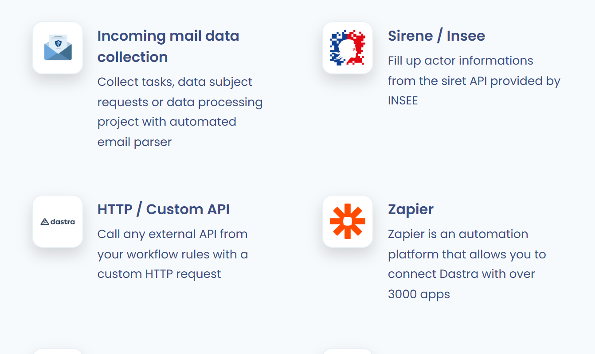
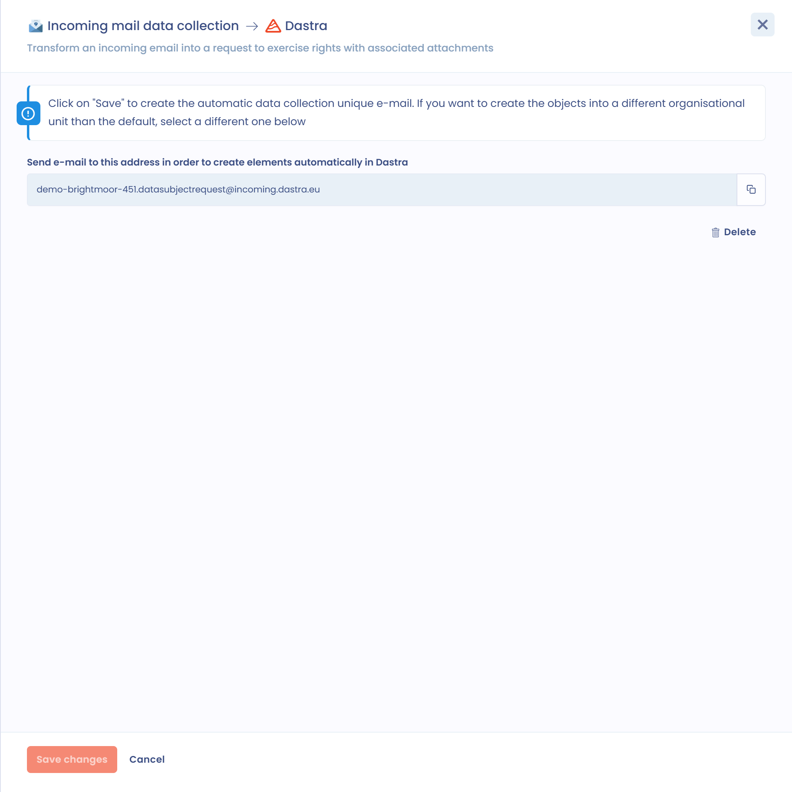

# Gegevens verzamelen via inkomende e-mail

Met deze integratie maakt u automatisch objecten aan in Dastra op basis van e-mails die op speciale verzameladressen binnenkomen. Dastra levert deze adressen en zet elke inkomende e-mail om in een object.

Aan een verzameladres kunnen vijf soorten objecten worden gekoppeld:

* taken;
* gegevensverwerkingen;
* verzoeken van betrokkenen;
* contracten;
* datalekken.

## Een verzameladres instellen

Voor de installatie hebt u de machtiging nodig om integraties in de werkruimte te beheren. U kunt per werkruimte en per type object slechts één verzameladres hebben.

1. Open **Instellingen voor werkruimte** > **Integraties** en klik op de kaart **Incoming mail data collection**.

   <figure><figcaption>
De kaart Incoming mail data collection in de integraties
</figcaption></figure>
2. Zoek in de lijst **Voorgeconfigureerde gebruikssituaties** het type object dat u wilt voeden en klik op **Integratie toevoegen**.

   <figure><figcaption>
Eén gebruikssituatie per type object
</figcaption></figure>
3. Kies in het paneel dat opent zo nodig de **Bestemmingsorganisatie-eenheid** van de aangemaakte objecten. Laat u dit veld leeg, dan worden de objecten aangemaakt in de standaard organisatorische eenheid.

   <figure><figcaption>
De organisatorische eenheid van bestemming kiezen
</figcaption></figure>
4. Klik op **Opslaan**. Dastra rondt de installatie af en toont het e-mailadres dat u moet gebruiken.

   <figure><figcaption>
Het aangemaakte verzameladres
</figcaption></figure>

Om een verzameladres te verwijderen, opent u het paneel van de gebruikssituatie opnieuw en klikt u op **Verwijderen**. Het adres wordt vrijgegeven en ontvangt geen e-mails meer.

## Werking

* Elke e-mail die op een verzameladres binnenkomt, maakt in Dastra een object van het gekoppelde type aan.
* Het object wordt aangemaakt in de organisatorische eenheid die bij de installatie is gekozen.
* Het onderwerp van de e-mail wordt de naam van het object.
* De tekst van de e-mail wordt de beschrijving van het object.
* De bijlagen van de e-mail worden bijlagen van het object, onder de voorwaarden hieronder.

## Bijlagen

Een bijlage blijft behouden wanneer:

* de extensie geldig is. De toegestane extensies zijn `7z`, `csv`, `doc`, `docx`, `eml`, `epub`, `gif`, `htm`, `html`, `jpeg`, `jpg`, `json`, `md`, `msg`, `ods`, `odg`, `odp`, `odt`, `pdf`, `png`, `ppt`, `pptx`, `rar`, `rtf`, `svg`, `txt`, `xls`, `xlsm`, `xlsx` en `zip`;
* het bij een afbeelding (jpg, png, gif enzovoort) om minimaal 5 kB gaat. Die grens voorkomt dat irrelevante afbeeldingen, zoals logo's in e-mailhandtekeningen, worden toegevoegd.

## De objecten terugvinden die door een verzameladres zijn aangemaakt

De betrokken objecten hebben een veld **bron**, ook **herkomst van de verzameling** genoemd. Voeg de bijbehorende kolom toe om het in een tabel te tonen.

Alle objecten die uit een verzameladres voortkomen, dragen ook het label **Incoming email**, waarmee u ze terugvindt.

## Bevestigingsmelding

Is een object aangemaakt nadat een e-mail is ontvangen, dan stuurt Dastra automatisch een e-mailmelding naar het adres dat de integratie in gang zette. Die e-mail bevestigt dat het object in Dastra is aangemaakt.

De bevestigingsmail is geschreven in de standaardtaal van de werkruimte waarin de integratie is geïnstalleerd (instellingen van de werkruimte, standaardtaal).

## Uw bestaande e-mails automatisch doorsturen naar Dastra

Hebt u al een eigen adres voor verzoeken van betrokkenen (bijvoorbeeld `privacy@uwbedrijf.com`), dan hoeft u dat niet te vervangen. Stel in uw mailserver een doorstuurregel in die de inkomende e-mails omleidt naar het Dastra-verzameladres.

De e-mails komen dan rechtstreeks in Dastra binnen zonder handmatige actie, terwijl uw contacten uw gebruikelijke adres blijven gebruiken.

### Met Microsoft Exchange / Office 365

Open het **Exchange Admin Center** > **Mail flow** > **Rules** en klik op **+ Add a rule**. Stel de regel als volgt in:

1. Voorwaarde: **The sender is located** > **Outside the organization**. U kunt een filter op trefwoorden in het onderwerp toevoegen om alleen de relevante verzoeken om te leiden (bijvoorbeeld een onderwerp dat "verzoek" of "wissing" bevat).
2. Actie: **Redirect the message to** en vul dan het Dastra-verzameladres in dat u in de vorige stap hebt gekregen.
3. Modus: **Enforce**.


Met filters op het onderwerp leidt u alleen bepaalde soorten verzoeken (wissing, inzage, overdraagbaarheid enzovoort) om naar het bijbehorende verzameladres. Andere berichten blijven in uw gebruikelijke inbox.



Zorg dat uw regel geen doorstuurlus veroorzaakt als het Dastra-adres zelf e-mails omleidt. Gebruik de voorwaarde "Received from outside the organization" om lussen te voorkomen.


### Met Google Workspace (Gmail)

Voeg in de **Google Admin Console** > **Apps** > **Google Workspace** > **Gmail** > **Routing** een regel voor inkomende berichten toe met de actie **Change route** en vul het Dastra-verzameladres in.
