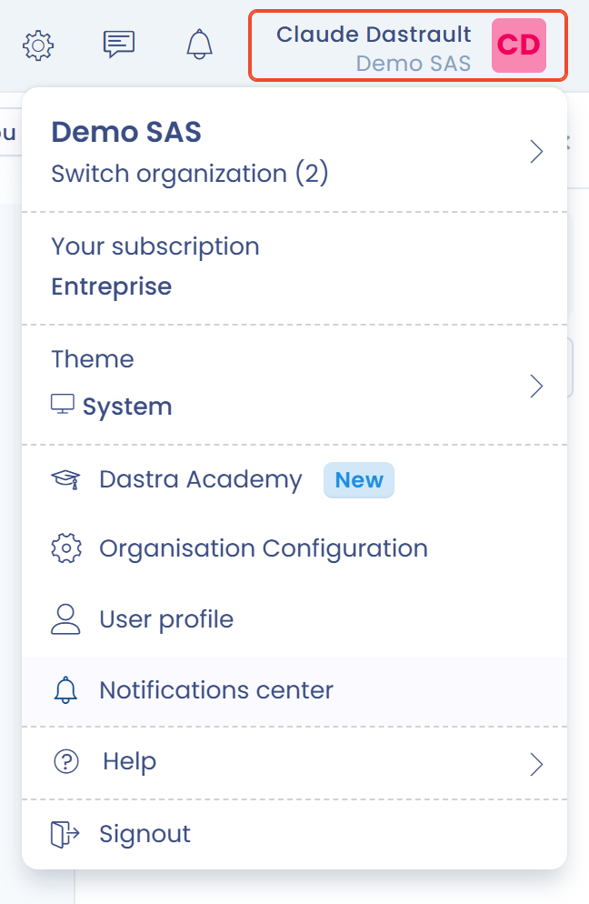

# Meldingen

## Overzicht

Meldingen in Dastra houden u op de hoogte van belangrijke activiteit rond uw verwerkingsactiviteiten, vragenlijsten, taken en verzoeken van betrokkenen.

Er zijn twee soorten meldingen:

1. het meldingscentrum, rechtstreeks in de toepassing ingebouwd;
2. e-mailmeldingen, die elke gebruiker naar eigen voorkeur instelt.

## Meldingscentrum (in de toepassing)

Het meldingscentrum groepeert de waarschuwingen die u ziet via het meldingenpictogram rechtsboven in het scherm. Het heeft twee tabbladen: **Meldingen** en **Toegewezen taken**.

* Het is beschikbaar voor alle gebruikers van de werkruimte.
* Het kan niet worden aangepast: het wordt gedeeld door de hele werkruimte.
* Het bevat algemene meldingen over recente activiteit: het aanmaken, wijzigen of verwijderen van items.
* De knop **Verversen** laadt de lijst opnieuw, **Meer tonen** opent de geschiedenispagina en de schakelaar **Mijn activiteit** beperkt de lijst tot uw eigen acties.

<figure><figcaption>
Het meldingscentrum
</figcaption></figure>


Voorbeeld: "De verwerkingsactiviteit Personeelsbeheer is gewijzigd".


## E-mailmeldingen

Elke gebruiker kiest in zijn profiel welke meldingen hij per e-mail ontvangt.

### Uw meldingen aanpassen

1. Klik rechtsboven in Dastra op uw **avatar**.
2. Selecteer **Meldingscentrum**.
3. Schakel gebeurtenissen in of uit naar behoefte. Elke wijziging wordt meteen opgeslagen.

<figure><figcaption>
De vermelding "Meldingscentrum" van het avatarmenu
</figcaption></figure>

De pagina heeft drie blokken: **Pushmeldingen** (meldingen op het bureaublad, ook als uw browser gesloten is), **Marketing en reclame** (aanmelding voor de nieuwsbrief en commerciële communicatie) en **Meldingen van activiteiten**, dat de e-mailgebeurtenissen groepeert. Met de schakelaar boven aan dat laatste blok zet u alle gebeurtenissen in één keer aan of uit.


E-mailmeldingen zijn geschikt om te worden gewaarschuwd bij acties die een snelle reactie vragen (vragenlijsten, verzoeken, datalekken enzovoort).


### Vereiste: het recht Kennisgeving in de rol

Het aanpassen van e-mailmeldingen werkt alleen als de rol van de gebruiker dat toestaat.

In de configuratie van de rollen (**Instelling van de organisatie** > **Rollen en machtigingen**) heeft elke module een selectievakje **Kennisgeving**. Is het niet aangevinkt, dan ontvangen gebruikers met die rol geen e-mailmelding voor die module, ongeacht hun persoonlijke voorkeuren. Is het wel aangevinkt, dan ontvangen ze ongeveer een uur na de laatste activiteit een gebundelde melding.


De rol opent of sluit het recht om meldingen te ontvangen. De gebruiker kan zijn voorkeuren daarna verfijnen, maar alleen binnen de grenzen van wat zijn rol toestaat.


### Categorieën van meldingen

E-mailmeldingen zijn geordend in categorieën, één per objecttype. Elke categorie bevat meerdere gebeurtenissen die u afzonderlijk kunt inschakelen.

| Categorie | Aangeboden gebeurtenissen |
| --- | --- |
| Gegevensverwerking | Aanmaak, wijziging, statuswijziging, publicatie, archivering, verwijdering, relaties, uitnodiging, beoordeling |
| Verzoek om rechten uit te oefenen | Aanmaak, wijziging, statuswijziging, nieuw bericht, toewijzing, identiteitsvalidatie, opschorting, anonimisering |
| Datalek | Aanmaak, wijziging, statuswijziging, archivering, uitnodiging |
| Taak | Aanmaak, wijziging, statuswijziging, vermelding, toewijzing, archivering, verwijdering |
| Commentaar | Nieuw bericht, nieuwe vermelding |
| Widget voor cookietoestemming | Aanmaak van een widget |
| Indiening van questionnaire | Antwoord geweigerd, gevalideerd of afgerond, uitnodiging, annotaties, actieplan gegenereerd, antwoord in afwachting van validatie |
| Audit template | Aanmaak, wijziging, verwijdering |
| Vertrouwenscentrum | Aanmaak, bijwerking |
| Analytics-rapporten | Abonnement op het maandelijkse rapport |
| Generieke relaties | Aanmaak, verwijdering van een relatie |
| Risicobeoordeling | Aanmaak, wijziging, statuswijziging |
| Controlepunt | Aanmaak, wijziging, beoordeling |
| Bijdragen | Goedkeuring, afwijzing |
| Stakeholder | Import, aanmaak, wijziging, statuswijziging, verwijdering, beoordeling |
| Dataset | Import |
| Actief | Import, aanmaak, wijziging, statuswijziging, verwijdering, beoordeling |
| Categorie van de betrokken persoon | Import, aanmaak, wijziging, statuswijziging, verwijdering |
| Veld voor persoonlijke gegevens | Import, aanmaak, wijziging, statuswijziging, verwijdering |
| Veiligheidsmaatregel | Import, aanmaak, wijziging, statuswijziging, verwijdering |
| Teams | Gebruiker toegevoegd of verwijderd, aanmaak, wijziging, verwijdering |
| Organisatie-eenheid | Team toegevoegd of verwijderd, wijziging, verwijdering |
| Contract | Aanmaak, wijziging, statuswijziging, verwijdering, beoordeling, elektronische handtekening, toewijzing, vervaldatum |
| AI-systeem | Aanmaak, bijwerking, fasewijziging, verwijdering, beoordeling, uitnodiging om aan te vullen |
| Conformiteitsproject | Aanmaak, archivering, statuswijziging |
| Conformiteitsaudit | Aanmaak, archivering, afronding |
| Testcampagne | Aanmaak, afronding |
| Rapportage op maat | Aanmaak, wijziging, verplaatsing naar de prullenbak, herstel, definitieve verwijdering |

Voor verwerkingsactiviteiten kunt u bijvoorbeeld kiezen of u een melding krijgt bij een wijziging, een statuswijziging of het verwijderen van een relatie:

<figure><figcaption>
De gebeurtenissen van de categorie Gegevensverwerking
</figcaption></figure>

Voor vragenlijsten kunt u kiezen om een e-mail te ontvangen wanneer een antwoord wordt afgewezen of gevalideerd, bij een uitnodiging om te antwoorden, of wanneer een annotatie wordt toegevoegd:

<figure><figcaption>
De gebeurtenissen van de categorie Indiening van questionnaire
</figcaption></figure>

## Automatische meldingen

Sommige meldingen zijn systeemmeldingen: ze worden automatisch verstuurd, ook als u de bijbehorende categorie hebt uitgeschakeld.

Deze meldingen worden als essentieel voor de samenwerking beschouwd:

* uitnodiging voor een vragenlijst
* toewijzing van een taak of een verzoek
* directe vermelding in een commentaar (@uwnaam)
* uitnodiging om het verwerkingsregister aan te vullen
* onmiddellijke verzending van een geplande uitnodiging (als de optie is ingeschakeld)

## Aanbevelingen

* Schakel e-mails in voor activiteiten waarvoor u moet handelen (vragenlijsten, verzoeken, datalekken).
* Controleer regelmatig het meldingscentrum voor een overzicht van de werkruimte.
* Kijk in de map "Meldingen" van uw mailbox als u denkt dat u sommige berichten niet meer ontvangt.
* Voor een functionaris voor gegevensbescherming: schakel alle categorieën in.
* Voor een medewerker die bijdraagt: geef voorrang aan taken, commentaren en vragenlijsten.

## Veelgestelde vragen

### Ik ontvang mijn meldingen niet meer. Wat moet ik doen?

Controleer uw voorkeuren in het **Meldingscentrum**, via uw avatarmenu. Controleer ook of de e-mails van Dastra niet naar uw map "Promoties" of "Spam" worden omgeleid.


Standaard ontvangt u geen meldingen voor acties die u zelf uitvoert.


### Kan ik een maandelijks overzicht ontvangen?

Ja, u kunt een maandelijks overzicht van de activiteit in uw werkruimte ontvangen. Schakel in het **Meldingscentrum** de gebeurtenis **Maandelijkse rapportage** van de categorie **Analytics-rapporten** in.

## Zie ook

* [Uw gebruikersprofiel instellen](../../getting-started/setup/profile.md)
* [Rollen en machtigingen](roles.md)
* [Uw vragenlijsten opvolgen](../questionnaires/README.md)
