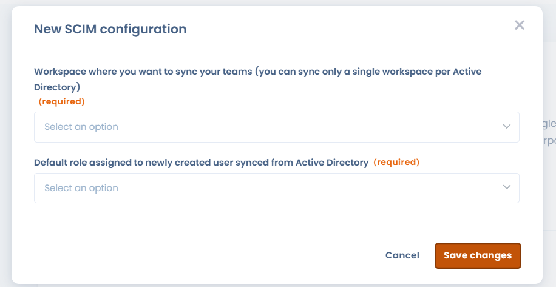

# SCIM

## Hoe het werkt

SCIM (System for Cross-domain Identity Management) is een open standaard voor het automatiseren van gebruikersprovisioning. Het SCIM-protocol fungeert als tussenpersoon: het verzamelt de identiteitsgegevens van gebruikers bij identiteitsproviders (Microsoft Entra ID, Google Workspace, Okta...) en geeft ze door aan de serviceproviders (zoals Dastra) die ze nodig hebben.


De SCIM-functie is voorbehouden aan klanten met een **Enterprise-abonnement**.

[Zie onze prijspagina](https://www.dastra.eu/en/pricing)



Wij raden u sterk aan eerst [SSO in te stellen](sso/README.md) met de optie **Forceer voor alle gebruikers** ingeschakeld.


## SCIM configureren met Microsoft Entra ID

Met SCIM 2.0 voegt u Dastra-gebruikers toe, verwijdert u ze en wijzigt u ze. U definieert groepen in Entra ID en Dastra synchroniseert die gebruikers automatisch, zonder handmatige tussenkomst.

### 1. Aanmelden bij het Microsoft Entra-portaal

Ga naar [https://entra.microsoft.com](https://entra.microsoft.com) en meld u aan met een beheerdersaccount.

### 2. Naar Enterprise applications gaan

Klik in het linkermenu op **Entra ID** > **Enterprise applications** > **All applications**.

### 3. Op New application klikken

Klik boven de lijst met toepassingen op **New application**.

<figure><figcaption></figcaption></figure>

### 4. Uw eigen toepassing maken

Klik op de pagina **Browse Microsoft Entra App Gallery** op **+ Create your own application**.

### 5. Uw toepassing een naam geven en configureren

Doe in het paneel dat opent het volgende:

1. Voer een naam in voor uw toepassing (bijvoorbeeld **Dastra SCIM**).
2. Selecteer **Integrate any other application you don't find in the gallery (Non-gallery)**.
3. Klik op **Create**.

### 6. De provisioningconfiguratie openen

Klik op de pagina **Overview** van de zojuist gemaakte toepassing op **3. Provision User Accounts**, of klik in het linkernavigatiemenu op **Provisioning**.

### 7. De SCIM-URL en het token ophalen in Dastra

Haal eerst uw SCIM-gegevens op in Dastra.

Meld u aan bij Dastra als eigenaar van de organisatie. Ga naar **Organisatie-instellingen** > [**Eenmalig inloggen**](https://app.dastra.eu/general-settings/sso) > **SCIM**.

<figure><figcaption></figcaption></figure>

Klik op **Configureren** om een nieuwe SCIM-configuratie te maken.

<figure><figcaption>
Selecteer de doelwerkruimte en de standaardrol voor nieuwe gebruikers
</figcaption></figure>

Selecteer de werkruimte die u wilt synchroniseren (teams en gebruikers worden daar automatisch geprovisioneerd) en de standaardrol die nieuwe gebruikers krijgen. Beheerders van Dastra kunnen rollen daarna nog lokaal wijzigen.

Klik op **Opslaan** en kopieer daarna de weergegeven SCIM-URL en het authenticatietoken.


Dastra ondersteunt via SCIM de synchronisatie van één werkruimte per organisatie.


### 8. Automatische provisioning configureren in Entra

Ga terug naar de provisioningpagina van uw toepassing in Entra en doe het volgende:

1. Stel **Provisioning Mode** in op **Automatic**.
2. Vul onder **Admin Credentials** de volgende velden in:
   * **Tenant URL**: de SCIM-URL die u in Dastra hebt gekopieerd
   * **Secret Token**: het authenticatietoken dat u in Dastra hebt gekopieerd

<figure><figcaption></figcaption></figure>

3. Klik op **Test Connection** om de verbinding te controleren.
4. Klik op **Save**.

Krijgt u een foutmelding bij de verbindingstest, controleer dan of de SCIM-functie is ingeschakeld in uw abonnement. [Neem zo nodig contact op met de support](../../getting-started/support/request.md).

### 9. Provisioning activeren

Activeer de provisioning zodra de configuratie is opgeslagen: zet de status op **On** en klik op **Save**.

<figure><figcaption></figcaption></figure>

### 10. Gebruikers en groepen toevoegen

Klik in het navigatiemenu van de toepassing op **Users and groups** en wijs daarna de Entra-gebruikers of -groepen toe die u met Dastra wilt synchroniseren.

## Uw gebruikers laten inloggen

Uw accounts uit de Entra-directory verschijnen automatisch gesynchroniseerd in Dastra. Als SSO niet is ingesteld en afgedwongen, moeten gebruikers hun wachtwoord resetten voor hun eerste login. Is SSO ingeschakeld en afgedwongen voor alle gebruikers, dan worden ze automatisch doorgestuurd naar het inlogformulier van uw identiteitsprovider (Microsoft Entra ID, Google Workspace, Okta...).

## Gedrag en beperkingen van de SCIM-synchronisatie

### Levenscyclus van gebruikers

#### Gebruiker uitgeschakeld in Entra ID

Wanneer een gebruiker wordt uitgeschakeld in Entra ID:

* wordt zijn profiel in Dastra geanonimiseerd;
* wordt er een nieuw gebruikersaccount aangemaakt als de gebruiker later opnieuw wordt ingeschakeld. Het eerdere, geanonimiseerde account wordt niet hersteld.

***

#### Volledig verwijderd in Entra ID

Wanneer een gebruiker definitief wordt verwijderd uit Entra ID:

* wordt zijn profiel in Dastra volledig geanonimiseerd;
* blijven alle eerdere acties bewaard;
* verschijnt de gebruiker als **deleted user**.

Gevolgen voor gerelateerde gegevens:

* gekoppelde objecten (bijvoorbeeld verwerkingsactiviteiten, risico's, verzoeken) worden niet verwijderd;
* relaties (bijvoorbeeld eigenaar, toegewezen persoon) blijven behouden;
* alleen de identiteit van de gebruiker wordt geanonimiseerd.

***

### Beheer van groepen (teams)

#### Groep verwijderd in Entra ID

Als een groep in Entra ID wordt verwijderd:

* wordt het bijbehorende team in Dastra verwijderd;
* blijven de gebruikersaccounts actief;
* heeft dit geen gevolgen voor individuele gebruikers.

***

### Mapping en reikwijdte van de synchronisatie

#### Groepen en werkruimten

* SCIM ondersteunt de synchronisatie van meerdere groepen.
* Huidige beperking: er kan maar één werkruimte per organisatie worden gesynchroniseerd. Synchronisatie van meerdere werkruimten wordt niet ondersteund.

***

#### Ondersteunde attributen

Dastra synchroniseert momenteel:

* voor gebruikers: de inlogidentificatie, voor- en achternaam, het e-mailadres, de actieve status, de taal en het postadres (land, plaats, postcode, regio); zie [Welke attributen en claims worden ondersteund?](#welke-attributen-en-claims-worden-ondersteund) voor de volledige lijst;
* voor groepen: de naam (`displayName`), de groepsidentificatie (`externalId`) en de leden.

Niet ondersteund in dit stadium:

* de koppeling met organisatorische eenheden;
* de attributen van de enterprise-extensie (organisatie, afdeling, personeelsnummer, manager...): identiteitsproviders sturen ze standaard mee, Dastra accepteert ze zonder ze op te slaan.

> Dit kan in de toekomst worden ondersteund via een specifiek attribuut met een referentie-identificatie die compatibel is met Dastra.

***

### Lokaal beheer in Dastra

Na de SCIM-synchronisatie kunnen beheerders nog steeds:

* rollen wijzigen;
* machtigingen aanpassen.

Gedetailleerde toegangscontrole blijft lokaal in Dastra te beheren.

***

### Gevolgen voor de licentie

* De SCIM-synchronisatie wordt beperkt door het aantal gebruikers dat in uw abonnement is inbegrepen.
* Als het quotum wordt overschreden:
  * geeft de SCIM-server een `403`-fout terug van het type `limitExceeded`;
  * worden extra gebruikers niet geprovisioneerd.

***

## SCIM-endpoints en discovery

De SCIM-API van Dastra biedt de standaard SCIM 2.0-endpoints, allemaal beschikbaar onder uw SCIM-URL en geauthenticeerd met het SCIM-token (verzoeken zonder geldig token krijgen een `401`):

| Endpoint | Doel |
| --- | --- |
| `/v2/Users` | Gebruikers aanmaken, lezen, bijwerken (PATCH) en verwijderen |
| `/v2/Groups` | Groepen (Dastra-teams) aanmaken, lezen, bijwerken (PATCH) en verwijderen |
| `/v2/ServiceProviderConfig` | Geeft de mogelijkheden van de SCIM-service aan |
| `/v2/ResourceTypes` | Somt de brontypen op (User, Group) |
| `/v2/Schemas` | Definitie per attribuut van elk ondersteund schema |

Wijzigingen verlopen via `PATCH`; een volledige resource vervangen met `PUT` wordt niet ondersteund. Een geslaagde aanmaak (`POST`) geeft `201` terug met een `Location`-header en een attribuut `meta.location` met de URL van de nieuwe resource.

De drie discovery-endpoints (RFC 7644 §4) zijn alleen-lezen. Identiteitsproviders en SCIM-connectors (Microsoft Entra ID, Okta, aangepaste connectors enzovoort) raadplegen ze om het attribuutschema automatisch op te bouwen, zonder handmatig schemabestand. `/v2/Schemas` beschrijft precies de attributen die Dastra leest en schrijft: dit is de gezaghebbende lijst, en een attribuut dat er niet in staat, wordt door de synchronisatie genegeerd. `ServiceProviderConfig` antwoordt ook op de gangbare aliassen `/v2/ServiceProviderConfigs` en `/v2/ServiceProviderConfiguration`, omdat connectors verschillen in hoe ze de naam schrijven.

Mogelijkheden die `ServiceProviderConfig` aangeeft, in overeenstemming met het werkelijke gedrag van de API:

* Ondersteund: PATCH-bewerkingen, filteren (zie de beperking hieronder).
* Niet ondersteund: bulkbewerkingen, sorteren, etags, wachtwoordwijziging.

### Filteren

Een filter bevat één enkele voorwaarde, met de operator `eq` (gelijk aan) of `ne` (niet gelijk aan), op een van deze attributen:

| Resource | Filterbare attributen |
| --- | --- |
| Gebruikers | `userName`, `externalId`, `emails.value` |
| Groepen | `displayName`, `externalId` |

Voorbeeld: `filter=userName eq "jane.doe@company.com"`. Attribuutnamen zijn niet hoofdlettergevoelig.


Dastra beantwoordt nooit een filter dat het niet exact kan evalueren. Een andere operator (`co`, `sw`, `gt`...), een ander attribuut of meerdere voorwaarden die met `and` / `or` zijn gecombineerd, geven een `400`-fout van het type `invalidFilter` die het probleem benoemt.


### PATCH-bewerkingen

`PATCH` accepteert de drie vormen die identiteitsproviders sturen: een bewerking met een `path` en een eenvoudige waarde, een bewerking met een `path` en een objectwaarde, en een bewerking zonder `path` waarvan de waarde de te wijzigen attributen opsomt. De bewerkingen `add`, `replace` en `remove` worden ondersteund.

* Gebruikers: de attributen uit `/v2/Schemas` worden toegepast. Attributen die Dastra niet opslaat (enterprise-extensie, telefoonnummers, functietitel enzovoort) worden geaccepteerd en genegeerd, zodat de standaardmappings van Microsoft Entra ID en Okta zonder aanpassing werken. `userName` en het e-mailadres kunnen niet worden verwijderd. Wanneer u `active` op `false` zet, wordt de gebruiker gedeactiveerd, zoals hierboven beschreven.
* Groepen: `displayName` en `externalId` kunnen worden gewijzigd. Leden kunnen worden toegevoegd (`add`), in hun geheel worden vervangen (`replace`) of worden verwijderd (`remove`), allemaal tegelijk of één voor één met het pad `members[value eq "<user id>"]`.

Een gebruiker die niet tot uw organisatie behoort, wordt gemeld als niet gevonden (`404`).

### Fouten

Fouten volgen het SCIM-formaat (RFC 7644 §3.12): een JSON-body met `status`, `scimType` en een bericht `detail` dat zegt wat is geweigerd.

| Code | Wanneer |
| --- | --- |
| `400` | Ongeldig verzoek: ontbrekende of onjuist opgemaakte waarde (`invalidValue`), niet-ondersteund filter (`invalidFilter`), onbekend pad (`invalidPath`), attribuut dat niet kan worden verwijderd (`mutability`)... |
| `401` | Ontbrekend of ongeldig SCIM-token |
| `403` | Gebruikersquotum van uw abonnement bereikt (`limitExceeded`) |
| `404` | Resource niet gevonden, of geen deel van uw organisatie |
| `409` | Er bestaat al een gebruiker of groep met dezelfde identificatie (`uniqueness`) |

***

## Veelgestelde vragen

### Wat is de rol van SCIM in Dastra?

SCIM is het geautomatiseerde provisioningkanaal tussen uw bedrijfsdirectory (Entra ID, Okta, Google Workspace enzovoort) en Dastra. Het vult SSO aan, maar is er duidelijk van te onderscheiden:

|                   | SSO                     | SCIM                                          |
| ----------------- | ----------------------- | --------------------------------------------- |
| Rol               | Authenticatie (login)   | Beheer van de levenscyclus van gebruikers     |
| Trigger           | Login van de gebruiker  | Actie in de IdP (toevoegen, wijzigen, verwijderen) |
| Wat het doet      | Controleert de identiteit | Maakt accounts aan, werkt ze bij en deactiveert ze |
| Protocol          | SAML 2 / OpenID Connect | SCIM 2.0 (HTTP REST + JSON)                   |

Met SCIM hoeft u accounts in Dastra niet meer handmatig aan te maken of in te trekken wanneer iemand vertrekt: uw directory blijft de enige bron van waarheid voor identiteitsbeheer.


SCIM beheert wie er in Dastra bestaat. SSO beheert hoe die mensen inloggen. De twee zijn onafhankelijk van elkaar, maar vullen elkaar ideaal aan: provisioning via SCIM, authenticatie via SSO.


***

### Hoe verloopt provisioning en deprovisioning in grote lijnen?

#### Provisioning (account aanmaken)

Wanneer een gebruiker of groep in uw IdP aan de Dastra-toepassing wordt toegewezen:

1. Stuurt de IdP een `POST /scim/v2/Users`-verzoek naar het SCIM-endpoint van Dastra.
2. Maakt Dastra het account aan met de standaardrol uit uw SCIM-configuratie.
3. Wordt de gebruiker toegevoegd aan de doelwerkruimte.
4. Kan de gebruiker, als SSO is ingeschakeld en afgedwongen, meteen inloggen zonder wachtwoord.

#### Wijzigingen

Elke profielwijziging in de IdP (naam, e-mailadres, taal, adres) activeert een `PATCH /scim/v2/Users/{id}`-verzoek dat het bijbehorende account in Dastra bijwerkt. Een wijziging van het groepslidmaatschap activeert een `PATCH /scim/v2/Groups/{id}`-verzoek dat de leden van het bijbehorende team toevoegt of verwijdert.

#### Deprovisioning (deactivering of verwijdering)

| Actie in de IdP | SCIM-verzoek | Effect in Dastra |
| --- | --- | --- |
| Gebruiker uitgeschakeld | `PATCH` (`active: false`) | Profiel geanonimiseerd |
| Definitieve verwijdering | `DELETE /scim/v2/Users/{id}` | Profiel volledig geanonimiseerd, gegevens bewaard |
| Groep verwijderd | `DELETE /scim/v2/Groups/{id}` | Team verwijderd, gebruikers ongemoeid |


Als u een eerder geanonimiseerde gebruiker opnieuw inschakelt, wordt er een nieuw account aangemaakt: de geschiedenis van het oude account wordt niet hersteld.


***

### Welke attributen en claims worden ondersteund?

#### Gesynchroniseerde SCIM-attributen (provisioning)

Tijdens de synchronisatie leest Dastra de volgende SCIM 2.0-attributen. `/v2/Schemas` geeft dezelfde lijst terug.

##### Gebruikers

| SCIM-attribuut | Veld in Dastra | Verplicht |
| --- | --- | --- |
| `userName` | Inlogidentificatie, uniek binnen uw organisatie (meestal het e-mailadres) | Ja |
| `emails` | E-mailadres. Dastra bewaart één adres: de vermelding met de vlag `primary`, anders de eerste | Ja |
| `name.givenName` | Voornaam | Aanbevolen |
| `name.familyName` | Achternaam | Aanbevolen |
| `active` | Status actief / inactief | Ja |
| `locale` | Taal (bijvoorbeeld `en`, `fr-FR`) | Optioneel |
| `address` | Land (code van twee letters), plaats, postcode, regio (één enkel adres) | Optioneel |
| `externalId` | Alleen-lezen: geeft altijd dezelfde waarde terug als `userName`. Het kan in een filter worden gebruikt; een waarde die de identiteitsprovider stuurt, wordt genegeerd | Niet van toepassing |
| `nickName` | Geaccepteerd bij het aanmaken, nooit teruggegeven | Optioneel |

##### Groepen

| SCIM-attribuut | Veld in Dastra | Verplicht |
| --- | --- | --- |
| `displayName` | Teamnaam (maximaal 30 tekens) | Ja |
| `externalId` | Groepsidentificatie in de identiteitsprovider | Optioneel |
| `members` | Teamleden (Dastra-gebruikersidentificaties) | Optioneel |


Dastra bewaart per gebruiker één provisioningidentificatie, `userName`. Als u de `userName` van een gebruiker in de identiteitsprovider wijzigt, wordt die in Dastra bijgewerkt; als het account is geprovisioneerd met het e-mailadres als `userName`, volgt het e-mailadres de wijziging.


#### SSO-claims die bij het inloggen worden gebruikt

Bij het inloggen identificeert Dastra de gebruiker aan de hand van de e-mailclaim die de IdP stuurt. Beide ondersteunde SSO-protocollen gebruiken dezelfde eigenschap:

| Protocol | Gebruikte e-mailclaim | Vereiste scope |
| --- | --- | --- |
| SAML 2 | `http://schemas.xmlsoap.org/ws/2005/05/identity/claims/emailaddress` | Geen |
| OpenID Connect | `http://schemas.xmlsoap.org/ws/2005/05/identity/claims/emailaddress` | `openid profile email` |


Het e-mailadres is de koppelsleutel tussen SCIM en SSO: de `userName` die via SCIM is geprovisioneerd, moet identiek zijn aan de e-mailclaim die bij het SSO-login wordt teruggegeven. Elke afwijking verhindert dat de accounts worden gekoppeld.


Zie de pagina [Single Sign On (SSO)](sso/README.md) voor de volledige configuratie van de SSO-claims.
