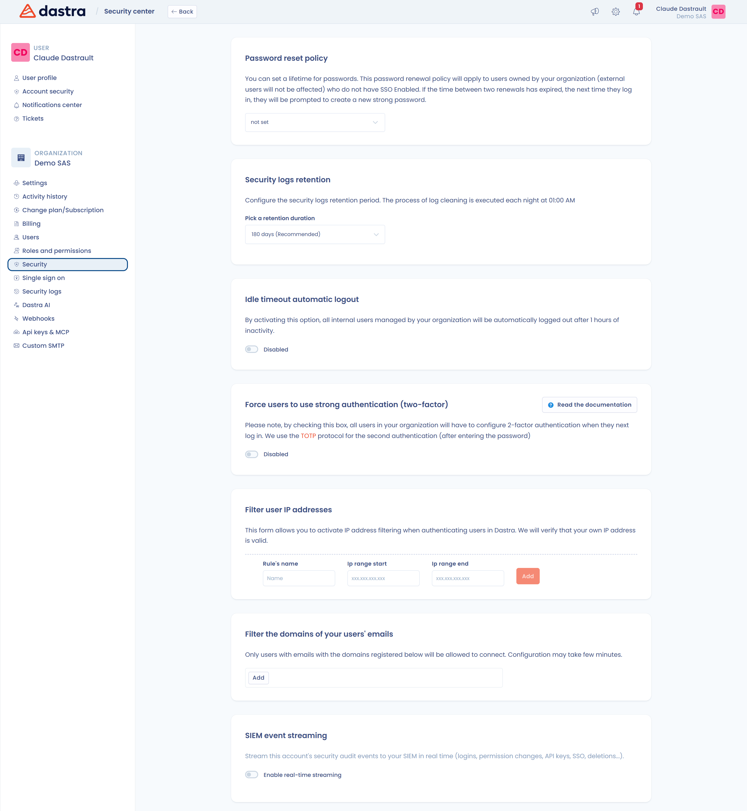

# Beveiliging van de organisatie en beveiligingslogboeken

Deze pagina is bedoeld voor eigenaars van de organisatie. Ze beschrijft de pagina **Beveiliging** van de organisatie-instellingen, waar u de beveiligingsregels instelt die voor alle gebruikers van uw organisatie gelden, en de twee logboekpagina's waarmee u opvolgt wat er in gebeurt.

## De pagina Beveiliging openen

Klik op het tandwielpictogram in de bovenbalk (**Organisatie-instellingen**) en daarna in het linkermenu op **Beveiliging**. De pagina is alleen zichtbaar voor eigenaars van de organisatie. Ze vereist het plan **Enterprise**: met een ander plan toont de pagina de melding **Deze functie is gereserveerd voor het abonnement:** gevolgd door de naam van het plan.

<figure><figcaption>
De pagina Beveiliging, met één kaart per regel
</figcaption></figure>

Elke kaart wordt toegepast zodra u ze wijzigt: er is geen opslaan-knop.

## Beleid voor wachtwoordverlenging

De kaart **Beleid voor wachtwoordverlenging** bepaalt de levensduur van wachtwoorden: **90 dagen**, **180 dagen** of **365 dagen**. Kies **Voor onbepaalde tijd** om het beleid uit te schakelen.

Het beleid geldt voor de interne gebruikers van uw organisatie die zich niet met SSO aanmelden. Externe gebruikers worden niet getroffen. Is de levensduur verstreken, dan wordt de gebruiker bij de volgende aanmelding gevraagd een nieuw sterk wachtwoord aan te maken.

## Bewaartermijn van beveiligingslogboeken

De kaart **Veiligheidslogboeken bijhouden** bepaalt hoe lang Dastra de [beveiligingslogboeken](#beveiligingslogboeken) bewaart. Kies een duur bij **Kies een houdbaarheidsdatum**: 30 dagen, 90 dagen, 180 dagen (**Aanbevolen**), 365 dagen, 730 dagen of 1.095 dagen.

Dastra verwijdert de logboeken die ouder zijn dan deze periode elke nacht om 01:00 uur. Stem de duur af op uw eigen bewaarregels voor audittrails.

## Automatische afmelding bij inactiviteit

De kaart **Automatisch verbinding verbreken** heeft een schakelaar, **Actief** of **Uitgeschakeld**. Is ze ingeschakeld, dan worden alle interne gebruikers van uw organisatie na 1 uur inactiviteit afgemeld.

## Sterke authenticatie afdwingen

De kaart **Gebruikers dwingen sterke verificatie te gebruiken (twee-factor)** heeft een schakelaar. Is ze ingeschakeld, dan moeten alle interne gebruikers van uw organisatie bij hun volgende aanmelding tweefactorauthenticatie instellen. Dastra gebruikt het TOTP-protocol, met een authenticatie-app, voor de tweede stap na het wachtwoord. Om dit als gebruiker in te stellen, zie [Aanmelden en authenticatie beheren](../../getting-started/setup/login.md#sterke-authenticatie-inschakelen).

## IP-adressen en e-maildomeinen filteren

Twee kaarten beperken wie zich kan aanmelden:

* **Filter de IP-adressen van gebruikers** beperkt de toegang tot reeksen IP-adressen. Lees [IP-filtering](ip-filtering.md) voordat u een regel opslaat: u kunt ze niet via de interface verwijderen.
* **Filter de e-maildomeinen van je gebruikers** laat alleen de gebruikers zich aanmelden van wie het e-mailadres tot de vermelde domeinen behoort. Typ een domein zoals `dastra.eu` en druk daarna op Enter. De wijziging kan enkele minuten duren voordat ze wordt toegepast.

Het domeinfilter is niet hetzelfde als het blok **Geautoriseerde e-maildomeinen** van de pagina voor single sign-on, dat nieuwe collega's aan een werkruimte toewijst: zie [E-mail domeinen](email-domains.md).

## SIEM-streaming

De laatste kaart streamt uw beveiligingsgebeurtenissen in realtime naar uw SIEM. Zie [SIEM-streaming](siem.md).

## Beveiligingslogboeken

De beveiligingslogboeken tonen de beveiligingsgebeurtenissen van uw organisatie. Klik op het tandwielpictogram in de bovenbalk en daarna in het linkermenu op **Beveiligingslogboeken**. Alleen eigenaars van de organisatie kunnen deze pagina openen.

<figure><figcaption>
De pagina Beveiligingslogboeken
</figcaption></figure>

1. Kies een periode met de datumkiezer.
2. Klik op **Evenementen** om een of meer gebeurtenistypen te selecteren en wacht daarna tot de lijst is ververst.
3. Lees de lijst: **Datum**, **Belang**, het label van de gebeurtenis en de **Gebruiker** die ze heeft veroorzaakt.
4. Klik op een gebeurtenis of op **Details** om de pagina ervan te openen. Ze toont de types, de **Samenvatting**, de gebruiker, de datum en de **Event identifier**, in een **Gestructureerde weergave** of een **Ruwe weergave**, met een knop **Kopiëren** voor de ruwe gegevens.

Gebruik **Exporteren** om de logboeken van de geselecteerde periode te downloaden. **Exporteren (SIEM)** downloadt ze in een formaat dat uw SIEM leest: **CEF (Common Event Format)**, **Syslog (RFC 5424)** of **Splunk HEC (JSON)**. Hetzelfde menu opent **Real-time streaming configureren** voor organisaties met het plan Enterprise. Zie [SIEM-streaming](siem.md#handmatige-export-vanuit-de-auditlogs).

Dastra bewaart de gebeurtenissen voor de duur die is ingesteld bij [Bewaartermijn van beveiligingslogboeken](#bewaartermijn-van-beveiligingslogboeken).

## Activiteitengeschiedenis

De pagina **Geschiedenis van de activiteit**, ook in de organisatie-instellingen, toont de gebeurtenissen van de hele organisatie: aanmaken, bijwerken, verwijderen en andere acties op de records, naast de beveiligingsgebeurtenissen. Ze is zichtbaar voor elke gebruiker die de organisatie-instellingen opent.

1. Kies een periode.
2. Beperk de lijst met de filters **Werkruimte**, **Type**, **Evenementen** en **Gebruiker**. Klik op **Filters wissen** om ze te wissen.
3. De gebeurtenissen zijn per dag gegroepeerd. Klik op **Meer tonen** om oudere gebeurtenissen te zien.
4. Klik op een gebeurtenis om de details ervan te openen, met dezelfde gestructureerde en ruwe weergave als de beveiligingslogboeken.

Alleen eigenaars van de organisatie zien de knop **Exporteren** op deze pagina.
