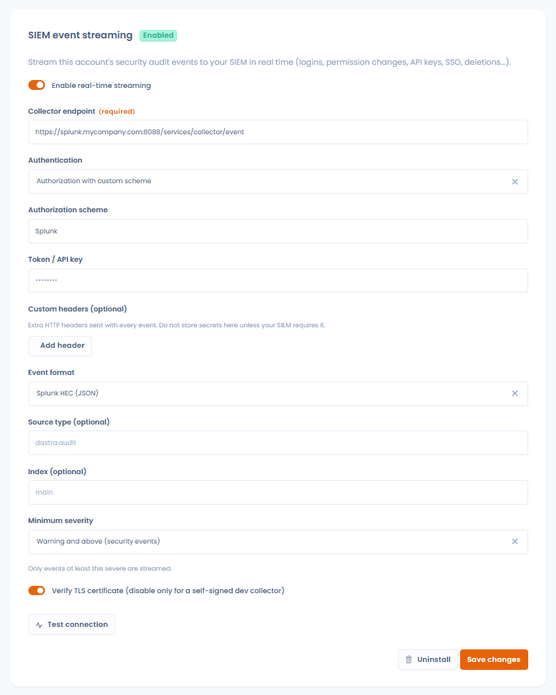

# SIEM-streaming

## Overzicht

SIEM-streaming stuurt **de beveiligingsauditgebeurtenissen van uw Dastra-account in realtime door naar uw SIEM**: aanmeldingen, wijzigingen van machtigingen, API-sleutels, MFA- en SSO-wijzigingen, verwijderingen van gebruikers en werkruimtes, enzovoort. Alle auditgebeurtenissen van het account worden doorgestuurd, zodat uw beveiligingsteam het volledige spoor heeft in de tool die het al bewaakt (Splunk, Sentinel, Sumo Logic, QRadar enzovoort).

Los van streaming kunnen de auditlogs ook **handmatig worden geëxporteerd** in SIEM-formaten: zie [Handmatige export](#handmatige-export-vanuit-de-auditlogs) hieronder.

## Vereisten

* Het **Enterprise-abonnement** (functie Geavanceerde beveiliging).
* **Eigenaar** van de organisatie zijn: de configuratie staat in **Organisatie-instellingen** > **Beveiliging**, onderaan de pagina (sectie **Streaming van SIEM-gebeurtenissen**). De kaart **SIEM streaming** van de catalogus met integraties opent ook deze sectie.
* Aan de SIEM-kant: een HTTP-event-collector-endpoint dat via HTTPS bereikbaar is (bijvoorbeeld een Splunk-HEC-endpoint) en het bijbehorende token of de API-sleutel.

<figure><figcaption>
De sectie Streaming van SIEM-gebeurtenissen, in Organisatie-instellingen > Beveiliging
</figcaption></figure>

## Configuratie

Schakel **Real-time streaming inschakelen** in: het formulier verschijnt. Vul het in en klik op **Opslaan**:

* **Endpoint van de verzamelaar** (verplicht): de HTTP(S)-URL van uw SIEM-collector, bijvoorbeeld `https://collector.example.com/services/collector/event` voor Splunk HEC.
* **Authenticatie**: hoe het token met elke gebeurtenis wordt verstuurd:
  * **Bearer**: `Authorization: Bearer <token>` (standaard),
  * **API-sleutel**: `Authorization: ApiKey <token>`,
  * **Autorisatie met aangepast schema**: `Authorization: <schema> <token>`, waarbij u het woord van het **Autorisatieschema** invult (bijvoorbeeld `Splunk` voor een Splunk-HEC-input, `Api-Token` voor Dynatrace),
  * **Aangepaste header**: het token wordt verstuurd in de header die u opgeeft bij **Naam van de header** (bijvoorbeeld `X-API-Key`),
  * **Geen**: geen authenticatieheader (bijvoorbeeld wanneer het token deel uitmaakt van de URL).
* **Token / API-sleutel**: het token van de collector. Het wordt versleuteld opgeslagen en nooit meer getoond; laat het veld later leeg om het huidige te behouden.
* **Aangepaste headers (optioneel)**: extra HTTP-headers die met elke gebeurtenis worden verstuurd, als sleutel/waarde-paren.
* **Evenementenformaat**:
  * **Splunk HEC (JSON)**: het eigen formaat van de Splunk HTTP Event Collector. Er verschijnen twee extra optionele velden: **Bron type (optioneel)** (standaard `dastra:audit`) en **Index (optioneel)**.
  * **Dynatrace (Log Monitoring v2)**: het eigen formaat van de Dynatrace-logingest-API.
  * **CEF (Common Event Format)**: voor ArcSight, Sumo Logic en de meeste SIEM's die CEF verwerken.
  * **Syslog (RFC 5424)**: gestructureerde syslogregels.
* **Minimale ernst**: het laagste niveau dat nog wordt doorgestuurd: **Alle gebeurtenissen**, **Kennisgeving en meer**, **Waarschuwing en meer (beveiligingsgebeurtenissen)** of **Fout en meer**. Het standaardniveau, dat ook het aanbevolen niveau is, is **Waarschuwing en meer**: u behoudt de voor de beveiliging relevante signalen (mislukte aanmeldingen, wijzigingen van machtigingen, SSO/MFA, API-sleutels, verwijderingen enzovoort) zonder uw SIEM te overspoelen met dagelijkse activiteit. Kies **Alle gebeurtenissen** alleen als uw SIEM het volledige auditspoor moet verwerken.
* **Controleer het TLS-certificaat**: laat dit ingeschakeld; schakel het alleen uit voor een zelfondertekende ontwikkelcollector.

Bestaat er al een configuratie, dan schakelt dezelfde schakelaar de streaming onmiddellijk in of uit. **Verwijderen** wist de configuratie.


Veelvoorkomende voorbeelden. Splunk HEC: endpoint `https://<host>:8088/services/collector/event`, formaat Splunk HEC (JSON), authenticatie Bearer (of Autorisatie met aangepast schema + `Splunk` voor klassieke HEC-inputs). Dynatrace: endpoint `https://<omgeving>.live.dynatrace.com/api/v2/logs/ingest`, formaat Dynatrace (Log Monitoring v2), authenticatie Autorisatie met aangepast schema + `Api-Token`.


<figure><figcaption>
SIEM-streaming configureren
</figcaption></figure>

## De verbinding testen

**Test de verbinding** stuurt een synthetische testgebeurtenis met de huidige waarden van het formulier naar uw collector en toont het resultaat ("Testgebeurtenis succesvol afgeleverd", of de HTTP-fout die de collector teruggeeft). Gebruik de knop na elke wijziging: de test vereist niet dat streaming is ingeschakeld.


Streaming geldt voor de hele organisatie (alle werkruimtes). Er is één SIEM-configuratie per organisatie.


## Inhoud van de gebeurtenissen

Elke auditgebeurtenis wordt afzonderlijk afgeleverd, op het moment dat ze plaatsvindt, met de volgende inhoud:

| Veld | Inhoud |
| --- | --- |
| `id` | Unieke identificatie van de auditgebeurtenis |
| `time` / `timestamp` | Tijdstip van de gebeurtenis (UTC) |
| `action` | Type gebeurtenis, bijvoorbeeld `UserLogin`, `PermissionChange`, `ApiKeyAdded` |
| `message` | Leesbare beschrijving |
| `objectType` / `objectId` | Betrokken record, indien van toepassing |
| `severity` | Ernst van het type syslog (zie hieronder) |
| `outcome` | `success` of `failure` |
| `actorId` / `actorName` / `actorEmail` | Wie de actie heeft uitgevoerd |
| `tenantId` / `workspaceId` / `workspaceName` / `areaId` | Waar het is gebeurd |
| `url` | Directe link naar het record in Dastra |

Voor de beveiliging gevoelige gebeurtenissen krijgen een hogere ernst, los van hun weergaveprioriteit in Dastra: herhaalde mislukte aanmeldingen worden als **Error** verstuurd (met `outcome: failure`); wijzigingen van machtigingen, het aanmaken of verwijderen van API-sleutels, MFA- en SSO-wijzigingen, intrekkingen en verwijderingen van gebruikers en verwijderingen van werkruimtes worden als **Warning** verstuurd. Op deze ernst is ook de instelling **Minimale ernst** gebaseerd: **Waarschuwing en meer** (de aanbevolen instelling) beperkt de stroom tot deze beveiligingsgebeurtenissen.


De gebeurtenissen bevatten de naam en het e-mailadres van de uitvoerder van de actie, gegevens die al in het Dastra-auditlogboek worden getoond. Er wordt geen inhoud van records (persoonsgegevens van betrokkenen, documentinhoud enzovoort) doorgestuurd.


## Handmatige export vanuit de auditlogs

U kunt het beveiligingsauditspoor op verzoek exporteren, in dezelfde formaten, zonder streaming te configureren:

1. Open **Organisatie-instellingen** > **Beveiligingsaudit**.
2. Stel de filters (periode, werkruimte enzovoort) naar wens in.
3. Open het menu **Exporteren (SIEM)** naast de gebruikelijke exportknop en kies **CEF (Common Event Format)**, **Syslog (RFC 5424)** of **Splunk HEC (JSON)**.

Het bestand (`dastra-security-logs-<datum>`) bevat de overeenkomende auditgebeurtenissen, tot 100.000, klaar om door uw SIEM te worden ingelezen.

Hetzelfde menu biedt ook **Real-time streaming configureren**, een snelkoppeling naar de hierboven beschreven streamingconfiguratie.

<figure><figcaption>
Eenmalige SIEM-export vanuit de beveiligingslogs
</figcaption></figure>

## Probleemoplossing

* **Test mislukt: HTTP 401/403**: controleer het token en het authenticatieschema dat uw collector verwacht (Splunk HEC verwacht het token zoals geconfigureerd op de HEC-input; sommige collectors verwachten een aangepaste header).
* **Test mislukt: certificaatfout**: uw collector gebruikt een certificaat dat Dastra niet kan controleren. Herstel de certificaatketen; schakel **Controleer het TLS-certificaat** alleen uit voor een ontwikkelcollector.
* **Er komen geen gebeurtenissen aan**: controleer of **Real-time streaming inschakelen** is ingeschakeld en raadpleeg de ingestlogs van uw collector. Gebruik **Test de verbinding** om connectiviteit en configuratie van elkaar te scheiden.
