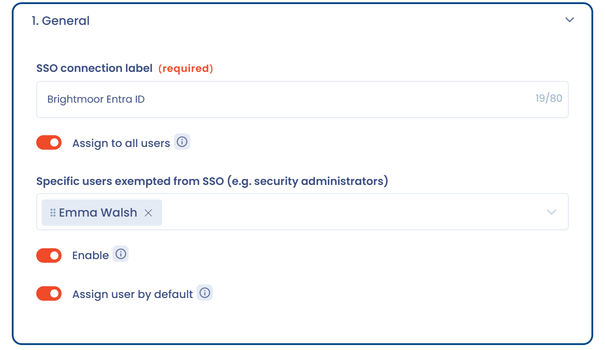
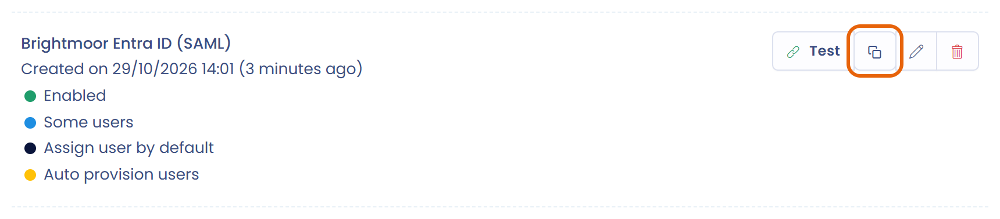

# Single Sign On (SSO)

## Werkingsprincipe

Single sign-on, vaak afgekort tot SSO, is een methode waarmee een gebruiker na één enkele authenticatie toegang krijgt tot meerdere toepassingen (of beveiligde websites).

Een bedrijf kan zijn eigen authenticatiesysteem gebruiken in plaats van de lokale login die Dastra standaard biedt. De meest gebruikte SSO-systemen zijn Microsoft Active Directory, Google Workspace (voorheen GSuite) en Auth0.

Het proces verloopt als volgt:

Een gebruiker (User Agent) vraagt een verbinding aan bij de serviceprovider (Service Provider), die een identiteitsprovider (Identity Provider) vraagt de gebruiker te authenticeren. Het resultaat van de authenticatie gaat terug naar de serviceprovider, die het verbindingsverzoek van de gebruiker accepteert.

Bij Dastra is de User Agent de browser van een Dastra-gebruiker, de Service Provider is Dastra en de Identity Provider is uw authenticatieprovider (bijvoorbeeld Active Directory).

<figure><figcaption></figcaption></figure>

## Implementatie

Een Dastra-abonnement kan een of meer SSO-logins bevatten, als de functie in uw abonnement is inbegrepen. Om ze te beheren opent u **Organisatie-instellingen** (onderaan het menu **Instellingen voor werkruimte**) en daarna **Eenmalig inloggen**. U komt dan op de [configuratiepagina voor SSO-logins](https://app.dastra.eu/general-settings/sso).


Alleen een eigenaar van de organisatie heeft toegang tot deze pagina.


<figure><figcaption><p>De pagina <strong>Eenmalig inloggen</strong></p></figcaption></figure>

De pagina bevat drie blokken:

* **Geautoriseerde e-maildomeinen**, bovenaan: zie [E-mail domeinen](../email-domains.md).
* De lijst met uw SSO-verbindingen, die u uitbreidt met **Voeg een SSO-login toe**.
* **SCIM**, onderaan: zie [SCIM](../scim.md).

Om een verbinding te maken klikt u op **Voeg een SSO-login toe** en kiest u daarna het protocol. Dastra biedt twee protocollen voor eenmalig inloggen, [**SAML 2**](saml.md) en [**OpenID**](openid.md). Gebruik de onderstaande links voor de configuratiehandleidingen.


[SAML 2](saml.md)



[OpenId](openid.md)



[ADFS](adfs.md)



[Active Directory (Microsoft Entra ID)](entra-id.md)



[Okta](okta.md)



[Bekende problemen](known-problems.md)


## Formuliervelden

Het formulier van een SSO-verbinding opent in een zijpaneel met drie secties.

### 1. Algemeen

* **Titel van de SSO-verbinding**: de naam van de verbinding in de lijst, maximaal 80 tekens.
* **Forceer voor alle gebruikers**: elke gebruiker moet inloggen met deze SSO-login. Zie [SSO inschakelen voor alle gebruikers](#sso-inschakelen-voor-alle-gebruikers).
* **Inschakelen**: als de verbinding is uitgeschakeld, blijft het standaard wachtwoordlogin van kracht.
* **Standaard toegewezen aan nieuwe uitgenodigde gebruikers**: Dastra selecteert deze verbinding standaard wanneer u een nieuwe gebruiker uitnodigt.

### 2. Configuratie

* De velden die specifiek zijn voor het protocol: zie [SAML 2](saml.md) en [OpenID](openid.md).
* **De naam van de claim met het e-mailadres**: de naam van de claim waarin uw identiteitsprovider het e-mailadres van de gebruiker teruggeeft (in het Engels: "User's email address claim name mapping (Used if user does not exist locally)"). Als Dastra uw gebruikers niet herkent, zie dan [Bekende problemen](known-problems.md).

### 3. Automatisch gebruikers aanmaken

* **Gebruiker aangemaakt als de gebruiker nog nooit is uitgenodigd voor Dastra**: schakelt de automatische aanmaak van accounts in. Zie [Automatische gebruikersprovisioning inschakelen](#automatische-gebruikersprovisioning-inschakelen).
* **De standaardrol die is toegewezen aan alle werkruimten in het abonnement wanneer de gebruiker wordt gemaakt**: optioneel.
* **Een specifieke werkruimte selecteren**: optioneel. Als u een werkruimte kiest, verschijnt een veld voor de naam van de groepsclaim: zie [Teams koppelen](#teams-koppelen).

## SSO inschakelen voor alle gebruikers

1. Klik in de lijst met SSO-verbindingen op de verbinding.
2. Schakel in de sectie **Algemeen** de optie **Forceer voor alle gebruikers** in.

<figure><figcaption><p>De sectie <strong>Algemeen</strong> van de verbinding</p></figcaption></figure>

### Gebruikers die van SSO zijn vrijgesteld

In sommige gevallen wilt u SSO voor bepaalde gebruikers uitschakelen, bijvoorbeeld voor een beveiligingsbeheerder, een serviceaccount of een gebruiker die niet in uw Active Directory staat. U kunt specifieke gebruikers aanwijzen die niet worden doorgestuurd naar de SSO-login van uw organisatie. Wij raden aan ten minste één gebruiker met een lokaal serviceaccount aan te wijzen: daarmee kunt u herstellen van een SSO-storing, zoals een storing bij de identiteitsprovider of een configuratiefout.

Deze gebruikers loggen in bij de toepassing met hun wachtwoord.

Om ze aan te wijzen selecteert u gebruikers van uw organisatie in het veld **Specifieke gebruikers die zijn vrijgesteld van SSO (bijv. beveiligingsbeheerders)**. Dit veld verschijnt wanneer **Forceer voor alle gebruikers** is ingeschakeld.

## Automatische gebruikersprovisioning inschakelen

Wilt u dat de gebruikers van uw identiteitsprovider geen account nodig hebben voordat ze toegang krijgen tot de organisatie, schakel dan in de sectie **Automatisch gebruikers aanmaken** de optie **Gebruiker aangemaakt als de gebruiker nog nooit is uitgenodigd voor Dastra** in.

Automatische provisioning werkt alleen wanneer gebruikers inloggen met de link van uw SSO-verbinding. Het werkt niet vanaf de standaard loginpagina. De link ziet er zo uit:

```
https://account.dastra.eu/Account/ExternalLogin?returnUrl=https://app.dastra.eu&provider={your provider id}
```

De adressen in de link zijn die van uw regio. Om de link op te halen klikt u op de knop **Link kopiëren** op de kaart van de verbinding, rechts van **Testen**, en stuurt u hem daarna naar uw gebruikers.

<figure><figcaption><p>De knop <strong>Link kopiëren</strong> op de kaart</p></figcaption></figure>

Na een geslaagde authenticatie wordt het account automatisch aangemaakt in Dastra. De eigenaren van de organisatie ontvangen dan een melding met de naam en het e-mailadres van het aangemaakte account, de datum en het tijdstip, de SSO-verbinding die het heeft aangemaakt, de toegewezen standaardrol en, indien van toepassing, de betrokken werkruimte. De melding bevat een link naar de pagina **Gebruikers**, zodat u zonder uitstel de verwachte rechten kunt toekennen.


Als het account van een gebruiker wordt verwijderd of uitgeschakeld in de authenticatieprovider, wordt het niet gewist in Dastra, maar de gebruiker kan niet meer inloggen. U kunt deze accounts opschonen in het [gebruikersbeheer van het abonnement](https://app.dastra.eu/general-settings/users).


U kunt de **standaardrol** kiezen die aan nieuw aangemaakte gebruikers wordt toegewezen.

<figure><figcaption><p>De sectie <strong>Automatisch gebruikers aanmaken</strong></p></figcaption></figure>


Dastra ondersteunt momenteel niet het koppelen van rollen aan eigenschappen van de authenticatieserver. Is deze functie voor u belangrijk, meld dat dan via de [ondersteuningspagina](https://app.dastra.eu/general-settings/support).


### Teams koppelen

U kunt de teams van een werkruimte koppelen aan een eigenschap (claim) die uw authenticatieserver teruggeeft. Selecteer de werkruimte bij **Een specifieke werkruimte selecteren** en voer daarna in het veld dat eronder verschijnt de naam van de groepsclaim in: Dastra provisioneert de teams vanuit die claim.

## Logins van gebruikers beheren

U stelt het logintype van elke gebruiker in via het [gebruikersbeheer van het abonnement](https://app.dastra.eu/general-settings/users) (**Organisatie-instellingen** > **Gebruikers**). Open het profiel van de gebruiker en kies de gewenste SSO-login bij **Standaard verbindingsmodus**. Een gebruiker die daarna met zijn e-mailadres inlogt bij Dastra, wordt doorgestuurd naar de loginpagina van de authenticatieprovider die u hebt ingesteld.

Wanneer SSO voor alle gebruikers wordt afgedwongen, toont het profiel in plaats daarvan een bericht met die strekking.

<figure><figcaption><p>Het veld <strong>Standaard verbindingsmodus</strong></p></figcaption></figure>

U kunt het logintype ook instellen wanneer u nieuwe gebruikers uitnodigt.

## Als u niet met SSO kunt inloggen

Raadpleeg eerst de [bekende problemen](known-problems.md). Blijft u geblokkeerd, neem dan direct contact op met de [support](../../../getting-started/support/request.md).
