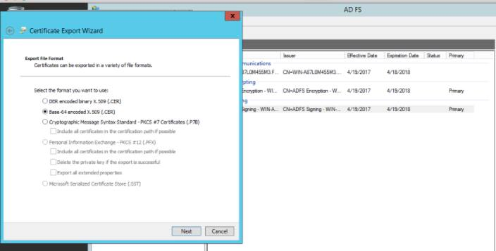
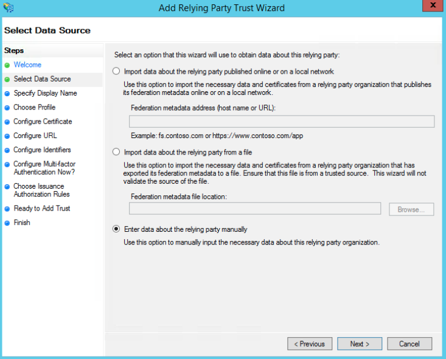
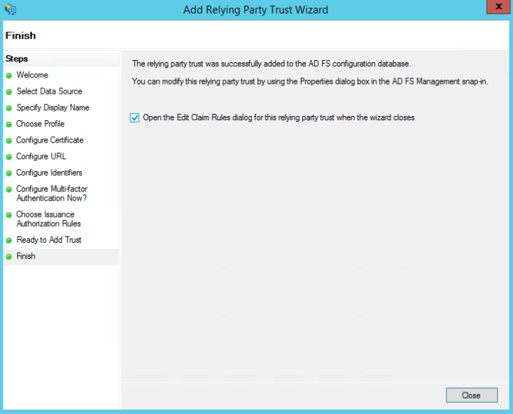
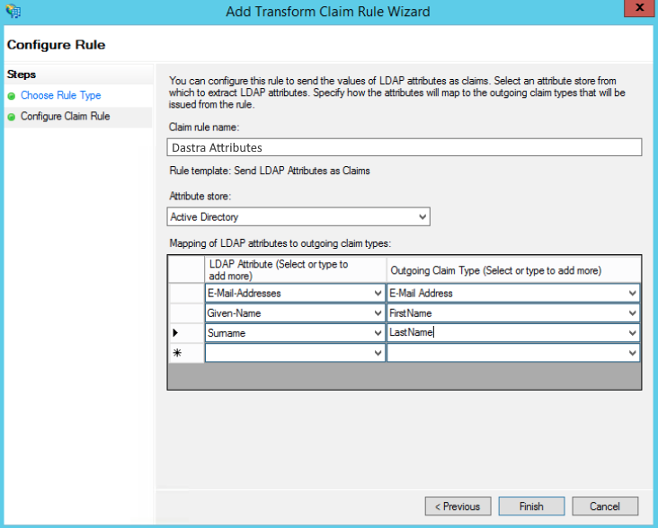
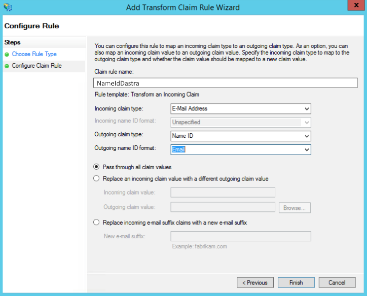

# ADFS

## Over ADFS

Active Directory Federation Services (meestal afgekort tot ADFS) is een oplossing voor eenmalig inloggen (SSO) van Microsoft. Deze diensten, een onderdeel van de Windows Server-besturingssystemen, laten gebruikers authenticeren via Active Directory (AD) wanneer ze toegang willen tot een toepassing die geen Integrated Windows Authentication (IWA) kan gebruiken.

## ADFS configureren in Dastra

### Stap 1: een SAML-login maken in Dastra

* Ga naar de [SSO-configuratiepagina van Dastra](https://app.dastra.eu/general-settings/sso) (**Organisatie-instellingen** > **Eenmalig inloggen**).
* Klik op **Voeg een SSO-login toe**.
* Selecteer bij **SSO-protocol** de optie **SAML2** en daarna **Handmatige configuratie**.
* Voer in het veld **Entiteits-ID van de identiteitsprovider (uitgever)** de volgende URL in: `http://<adfs server url>/adfs/services/trust`
* Voer in het veld **Identity Provider SSO url** het volgende in: `https://<adfs server url>/adfs/ls`

### Stap 2: het ADFS-certificaat ophalen

* Ga naar de map **Certificates** van de ADFS-server.
* Haal het .CER-certificaat van uw ADFS-server op via het certificaat **Token-Signing**.

<figure><figcaption></figcaption></figure>

* Klik op **View Certificates**.

<figure><figcaption></figcaption></figure>

Kopieer de code van het X509-certificaat door het CER-bestand te openen met een teksteditor. Plak die in het certificaatveld, tussen `-----BEGIN CERTIFICATE-----` en `-----END CERTIFICATE-----`. Uw loginconfiguratie moet er als volgt uitzien:

<figure><figcaption></figcaption></figure>

### Stap 3: de volgende waarden bewaren

* De SP-omleidings-URI (formaat: `https://account.dastra.eu/xxxxx-xxxx-xxxx-xxxx/Acs`): de callback-URL van de toepassing, waarnaar het SAML-token wordt gestuurd. De ondersteunde algoritmen zijn SHA-256 en hoger. Kopieer de URI bovenaan het SAML-formulier.
* De **Entiteits-ID van de identiteitsprovider (uitgever)**, die bovenaan hetzelfde formulier wordt weergegeven.

Deze twee waarden gebruikt u om de ADFS-server in te stellen zodat die SSO-verzoeken van Dastra accepteert.

## De Dastra-client configureren in ADFS

Zo configureert u Dastra-SSO met ADFS SSO SAML2P.

Stap 1: open **AD FS Management** op uw ADFS-server.

Stap 2: klik met de rechtermuisknop op **Relying Party Trusts** en selecteer **Add Relying Party Trust**. De wizard **Add Relying Party Trust** start.

<figure><figcaption></figcaption></figure>

Stap 3: kies op het scherm **Select Data Source** de optie **Enter data about the relying party manually**.

<figure><figcaption></figcaption></figure>

Stap 4: voer een **Display name** in, bijvoorbeeld "Dastra", en klik op **Next**.

Stap 5: kies **AD FS profile** (SAML 2.0) en klik op **Next**.

Stap 6: klik op het scherm **Configure Certificate** op **Next** zonder een certificaat te selecteren.

Stap 7: selecteer **Enable support for the SAML 2.0 WebSSO protocol**.

<figure><figcaption></figcaption></figure>

Voer in het veld **Relying party SAML 2.0 SSO service URL** de SP-omleidings-URI van Dastra in. Die ziet er zo uit: `https://account.dastra.eu/xxxx-xxxx-xxxx-xxxx/Acs`

Stap 8: voeg in het gedeelte **Relying party trust identifier** twee waarden toe: `account.dastra.eu` en `https://account.dastra.eu`.

Stap 9: klik op **Next** tot het einde van de wizard.

Stap 10: schakel het selectievakje **Open the Edit Claim Rules dialog** in voordat u op **Close** klikt. Het venster **Edit Claim Rules** verschijnt.

<figure><figcaption></figcaption></figure>

Stap 11: klik op **Add Rule** en kies het claimregelsjabloon **Send LDAP Attributes as Claims**.

<figure><figcaption></figcaption></figure>

Stap 12: koppel de claims als volgt. De namen van de claims kunnen verschillen naargelang de configuratie van uw server. Dastra heeft drie attributen nodig: het e-mailadres (verplicht), de achternaam en de voornaam van de gebruiker.

<figure><figcaption></figcaption></figure>

Stap 13: klik op **Finish** en daarna opnieuw op **Add Rule**. Kies deze keer het sjabloon **Transform an Incoming Claim** en klik op **Next**.

Stap 14: configureer de volgende regel: **Email Address** => **Name ID** => **Email**.

<figure><figcaption></figcaption></figure>

Klik daarna op **Apply**.

Stap 15: klik in het venster **AD FS Management** met de rechtermuisknop op de relying party van Dastra en kies **Properties**. Kies op het tabblad **Advanced** SHA-256 als beveiligd hashalgoritme.

Stap 16: de configuratie is voltooid.

## Afronden en testen

Wanneer alles aan beide kanten is geconfigureerd, gaat u terug naar Dastra en klikt u op **Testen**, rechts van de verbinding in de lijst met SSO-logins.
