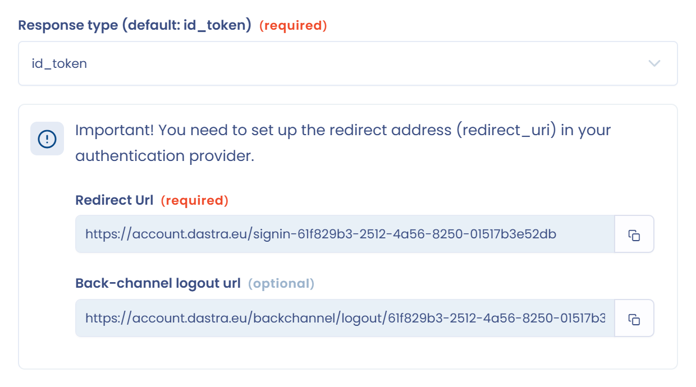

# Okta

Deze pagina legt uit hoe u de SSO-aanmelding met Okta in Dastra instelt met het protocol **OpenID Connect**. U kunt dit ook met SAML doen: zie [SAML 2](saml.md).

1. Meld u aan bij de beheerconsole van Okta.
2. Open het menu **Applications** > **Applications** en klik op **Create App Integration**.
3. Selecteer **OIDC - OpenID Connect**.
4. Selecteer als toepassingstype **Web application**.
5. Configureer de toepassing en vink **Implicit (hybrid)** aan onder **Grant type**. Voor het logo van de toepassing kunt u [dit logo gebruiken](https://www.dastra.eu/img/press/logodastra.png).
6. Haal in Dastra de omleidings-URL op: open de [SSO-beheerpagina](https://app.dastra.eu/general-settings/sso), klik op **Voeg een SSO-login toe** en kies **OpenID**. Kopieer in de sectie **Configuratie**, onderaan het formulier, de omleidings-URL.

   <figure><figcaption>
De omleidings-URL die Dastra toont
</figcaption></figure>
7. Ga terug naar Okta en plak de omleidings-URL in **Sign-in redirect URIs**. Selecteer de Okta-gebruikers aan wie u toegang tot Dastra wilt geven (standaard kunt u **Allow everyone** aanvinken) en klik op **Save**.
8. Okta toont de instellingenpagina van de nieuwe toepassing: de client-ID (Client ID), de geheime sleutel (Client secret) en het Okta-domein, dat als autoriteit dient.
9. Ga terug naar Dastra en vul de velden van het formulier in:

   * **ID van de client (clientId)**: kopieer de Client ID uit Okta.
   * **Autoriteit/domein**: vul het Okta-domein in met het protocol (`https://<uw domein>.okta.com`).
   * **Beheerder**: laat het veld leeg.
   * **Geheime sleutel**: kopieer de client secret uit Okta.
   * **Scope**: `openid profile email`.
   * **Type reactie (Standaard: id_token)**: `id_token`.

   <figure><figcaption>
Het OpenID-formulier van Dastra
</figcaption></figure>
10. Klik op **Opslaan** en klik daarna op **Testen** op de verbindingskaart. Als Okta u naar Dastra omleidt, is de configuratie voltooid.
