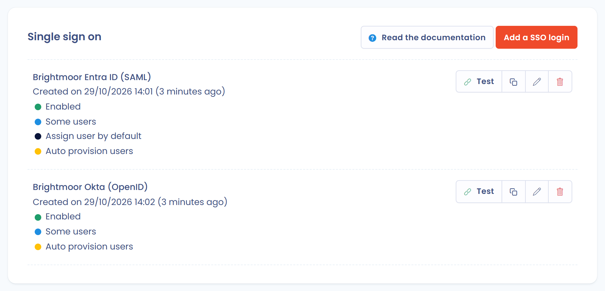
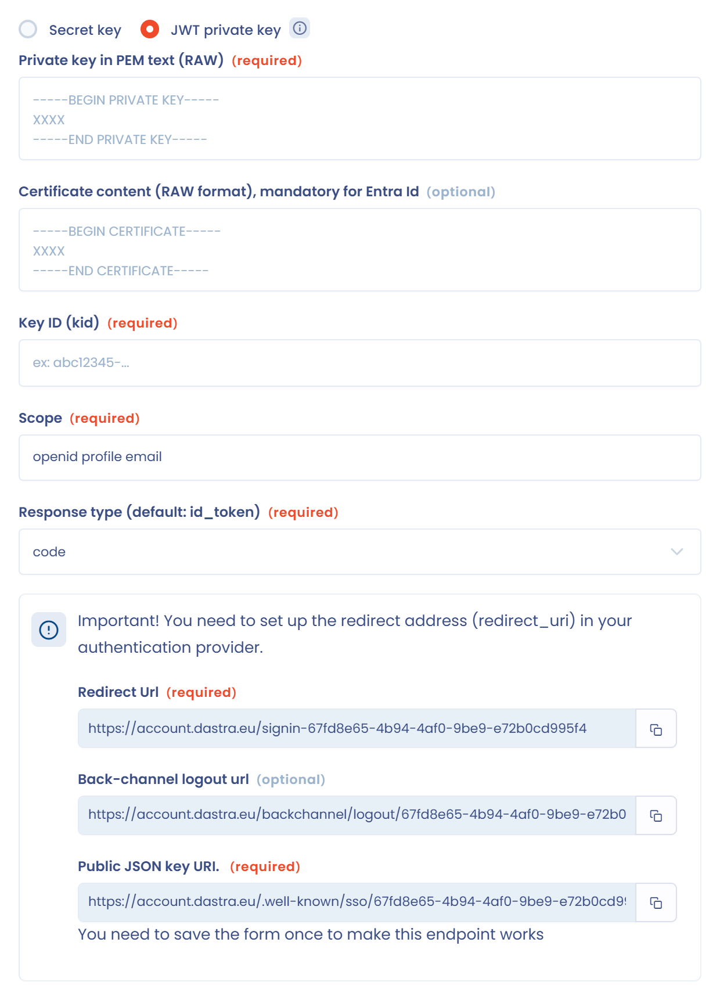

# OpenId

## Werkingsprincipe

De OpenId-specificaties vindt u [hier](https://openid.net/connect/).

<figure><figcaption></figcaption></figure>

SSO instellen met OpenId gebeurt in drie stappen:

* de authenticatieprovider configureren: Active Directory, Google Workspace enzovoort;
* de serviceprovider configureren: Dastra;
* de authenticatie testen.

## 1. De authenticatieprovider configureren

Stel een OpenId-configuratie in bij uw authenticatieprovider.

Voor Active Directory: [https://learn.microsoft.com/nl-nl/entra/identity-platform/v2-protocols-oidc](https://learn.microsoft.com/nl-nl/entra/identity-platform/v2-protocols-oidc)

Om de lokale accounts (die in Dastra worden gehost) aan de accounts van uw provider te koppelen, heeft Dastra een eigenschap nodig die het e-mailadres van de gebruiker bevat. Het veld **De naam van de claim met het e-mailadres** in stap 2 is vooraf ingevuld met `email`. Ontbreekt deze claim, dan zoekt Dastra ook naar de eigenschap met de naam [http://schemas.xmlsoap.org/ws/2005/05/identity/claims/emailaddress](http://schemas.xmlsoap.org/ws/2005/05/identity/claims/emailaddress).

Dit zijn de gegevens die u bij de serviceprovider moet invullen:

* **Autoriteit/domein**, bijvoorbeeld `https://account.oauth.sso.com`;
* **ID van de client (clientId)**;
* **Geheime sleutel**, of de onderdelen van de privésleutel JWT (zie de clientauthenticatiemethode in stap 2);
* **Type reactie (Standaard: id_token)**, standaard `id_token`;
* **Scope**, standaard `openid profile email`.

Om uw authenticatieprovider te configureren hebt u de **Redirect URL** nodig die in het formulier van Dastra staat, in de vorm `https://account.dastra.eu/signin-{connection identifier}`. Deze URL is specifiek voor elke verbinding.

## 2. De serviceprovider configureren

Open in Dastra de [SSO-beheerpagina](https://app.dastra.eu/general-settings/sso) (**Instelling van de organisatie** > **Eenmalig inloggen**, alleen beschikbaar voor eigenaren van de organisatie) en klik op **Voeg een SSO-login toe**. Kies het protocol **OpenID**.

<figure><figcaption></figcaption></figure>

Vul de velden van het formulier in met de gegevens van uw authenticatieprovider:

<figure><figcaption></figcaption></figure>

Het formulier toont ook de waarden die u bij uw authenticatieprovider moet declareren:

* **Redirect URL**;
* **Afmeld-URL (Back-channel logout url)**, optioneel;
* **JSON openbare sleutel URI (JWK Private Key)**, alleen bij de privésleutel JWT. Sla het formulier eenmaal op om dit eindpunt te laten werken.

Declareer de **Afmeld-URL (Back-channel logout url)** bij uw provider als u wilt dat een afmelding bij de provider ook de Dastra-sessie beëindigt. Dastra ondersteunt OpenID Connect Back-Channel Logout: wanneer uw provider een logouttoken voor een gebruiker of een sessie verstuurt, trekt Dastra de bijbehorende sessies in, zodat de gebruiker zich opnieuw moet aanmelden.

### Clientauthenticatiemethode: geheime sleutel of privésleutel JWT

Kies hoe Dastra zich bij uw identiteitsprovider authenticeert:

* **Geheime sleutel**: Dastra en uw provider bewaren allebei hetzelfde clientgeheim. Vul het in bij het veld **Geheime sleutel**.
* **Privésleutel JWT (private jwt assertion)**: Dastra ondertekent zijn authenticatie met de privésleutel die u opgeeft, en uw provider controleert de handtekening met de openbare sleutel. Er is geen gedeeld geheim nodig, wat het risico op lekken verkleint. Controleer of uw identiteitsprovider deze methode ondersteunt.

<figure><figcaption></figcaption></figure>

Bij **Privésleutel JWT (private jwt assertion)** schakelt het **Type reactie (Standaard: id_token)** over op `code` en vraagt het formulier om:

* **Privésleutel in de PEM-tekst (RAW)**: eenmaal opgeslagen wordt de sleutel niet meer getoond. Klik op **Replace private key** om hem te vervangen;
* **Inhoud van het certificaat (RAW-formaat), verplicht voor Entra Id**;
* **Sleutelidentificatie (kid)**, optioneel: vul de sleutel-ID in die uw provider heeft toegekend toen u de openbare sleutel uploadde, of laat het veld leeg zodat Dastra de JWK-thumbprint (RFC 7638) van de privésleutel gebruikt.

Declareer daarna de **JSON openbare sleutel URI (JWK Private Key)** bij uw provider, zodat die de openbare sleutel van de verbinding kan ophalen.

Het veld **Beheerder** is optioneel. Is het ingevuld, dan controleert Dastra dat het ontvangen token door deze uitgever is afgegeven, bijvoorbeeld `https://login.microsoftonline.com/{tenantid}/v2.0`.


U kunt alle gebruikers van de organisatie dwingen een bepaalde SSO te gebruiken (optie **Forceer voor alle gebruikers**). Wees voorzichtig: als de SSO uitvalt, hebt u als beheerder geen toegang meer tot uw account. Houd een lokaal reserveaccount aan, of stel gebruikers vrij met het veld **Specifieke gebruikers die zijn vrijgesteld van SSO (bijv. beveiligingsbeheerders)** (zie [Single Sign On (SSO)](README.md)). SSO per gebruiker beheren verdient de voorkeur.



Bijzonder geval van externe gebruikers: alleen accounts die intern zijn voor een abonnement vallen onder SSO. Accounts van externe gebruikers (met een extra abonnement) vallen er niet onder.


## 3. De SSO testen met OpenId

Test de authenticatie wanneer de configuratie klaar is door rechts van de verbinding in de lijst op **Testen** te klikken. Loopt u tegen een probleem aan, open dan een ticket via de [supportpagina](https://app.dastra.eu/general-settings/support).

<figure><figcaption></figcaption></figure>
