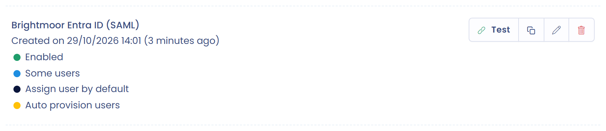

# SAML 2

SSO instellen met SAML 2 gebeurt in drie stappen:

* de authenticatieprovider configureren (Identity Provider, IdP): Active Directory, Google Workspace enzovoort;
* de serviceprovider configureren (Service Provider, SP): Dastra;
* de authenticatie testen.

Voor ADFS-servers verwijst u naar de speciale pagina:


[ADFS](adfs.md)


## 1. De authenticatieprovider configureren

Stel een SAML-configuratie in bij uw authenticatieprovider.

* Voor AD FS: zie de pagina [ADFS](adfs.md).
* Voor Microsoft Entra ID (voorheen Azure AD): zie de pagina [Active Directory (Microsoft Entra ID)](entra-id.md) en de [documentatie van Microsoft](https://learn.microsoft.com/nl-nl/entra/identity/enterprise-apps/add-application-portal-setup-sso).
* Voor Google: [https://support.google.com/a/answer/6087519?hl=nl](https://support.google.com/a/answer/6087519?hl=nl)

Om de lokale accounts (die in Dastra worden gehost) te koppelen, moet u een eigenschap met het e-mailadres van de gebruiker meegeven (standaard zoekt Dastra naar de eigenschap met de naam [http://schemas.xmlsoap.org/ws/2005/05/identity/claims/emailaddress](http://schemas.xmlsoap.org/ws/2005/05/identity/claims/emailaddress)). U kunt deze naam wijzigen in het veld **De naam van de claim met het e-mailadres**.

Dit zijn de gegevens die u bij de serviceprovider moet invullen:

* **Entiteits-ID van de identiteitsprovider (uitgever)** (Entity id, issuer);
* **Identity Provider SSO url** (Single sign on url);
* het certificaat in RAW-formaat (Base64-gecodeerd), in het veld **Identity Provider Certificaat (RAW)**.

Om uw authenticatieprovider te configureren hebt u de volgende gegevens nodig, die bovenaan het SAML-formulier in Dastra staan:

* Issuer: standaard `https://www.dastra.eu`;
* SP-omleidings-URI (ACS): `https://account.dastra.eu/{connection identifier}/Acs`. Deze URL is specifiek voor elke verbinding: kopieer haar bovenaan het SAML-formulier wanneer u de SSO-login in Dastra toevoegt (stap 2) en sla die login daarna op;
* **SP start URL (Aanmeld-URL)**, als uw provider een aanmeld-URL voor de toepassing vraagt;
* **SAML Logout-URL (optioneel)**, als uw provider het afmelden afhandelt.

## 2. De serviceprovider configureren

Open in Dastra de [SSO-beheerpagina](https://app.dastra.eu/general-settings/sso) (**Instelling van de organisatie** > **Eenmalig inloggen**, alleen beschikbaar voor eigenaren van de organisatie) en klik op **Voeg een SSO-login toe**. Kies het protocol **SAML2**.

<figure><figcaption></figcaption></figure>

Kies daarna hoe u de configuratie van uw identiteitsprovider aanlevert:

* **Upload uw SAML-configuratiemanifest (.xml)**: upload het metadatabestand (XML-manifest) dat uw provider levert. Dastra vult de velden van het formulier in op basis van dit bestand. Klik op de terugknop om van methode te wisselen.
* **Handmatige configuratie**: vul de velden zelf in.

<figure><figcaption></figcaption></figure>

Vul bij handmatige configuratie de velden van het formulier in met de gegevens van uw authenticatieprovider:

<figure><figcaption></figcaption></figure>


U kunt alle gebruikers van de organisatie dwingen een bepaalde SSO te gebruiken (optie **Forceer voor alle gebruikers**). Wees voorzichtig: als de SSO uitvalt, hebt u als beheerder geen toegang meer tot uw account. Houd een lokaal reserveaccount aan, of stel gebruikers vrij met het veld **Specifieke gebruikers die zijn vrijgesteld van SSO (bijv. beveiligingsbeheerders)** (zie [Single Sign On (SSO)](README.md)). SSO per gebruiker beheren verdient de voorkeur.



Bijzonder geval van externe gebruikers: alleen accounts die intern zijn voor een abonnement vallen onder SSO. Accounts van externe gebruikers (met een extra abonnement) vallen er niet onder.


## 3. De SSO testen

Test de authenticatie wanneer de configuratie klaar is door rechts van de verbinding in de lijst op **Testen** te klikken. Loopt u tegen een probleem aan, open dan een ticket via de [supportpagina](https://app.dastra.eu/general-settings/support).

<figure><figcaption></figcaption></figure>
