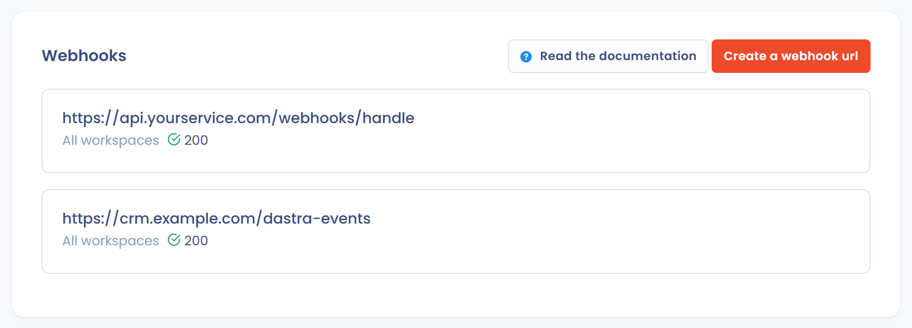

# Webhooks

## Concept

Een webhook activeert een actie als reactie op een gebeurtenis. Webhooks laten systemen met elkaar communiceren: ze waarschuwen u zodra er iets gebeurt in Dastra. Het doel is toepassingen van derden (API's, CRM, serverloze functies enzovoort) in realtime op de hoogte te brengen.

## Configuratie

Webhooks worden op organisatieniveau geconfigureerd en zijn voorbehouden aan eigenaren. Klik op het tandwielpictogram in de bovenbalk (**Organisatie-instellingen**) en daarna in het linkermenu op **Webhaken**. Het directe adres is [https://app.dastra.eu/general-settings/webhooks](https://app.dastra.eu/general-settings/webhooks).

<figure><figcaption><p>De lijst met webhooks</p></figcaption></figure>

1. Klik op **Maak een webhook url**.
2. Vul de **Webhook url** in. Wat die ontvangt, leest u in [Hoe ontvangt u de webhook](webhooks.md#comment-receptionner-le-webhook).
3. Kies de werkruimte bij **Een specifieke werkruimte selecteren**. Kiest u er geen, dan geldt de webhook voor **Alle werkplekken**.
4. Optioneel: vul het **E-mailadres dat wordt gebruikt om een melding te versturen bij herhaaldelijk falen** in. Dastra stuurt een e-mail naar dit adres wanneer de webhook in fout gaat.
5. Selecteer bij **Welk(e) event(s) wil je ontvangen?** de gebeurtenis of gebeurtenissen waarop u zich wilt abonneren. Minstens één gebeurtenis is verplicht. Het type gegevens dat wordt teruggestuurd, hangt af van de gebeurtenis: kiest u bijvoorbeeld het aanmaken van een verzoek van een betrokkene, dan bevat de inhoud van het verzoek een JSON die dat verzoek beschrijft.
6. Klik op **Opslaan**.

<figure><figcaption><p>Het webhookformulier</p></figcaption></figure>

De beschikbare gebeurtenissen zijn die van het meldingscentrum, gegroepeerd per objecttype (verwerkingsactiviteiten, verzoeken van betrokkenen, datalekken enzovoort).


Een organisatie kan maximaal 30 webhooks declareren.


Daarna opent het detailscherm van de webhook. Het toont de url, de werkruimte, de status van de webhook (**Actief** of **Uitgeschakeld**), in voorkomend geval de **Laatste foutmelding**, de gekozen gebeurtenissen en de **Webhook-validatiesleutel**, die u kunt kopiëren. De knoppen **Bewerken**, **Stuur een test webhook** en **Verwijderen** staan er ook.

<figure><figcaption><p>De details van een webhook</p></figcaption></figure>

## Hoe ontvangt u de webhook <a href="#comment-receptionner-le-webhook" id="comment-receptionner-le-webhook"></a>

Om webhookverzoeken te ontvangen, maakt u een API-eindpunt aan dat de gebeurtenissen opvangt. Het verzoek wordt als POST verstuurd en heeft altijd dezelfde structuur. De inhoud van het verzoek bevat een JSON met de details van de gebeurtenis die is geactiveerd.

Hier is de algemene structuur van het verstuurde verzoek:

```json
{
 "webhookId": <id of the webhook configured in dastra>,
 "signatureUrl": "https://yourapi.com/webhooks/handle",
 "userId": <The user who triggered the event>,
 "eventType": <The id of the event>,
 "eventName": <The label of the event>,
 "data": <Event dynamic data>,
 "date": <date of the event>
}
```

Op het verzoek geldt een time-out van 10 seconden, waarna het in fout gaat. Het antwoord moet een succescode (2xx) zijn, bijvoorbeeld 200.

Er kan een kleine vertraging zitten tussen het moment waarop de gebeurtenis in de toepassing plaatsvindt en het verzenden van de webhook. Die vertraging komt door de asynchrone uitvoering van webhooks in onze infrastructuur. Ze hangt af van de belasting van de infrastructuur en kan oplopen tot 60 à 120 seconden.


Er bestaat momenteel geen systeem om mislukte webhooks opnieuw af te spelen en zo een eventuele onbeschikbaarheid van de ontvangende server op te vangen. We raden in dat geval aan de mislukte gebeurtenissen handmatig te synchroniseren.


## Uw webhook url testen

Om uw webhook onder realistische omstandigheden te testen, opent u het detailscherm en klikt u op **Stuur een test webhook**. Doe in het venster **Webhook testtool** het volgende:

1. Kies bij **Kies het evenement dat je wilt testen** de gebeurtenis die u wilt testen. De lijst toont de gebeurtenissen waarop de webhook is geabonneerd.
2. Wijzig indien nodig de verzonden gegevens bij **Verzonden gegevens bewerken (indien nodig)**. Dastra vult het veld met een voorbeeld voor de gekozen gebeurtenis.
3. Klik op **Stuur een test webhook**.

Een bevestigingsbericht toont dat uw url met een 200-code heeft geantwoord. Was de webhook na fouten geblokkeerd, dan schakelt een geslaagde test hem weer in.

<figure><figcaption><p>De testtool voor webhooks</p></figcaption></figure>

## De webhook beveiligen


Het valideren van het binnenkomende verzoek is niet verplicht, maar wel aanbevolen. Zo voorkomt u dat iemand die het netwerk heeft bekeken, willekeurige gegevens naar uw webhook url post en daarmee het aanmaken van items in uw systeem activeert of vermenigvuldigt.


Telkens wanneer een gebeurtenis plaatsvindt waarop u bent geabonneerd, stuurt Dastra een POST-verzoek naar de webhook url. Elk verzoek bevat de header `Dastra-Signature`, die uw server kan lezen.

De waarde is de HMAC-SHA256 van de exacte JSON-inhoud van het verzoek, berekend met de validatiesleutel van de webhook en daarna gecodeerd in Base64.

> Dastra-Signature = Base64(HMAC-SHA256(\<JSON-inhoud van het verzoek>, \<validatiesleutel van de webhook>))

Gebruik de validatiesleutel precies zoals die op het detailscherm van de webhook wordt weergegeven. Hier zijn voorbeelden van de validatie van de handtekening:



```php
<?php
$secret = 'YOUR_WEBHOOK_KEY'; // signature key shown on the webhook details screen

$payload = file_get_contents('php://input'); // raw request body
$signature = $_SERVER['HTTP_DASTRA_SIGNATURE'] ?? ''; // value of the Dastra-Signature header

$computed = base64_encode(hash_hmac('sha256', $payload, $secret, true));

if (!hash_equals($computed, $signature)) {
    http_response_code(401);
    exit;
}

// the signature is valid: process the event
http_response_code(200);
```



```csharp
[HttpPost("webhooks/handle")]
public async Task<IActionResult> Handle()
{
    string signature = Request.Headers["Dastra-Signature"];
    string key = "YOUR_WEBHOOK_KEY";

    using var reader = new StreamReader(Request.Body, Encoding.UTF8);
    string payload = await reader.ReadToEndAsync();

    if (!ValidateSignature(signature, payload, key))
    {
        return Unauthorized();
    }

    // the signature is valid: process the event
    return Ok();
}

private static bool ValidateSignature(string signature, string payload, string secret)
{
    using var hmac = new HMACSHA256(Encoding.UTF8.GetBytes(secret));
    byte[] hash = hmac.ComputeHash(Encoding.UTF8.GetBytes(payload));
    string computed = Convert.ToBase64String(hash);

    return CryptographicOperations.FixedTimeEquals(
        Encoding.UTF8.GetBytes(computed),
        Encoding.UTF8.GetBytes(signature ?? string.Empty));
}
```



## Gedrag bij fouten

De webhook wordt als foutief beschouwd wanneer meer dan 5 fouten zijn geregistreerd. Dastra stopt met het versturen van gebeurtenissen naar de url zolang de laatste fout minder dan 24 uur oud is. Is er in de configuratie een e-mailadres opgegeven, dan ontvangt dat een bericht. Een geslaagde test zet de foutenteller terug op nul.

## Webhooks instellen met de API

Haal de webhooks op die aan uw account zijn gekoppeld (in alle werkruimten). De optionele parameter `workspaceId` beperkt de lijst tot één werkruimte.


[dastra-api.json](../../.gitbook/assets/dastra-api.json)


Maak een nieuwe webhook url aan met het POST-eindpunt. Geef met de parameter `subscribedEvents` de gebeurtenissen op waarop u uw webhook wilt abonneren.


[dastra-api.json](../../.gitbook/assets/dastra-api.json)


U krijgt een webhook-ID terug. Daarmee leest, wijzigt of verwijdert u de webhook.


[dastra-api.json](../../.gitbook/assets/dastra-api.json)



[dastra-api.json](../../.gitbook/assets/dastra-api.json)



[dastra-api.json](../../.gitbook/assets/dastra-api.json)

