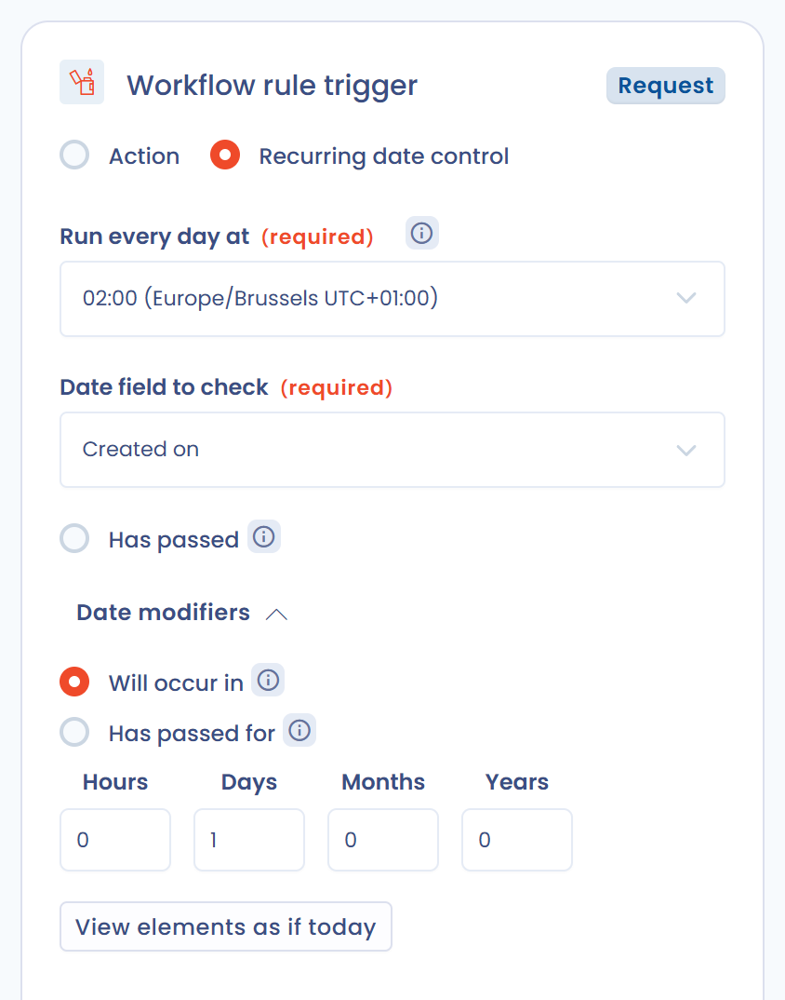
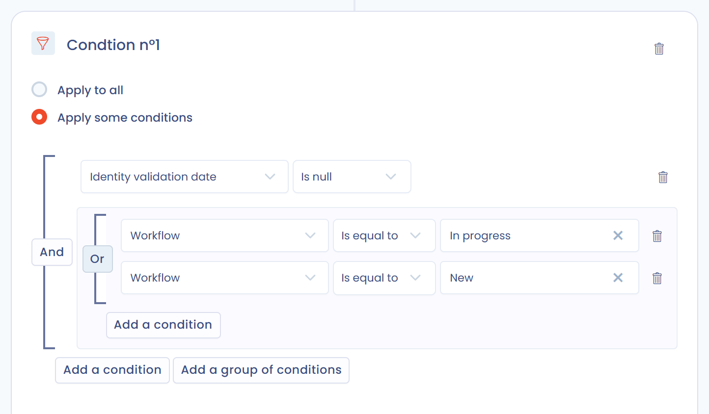
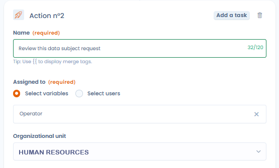
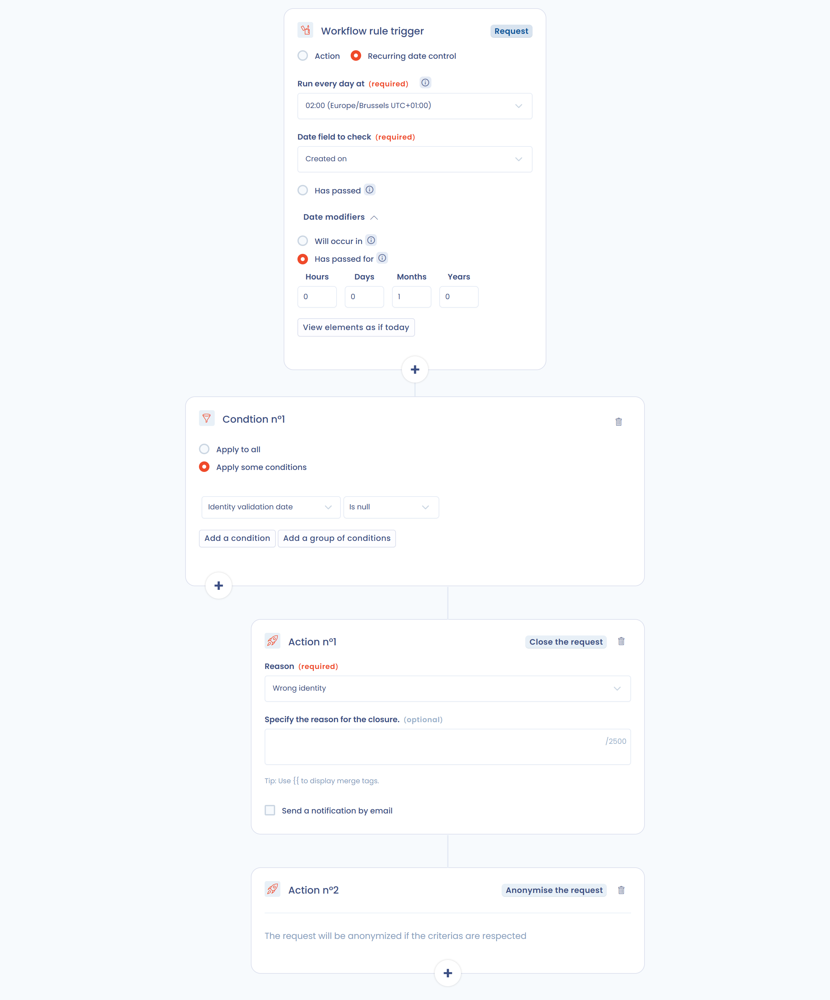
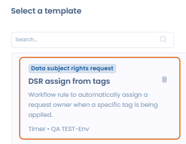
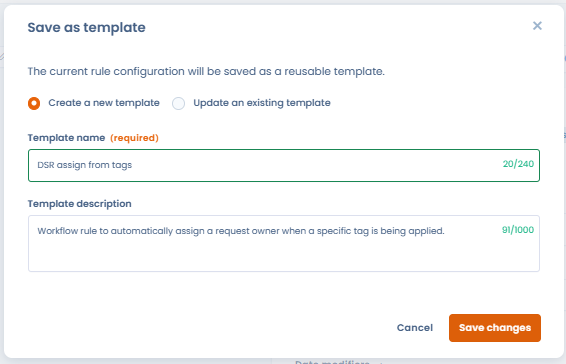

# Werkstroomregels


Workflowstappen en werkstroomregels

[Workflowstappen](workflow-stages.md) leggen de stappen vast die een object doorloopt (bijvoorbeeld van Nieuw naar In behandeling en daarna Afgerond). Werkstroomregels automatiseren acties wanneer die stappen of andere gebeurtenissen zich voordoen. De twee functies werken samen.


## Hoe het werkt

Een werkstroomregel is een reeks acties (e-mailmeldingen, het plannen van vragenlijsten, taken, veldwijzigingen enzovoort) die worden uitgevoerd wanneer aan bepaalde voorwaarden is voldaan. Ze automatiseert het verzenden van meldingen, het toewijzen van taken en het bijwerken van velden van een record.

Elke regel volgt een logica in drie delen: een trigger, voorwaarden en acties.

<figure><figcaption><p>Trigger, voorwaarden en acties</p></figcaption></figure>

Een regel is van toepassing op één objecttype. De aangeboden typen hangen af van de modules die in uw abonnement zijn ingeschakeld:

| Objecttype |
| --- |
| Verwerkingsactiviteit |
| Verzoek |
| Datalek |
| Taak |
| Activum |
| Stakeholder |
| Gegevensveld |
| Veiligheidsmaatregel |
| Categorie van betrokkenen |
| AI-systeem |
| Contract |
| Antwoord op een vragenlijst |


Het aantal beschikbare werkstroomregels hangt af van uw abonnement, van 25 tot 100 regels. Extra capaciteit kunt u aankopen. Neem voor meer informatie contact op met uw accountmanager.


## Een werkstroomregel aanmaken

1. Open in het zijmenu **Automations** en daarna **Regels voor de workflow**.
2. Klik op **Een werkstroomregel maken**.
3. Kies **Vanaf nul** om met een leeg canvas te beginnen, of **Vanaf een sjabloon** (zie [Sjabloonbibliotheek](#sjabloonbibliotheek)).
4. Vul de **Naam van de regel** en het **Soort element** in en bevestig.

De regelontwerper opent. Boven in het scherm schakelt de schakelaar **Status** de regel in of uit. De knoppen **Historiek** en **Ren** worden hieronder beschreven. Het menu van de knop **Opslaan** biedt ook **Opslaan en stoppen** en **Sla het sjabloon op**.

### Trigger

U kiest de trigger uit twee waarden:

* **Actie**: de regel gaat af wanneer zich een gebeurtenis voordoet op het object. De gebeurtenissen zijn **Creatie**, **Aanmaken of bewerken**, **Wijziging**, **Verwijderen of archiveren** en **Verandering van stadium**. Verwijderen of archiveren wordt niet aangeboden voor activa, stakeholders, gegevensvelden, veiligheidsmaatregelen en categorieën van betrokkenen.

<figure><figcaption><p>Een trigger op een actie aanmaken</p></figcaption></figure>

* **Terugkerende datumcontrole**: de regel wordt elke dag op een ingesteld tijdstip beoordeeld en gaat af op basis van een datumveld van het object. Stel het volgende in:

  * **Elke dag om**: het tijdstip van de dagelijkse controle, weergegeven met uw tijdzone (bijvoorbeeld 00:00 Europe/Paris).
  * **Controleer of de**: het datumveld dat wordt beoordeeld (bijvoorbeeld sluitingsdatum, aanmaakdatum, beoordelingsdatum).
  * Het moment waarop de regel afgaat, te kiezen uit:
    * **Is overschreden**: de regel gaat af op de dag waarop de datum wordt bereikt.
    * **Datum modifiers**, die een verschuiving aan de datum toevoegen:
      * **Zal worden overschreden in**: de regel gaat af N uren, dagen, maanden of jaren vóór de datum (bijvoorbeeld 30 dagen voordat een contract verloopt).
      * **Is overschreden sinds**: de regel gaat af N uren, dagen, maanden of jaren ná de datum (bijvoorbeeld 1 dag na de sluiting).

  De knop **Bekijk de betreffende items vandaag** toont een voorbeeld van de objecten die nu aan de regel zouden voldoen. Dat is nuttig om te testen voordat u de regel inschakelt.

<figure><figcaption><p>Een trigger op een terugkerende datumcontrole aanmaken</p></figcaption></figure>

Per regel kan maar één trigger worden gedefinieerd.

Bij de gebeurtenissen **Aanmaken of bewerken**, **Wijziging**, **Verwijderen of archiveren** en **Verandering van stadium** staat de optie **Voer de workflow slechts één keer per item uit (aanbevolen)** standaard aan. Wij raden sterk aan ze aan te laten staan: wanneer een regel meerdere keren op hetzelfde item draait, kunnen dubbele taken of herhaalde meldingen ontstaan.

### Voorwaarden

Een regel heeft maximaal vijf voorwaarden. Elke voorwaarde heeft haar eigen acties. Met de knoppen **+** van de ontwerper voegt u een voorwaarde toe.

Kies voor elke voorwaarde:

* **Geldt voor alle elementen**: de regel draait op elk item dat aan de trigger voldoet, zonder verdere filtering.
* **Specificeer voorwaarden**: filter op de waarde van een of meer velden van het object (bijvoorbeeld "Stap is gelijk aan Nieuw").

Voorwaarden kunnen elk veld van het object gebruiken en kunnen worden gegroepeerd, met de mogelijkheid om te wisselen tussen **En** en **of**. Met **Voeg een voorwaarde toe** voegt u een regel toe binnen een groep, en met **Voeg een groep voorwaarden toe** maakt u een afzonderlijk logisch blok.

<figure><figcaption><p>Hier wordt de actie uitgevoerd als de stap "Identiteitscontrole" of "Nieuw" is EN de validatiedatum van het e-mailadres is ingevuld</p></figcaption></figure>

### Acties

Om een actie toe te voegen klikt u op de knop **+** van een voorwaarde en kiest u de actie in het venster **Kies een actie om uit te voeren**. Een voorwaarde kan maximaal 20 acties bevatten. Daarboven is de knop om toe te voegen uitgeschakeld en meldt een bericht dat het maximum is bereikt.

<figure><figcaption><p>Een voorwaarde kan maximaal 20 acties bevatten</p></figcaption></figure>

Dit zijn de acties die u kunt activeren:

| Actie | Wat ze doet | Uitgesloten objecttypen |
| --- | --- | --- |
| **Een veld bewerken** | Een veld van het object bijwerken | |
| **Eigenaar definiëren** | Het object toewijzen aan een gebruiker, aan een lid van een team of aan een variabele van het object | Stakeholder, gegevensveld, veiligheidsmaatregel, categorie van betrokkenen, antwoord op een vragenlijst |
| **Voeg een taak toe** | Een taak aanmaken die aan het object is gekoppeld | |
| **Een melding verzenden** | Een melding per e-mail verzenden | |
| **Tag (s) toevoegen** | Een of meer tags aan het object toevoegen | Gegevensveld, antwoord op een vragenlijst |
| **Een antwoord op een vragenlijst plannen** | Automatisch een antwoord op een vragenlijst plannen | Antwoord op een vragenlijst |
| **Execute an AI agent** | Een AI-agent uitvoeren (zie [Een AI-agent uitvoeren](#een-ai-agent-uitvoeren)) | |
| **Stuur een Teams-notificatie** | Een kaart plaatsen in een Microsoft Teams-kanaal, als de Microsoft Teams-integratie is geïnstalleerd | |
| **Send an HTTP request** | De API van een extern platform aanroepen, als de integratie HTTP / Custom API is ingeschakeld | |

Voor verzoeken van betrokkenen zijn extra acties beschikbaar:

* **Een verzoekbericht verzenden**: een bericht naar de aanvrager sturen.
* **Het verzoek sluiten**
* **Het verzoek anonimiseren** (alleen beschikbaar als het verzoek is gesloten)

De actie **Verplaats naar prullenbak** is beschikbaar voor verzoeken en voor verwerkingsactiviteiten.


Voorbeeld: meerdere personen op de hoogte stellen wanneer een taak wordt aangemaakt. Kies het objecttype Taak en voeg, afhankelijk van de voorwaarden van de taak (bijvoorbeeld een tag die wordt toegevoegd), een actie **Een melding verzenden** toe.


### Organisatie-eenheid van een aangemaakte taak

De actie **Voeg een taak toe** bevat een veld **Organisatie-eenheid** dat bepaalt aan welke eenheid de aangemaakte taak wordt gekoppeld:

* **Standaard (geërfd van het object)**: de taak wordt gekoppeld aan de organisatie-eenheid van het triggerobject, als dat er een heeft. Deze waarde geldt wanneer het veld leeg blijft.
* Een specifieke eenheid: kies een eenheid in de boomstructuur. De taak wordt aan die eenheid gekoppeld, ongeacht de eenheid van het triggerobject.

Voor regels op repositoryobjecten (activa, gegevensvelden, veiligheidsmaatregelen, stakeholders, categorieën van betrokkenen), die geen organisatie-eenheid hebben, is het veld verplicht.

<figure><figcaption><p>De organisatie-eenheid kiezen van de taak die de regel aanmaakt</p></figcaption></figure>

### Toegewezen persoon en eigenaar van een aangemaakte taak

De actie **Voeg een taak toe** bevat de velden **Toegewezen aan** en **Eigenaar**. Elk veld accepteert een variabele van het triggerobject (de maker, de eigenaar, de verantwoordelijke enzovoort) of een gebruiker met naam. Als de variabele op het object niet is ingevuld, wordt de taak toch aangemaakt.

De variabele OU Owner geeft de taak aan de eigenaar van de organisatie-eenheid van het triggerobject. Heeft die eenheid geen eigenaar, dan wordt de eigenaar van de dichtstbijzijnde bovenliggende eenheid gebruikt. Heeft het object geen organisatie-eenheid, dan gebruikt de actie de in de actie gekozen Default organizational unit, met dezelfde regel. Wordt geen eigenaar gevonden, dan wordt de taak zonder toegewezen persoon aangemaakt, zonder de regel te blokkeren.

Om het werk over een team te spreiden, kiest u **Selecteer een gebruiker in het team** in de actie **Eigenaar definiëren** en selecteert u daarna het team bij **Selecteer een team**. Dastra kiest een gebruiker uit het team volgens het round-robinmodel: telkens wanneer de regel wordt uitgevoerd, wordt het volgende lid van het team gekozen.

### Een berichtsjabloon aan een actie koppelen

Voor regels die aan verzoeken van betrokkenen zijn gekoppeld, kan de actie **Een verzoekbericht verzenden** steunen op een bestaand berichtsjabloon in plaats van op handmatig ingevoerde inhoud.

<figure><figcaption><p>De actie Een verzoekbericht verzenden biedt Selecteer een sjabloon</p></figcaption></figure>

Klik in de actie op **Selecteer een sjabloon** en kies een sjabloon van het type Request message uit uw werkruimte. Wanneer de regel afgaat, wordt de inhoud van het sjabloon opgehaald en worden aangepaste variabelen (bijvoorbeeld `{{ givenName }}`, `{{ refId }}`) automatisch vervangen.

<figure><figcaption><p>Een sjabloon voor verzoekberichten kiezen uit de werkruimte</p></figcaption></figure>

* Het verzonden bericht gebruikt altijd de actuele versie van het sjabloon, ook als dat na het aanmaken van de regel wordt gewijzigd.
* Als het gekoppelde sjabloon wordt verwijderd, mislukt de uitvoering expliciet: het bericht wordt niet stilzwijgend overgeslagen.
* Regels met handmatige inhoud blijven ongewijzigd. U kunt op elk moment van een gekoppeld sjabloon terugkeren naar handmatige inhoud door op **Verwijderen** te klikken.

<figure><figcaption><p>Eenmaal gekoppeld kunt u het sjabloon wijzigen of loskoppelen. De variabelen worden bij de uitvoering vervangen</p></figcaption></figure>

### Een Teams-notificatie verzenden

Wanneer de [Microsoft Teams-integratie](../integrations/microsoft-teams.md) is geïnstalleerd en ingeschakeld in de werkruimte, plaatst de actie **Stuur een Teams-notificatie** een kaart in het Teams-kanaal dat aan de webhook is gekoppeld. U kiest geen ontvanger.

Vul de volgende velden in:

* **Titel van de kaart** (verplicht, maximaal 150 tekens).
* **Bericht**: opgemaakte tekst die in de kaart wordt weergegeven.
* **Een link naar het object in de kaart opnemen**: voegt een directe link naar het triggerobject in Dastra toe aan de kaart. Deze optie staat standaard aan.

De titel en het bericht accepteren aangepaste variabelen van het triggerobject: typ `{{` om de lijst met beschikbare variabelen te tonen (zie [Aangepaste variabelen in meldingen](#aangepaste-variabelen-in-meldingen)).


De actie verschijnt alleen in de lijst met acties wanneer de Microsoft Teams-integratie is geïnstalleerd en ingeschakeld. Als de integratie is verwijderd of uitgeschakeld, toont het actieformulier een waarschuwing: de actie mislukt totdat de integratie is geconfigureerd.


### Een HTTP-verzoek verzenden

De actie **Send an HTTP request** roept de API van een extern platform aan wanneer de regel afgaat: een ticketingtool, een ITSM-tool, een interne dienst of een automatiseringshub. Gebruik ze wanneer er geen native connector bestaat voor uw tool.

Vereiste: de integratie [HTTP / Custom API](../integrations/custom-http.md) is ingeschakeld in **Instellingen voor werkruimte** > **Integraties**, met een verbinding voor het doelplatform (API-sleutel, basisreferenties of OAuth 2.0). Voor het toevoegen of bewerken van deze actie is het recht Integrations op de werkruimte nodig.

Vul de volgende velden in:

* **Method** (GET, POST, PUT, PATCH of DELETE) en een absolute **URL** (`https://…`). De host ligt vast. Het pad en de querystring kunnen variabelen bevatten.
* Tabblad **Authentication**: de te gebruiken verbinding, of **No authentication** voor een openbaar eindpunt. De referenties blijven op de verbinding staan en nooit in de regel.
* Tabblad **Headers**: maximaal 20 headers, waarvan de waarden variabelen accepteren.
* Tabblad **Body** (POST, PUT en PATCH): een **JSON**- of **XML**-body, geschreven als sjabloon.

Typ `{{` in de URL, in een header of in de body om de velden van het triggerobject in te voegen (zie [Aangepaste variabelen in meldingen](#aangepaste-variabelen-in-meldingen)). De gerenderde body moet geldige JSON of XML zijn. Anders wordt niets verzonden en wordt de uitvoering als fout gelogd.

* **Test the request** rendert het verzoek met een echt object van de werkruimte. **Preview** verzendt niets. **Send the request** voert de echte aanroep uit en toont het antwoord van het doel.
* **Generate with AI** stelt het verzoek op uit een instructie en de payload die het doel verwacht. Alleen veldnamen en typen worden met de assistent gedeeld, nooit uw gegevens of referenties.

<figure><figcaption><p>De actie Send an HTTP request</p></figcaption></figure>


Als u de integratie HTTP / Custom API uitschakelt of verwijdert, of als u een verbinding verwijdert, worden de regels die ervan afhangen automatisch uitgeschakeld. Schakel ze opnieuw in zodra de afhankelijkheid is hersteld. Elk verzonden verzoek wordt vastgelegd in de logboeken van de integratie.


### Een AI-agent uitvoeren

De actie **Execute an AI agent** voert een [AI-agent](../general/ai-assistant/agents/README.md) van uw werkruimte uit wanneer de regel afgaat. Ze is voorbehouden aan abonnementen met aangepaste AI-agents en aan gebruikers die die mogen beheren.

Vul de volgende velden in:

* **AI agent to execute**: alleen agents die in de modus Agent zijn gepubliceerd, worden aangeboden. Is de lijst leeg, maak dan eerst een agent aan in de module AI Agents.
* **Instruction message**: een optioneel bericht dat bij elke uitvoering naar de agent wordt gestuurd. Het accepteert aangepaste variabelen van het triggerobject (typ `{{`).
* **Agent input fields**: de door de agent gedefinieerde velden verschijnen nadat u die hebt geselecteerd. Vul minstens de verplichte velden in.

### Aangepaste variabelen in meldingen

In bijvoorbeeld aangepaste meldingen is het vaak nuttig om informatie uit het object dat in de werkstroom terechtkwam, in te voegen: de naam van een verwerkingsactiviteit of de publicatiedatum ervan zijn variabelen die u met het variabelensysteem in de tekst kunt invoegen. Dastra gebruikt een templating-engine op basis van [LiquidJS](https://shopify.github.io/liquid/basics/introduction/).

Typ `{{` om de variabelen van het triggerobject te raadplegen: de lijst met beschikbare variabelen wordt getoond. De aangepaste velden van de werkruimte zijn beschikbaar als `customFields.<key>`.

Een tekstvariabele weergeven (de referentie van een verwerkingsactiviteit):

```
{{ref}}
```

Alle waarden van een lijstvariabele weergeven (de tags):

```

  {{ tag.label }}

```

Alleen de eerste waarde van een lijstvariabele weergeven (de eerste verantwoordelijke van een verwerkingsactiviteit):

```

{{accountable.displayName}}
```

### Voorbeelden

#### Voorbeeld van een werkstroom op basis van een actie

Dit voorbeeld stelt de verantwoordelijken van een verwerkingsactiviteit op de hoogte wanneer de stap verandert, zolang de huidige stap niet "Nieuw" is.

<figure><figcaption></figcaption></figure>

#### Voorbeeld van een werkstroom op basis van een datum

Dit voorbeeld ruimt automatisch verzoeken van betrokkenen op waarvan de identiteit van de aanvrager een maand na de aanmaak niet is gevalideerd.

<figure><figcaption><p>Sluit en anonimiseer elke dag de verzoeken waarvan de identiteit van de aanvrager een maand na de aanmaak niet is gevalideerd</p></figcaption></figure>

## Uitvoeringsgeschiedenis

Elke regel bewaart de geschiedenis van haar uitvoeringen. Klik in de ontwerper op **Historiek** om voor elk verwerkt object het volgende te zien:

* **Laatste uitvoeringsdatum**
* **Status**
* **Aantal uitvoeringen**
* Het resultaat: **Succes**, **Laatste uitvoering in fout** of **Fout**, met het aantal fouten

Het menu van elke rij biedt:

* **Gerelateerd object bekijken**: het object openen dat de regel heeft getriggerd.
* **De uitvoering van de regel opnieuw starten**: de regel opnieuw op hetzelfde object uitvoeren.
* **Reset**: het geschiedenisitem van dit object verwijderen.

## Handmatige uitvoering

U kunt een regel op elk moment uitvoeren met de knop **Ren** van de ontwerper, of met **Workflow uitvoeren** in het menu van de knop **Opslaan**. Een venster vraagt u het object te selecteren waarop de regel moet draaien. De trigger wordt genegeerd: alleen de voorwaarden en de acties worden toegepast.

Handmatige uitvoering is nuttig om een regel te testen of om haar toe te passen op een object dat vóór de regel is aangemaakt. Ze is pas beschikbaar nadat de regel is opgeslagen.

## Sjabloonbibliotheek

De bibliotheek met sjablonen voor werkstroomregels bundelt twee bronnen:

* De standaardbibliotheek van Dastra: kant-en-klare regels voor de meest voorkomende automatiseringsscenario's (afhandeling van datalekken, verlopen van contracten, beoordelingen van leveranciers, levenscyclus van verzoeken van betrokkenen enzovoort). Dastra onderhoudt en actualiseert ze.
* De eigen sjablonen van uw organisatie: elke regel die uw team als sjabloon heeft opgeslagen. Ze verschijnen in dezelfde bibliotheek en kunnen door elke gebruiker van de werkruimte worden hergebruikt.

U kunt sjablonen filteren op objecttype en taal.

### Een regel aanmaken op basis van een sjabloon

Kies bij het aanmaken van een regel **Vanaf een sjabloon** om te beginnen met een kant-en-klare configuratie in plaats van met een leeg canvas.

<figure><figcaption><p>Kies ervoor om met een sjabloon te beginnen in plaats van met een leeg canvas</p></figcaption></figure>

<figure><figcaption><p>Een sjabloon kiezen uit de bibliotheek</p></figcaption></figure>

### Een regel als sjabloon opslaan

Open een bestaande werkstroomregel, open het menu van de knop **Opslaan** en klik op **Sla het sjabloon op**. Geef het een naam en een beschrijving en bevestig. Het sjabloon is meteen beschikbaar in de bibliotheek en kan door elke gebruiker van de werkruimte worden hergebruikt.

<figure><figcaption><p>Een werkstroomregel opslaan als herbruikbaar sjabloon</p></figcaption></figure>

Dat is nuttig om automatiseringsregels binnen de organisatie te standaardiseren en te voorkomen dat u identieke werkstromen telkens opnieuw opbouwt op elk object of elke entiteit.
