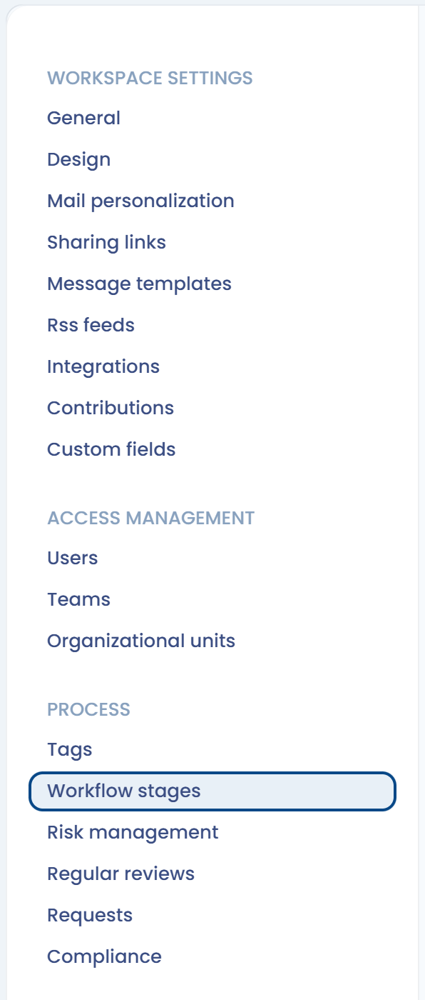
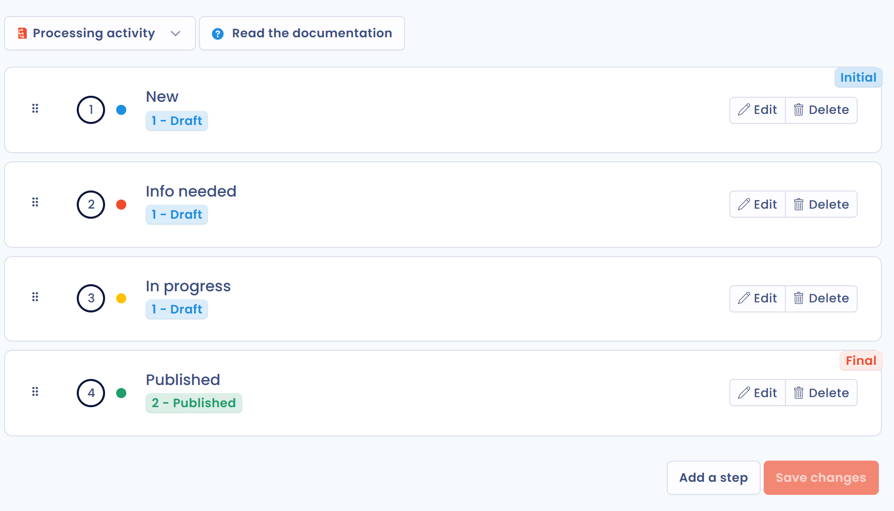

# Workflowstappen


Workflowstappen en workflowregels

Workflowstappen bepalen de statussen waarlangs objecten gaan. Om acties te automatiseren wanneer een stap verandert (een melding versturen, een taak aanmaken...), zie [Werkstroomregels](workflow-rules.md).


## Doel van workflowstappen

Workflowstappen modelleren een werkproces: objecten gaan van de ene stap naar de volgende. U kunt uw nalevingsprocedures operationeel opdelen door de te volgen stappen rechtstreeks in Dastra te definiëren.

Elk objecttype heeft zijn eigen set configureerbare stappen:

* Verzoeken van betrokkenen
* Datalekken
* Taken
* Verwerkingsactiviteiten
* Activa
* Stakeholders
* Gegevensvelden
* Beveiligingsmaatregelen
* Categorieën van betrokkenen
* AI-systemen
* Contracten

Elke stap is gekoppeld aan een **Interne werkstroomfase** die afhangt van het objecttype. Voor een verwerkingsactiviteit zijn de statussen bijvoorbeeld "concept" en "gepubliceerd".

## Workflowstappen aanpassen

Klik in het zijmenu op **Instellingen voor werkruimte** en klik daarna in het gedeelte **Proces** op **Processtroom**. Deze pagina is voorbehouden aan gebruikers die geavanceerde instellingen mogen beheren.

<figure><figcaption>
De vermelding Processtroom in de instellingen voor de werkruimte
</figcaption></figure>

Kies het objecttype in de lijst boven aan de pagina: u ziet de stappen die voor dat proces beschikbaar zijn, met hun interne status. Pas ze aan de processen van uw organisatie aan en klik daarna op **Opslaan**.

* Klik op **Bewerken** bij een stap om de naam, de beschrijving of de interne status te wijzigen, en om het bewerken van het object in deze stap voor te behouden aan gebruikers met een bepaalde rol.
* Klik op **Een stap toevoegen** om een nieuwe stap aan te maken.
* Sleep een stap om de volgorde te wijzigen. De eerste stap draagt het label **Initial** en de laatste het label **Final**.

<figure><figcaption>
De stappen van de workflow voor verwerkingsactiviteiten
</figcaption></figure>

## Een workflowstap verwijderen

Klik om een stap te verwijderen op **Verwijderen** naast de stap en bevestig.

Objecten die op dat moment aan de verwijderde stap zijn gekoppeld, worden automatisch opnieuw toegewezen aan de eerste stap met dezelfde interne status.

Als u bijvoorbeeld de stap "In uitvoering" in de taakworkflow verwijdert:

<figure><figcaption>
De taakworkflow voordat de stap "In uitvoering" wordt verwijderd
</figcaption></figure>

Dan gaan de eraan gekoppelde objecten naar de eerste stap met dezelfde status, bijvoorbeeld "Info nodig":

<figure><figcaption>
De taakworkflow na het verwijderen
</figcaption></figure>
