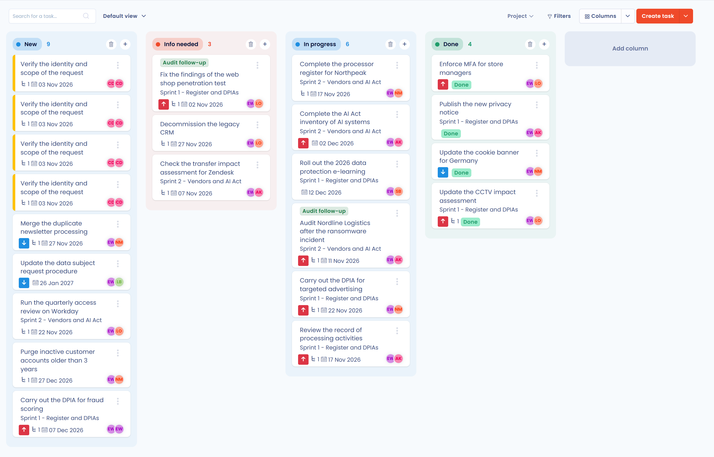

# Planning

De planningsmodule bundelt de taken van het actieplan van uw werkruimte. U maakt taken aan, wijst ze toe, volgt hun voortgang en exporteert ze. De module is bedoeld voor functionarissen voor gegevensbescherming (FG's) en compliance-teams die moeten aantonen wat ze hebben gedaan.

## Waarom een actieplan bijhouden

Artikel 24 van de AVG formuleert het beginsel van verantwoordingsplicht:

> (...) treft de verwerkingsverantwoordelijke passende technische en organisatorische maatregelen om te waarborgen en te kunnen aantonen dat de verwerking in overeenstemming met deze verordening wordt uitgevoerd.

Zodra een organisatie haar verwerkingsactiviteiten in kaart heeft gebracht en beoordeeld, moet ze technische en organisatorische maatregelen nemen om ze te beschermen. De verordening verplicht u om de naleving aan te tonen, zonder precieze indicatoren te geven. Een duidelijk, gedeeld en traceerbaar actieplan levert concreet bewijs: elke taak heeft een toegewezen persoon, een vervaldatum, een stap en een geschiedenis.

## De module openen

Klik in het zijmenu op **Planning**. Het menu klapt uit tot vijf pagina's:

* **Taken**: de lijst met taken, met de weergaven Kolommen, Tabel, Boomstructuur en Kalender;
* **Statistieken**: indicatoren en voortgangsgrafieken;
* **Huidige iteratie**: de taken van de lopende iteratie;
* **Projecten**: de projecten waarin taken worden gegroepeerd;
* **Iteraties**: de werkperioden.

<figure><figcaption>
De pagina's van de planningsmodule in het zijmenu
</figcaption></figure>

De pagina **Taken** opent standaard in de weergave **Kolommen**, waarin de taken per stap zijn ingedeeld.

<figure><figcaption>
De pagina Taken in de weergave Kolommen
</figcaption></figure>


De vermelding **Planning** verschijnt alleen als uw rol toegang geeft tot taken en de module voor uw organisatie is ingeschakeld.


## Verder gaan


[Een taak aanmaken of bewerken](create.md)



[Een project of een iteratie aanmaken of bewerken](projects.md)



[Taken volgen, filteren of exporteren](export.md)



[De takenworkflow aanpassen](workflow.md)



[Delen als kalender](calendar-sync.md)



[Veelgestelde vragen](faq.md)

