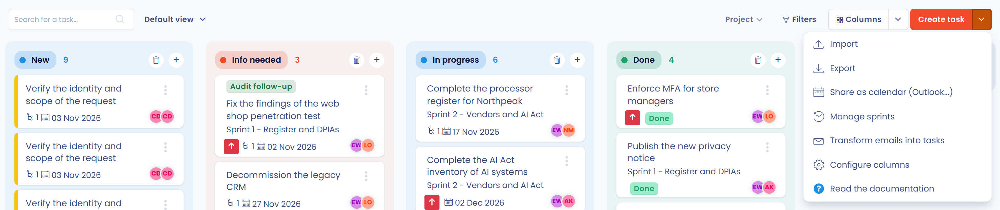
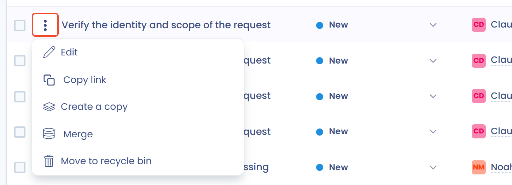
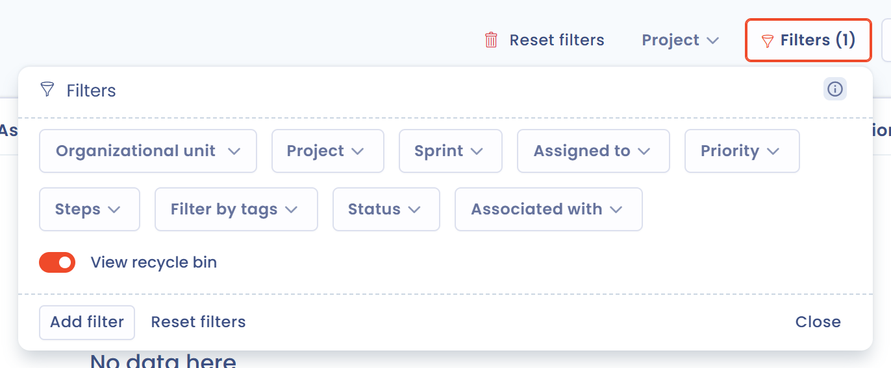

# Een taak aanmaken of bewerken

In Dastra is een taak een stuk werk dat moet worden uitgevoerd. Ze heeft een uitvoerder, een vervaldatum en een opvolgstap. Op deze pagina leest u hoe u een taak aanmaakt, toewijst, bewerkt en verwijdert.

## Een taak aanmaken

U kunt op drie manieren een taak aanmaken:

* vanaf de pagina **Taken** van de planningsmodule;
* vanuit het dossier van een ander element van de toepassing;
* vanuit een e-mail die op een verzameladres is ontvangen.

### Vanuit de planningsmodule

1. Klik in het zijmenu op **Planning** en kies vervolgens **Taken** in het submenu.
2. Klik op **Taak maken**. Het paneel **Nieuwe taak** opent aan de rechterkant van het scherm.

<figure><figcaption>
De knop Taak maken en de acties van het bijbehorende menu
</figcaption></figure>

3. Vul de **Taaktitel** (maximaal 120 tekens) en de **Organisatie-eenheid** in, die verplicht zijn. Vul de overige velden naar behoefte aan.
4. Klik op **Opslaan**. Om meerdere taken na elkaar aan te maken, klikt u op **Sla op en en maak een nieuwe**.

<figure><figcaption>
Het paneel voor het aanmaken van een taak
</figcaption></figure>

Het paneel bevat:

* **Organisatie-eenheid**: vooraf ingevuld met de eenheid die in de werkruimte is geselecteerd, of met de eerste beschikbare eenheid;
* **Project**, **Iteratie** en **Labels** om de taak te classificeren;
* **Toegewezen aan**, **Begin datum** en **Vervaldatum**;
* **Prioriteit** en **Interne referentie**, in het uitklapbare deel van het paneel;
* de aangepaste velden die u aan taken hebt toegevoegd.

### Een taak aan elementen koppelen

Een taak kan aan een of meer elementen van de toepassing worden gekoppeld. Klik in het paneel op **Een element associëren**, kies het type element en daarna een of meer elementen van dat type. De gekoppelde elementen staan onder **Geassocieerde elementen**.

De beschikbare typen zijn:

* **Gegevensverwerking**;
* **Verzoek om rechten uit te oefenen**;
* **Datalek**;
* **Responding to a questionnaire**;
* **Stakeholder**;
* **Actief**;
* **Dataset**;
* **Risicobeoordeling**;
* **Controlepunt**;
* **Veiligheidsmaatregel**;
* **AI-systeem**;
* **Contract**;
* **Veld voor persoonlijke gegevens**;
* **Categorie van de betrokken persoon**;
* **Conformiteitsproject**;
* **Conformiteitsaudit**.

U vindt de taak vervolgens terug in het dossier van elk van deze elementen (zie hieronder). Het filter **Geassocieerd met** van de pagina **Taken** toont de taken die aan een bepaald type element zijn gekoppeld.

### Vanuit het dossier van een ander element

De dossiers van verwerkingsactiviteiten, verzoeken van betrokkenen, datalekken, stakeholders, activa, datasets, veiligheidsmaatregelen, contracten, AI-systemen, controlepunten en risicobeoordelingen hebben een taakknop: een lijstpictogram met een vinkje en het aantal gekoppelde taken.

1. Open het dossier van het element.
2. Klik op de taakknop. Het paneel **Gekoppelde taken** toont de taken die aan dit element zijn gekoppeld, met filters op stap en op label.
3. Klik op **Taak maken**. De taak wordt aan het element gekoppeld en neemt de organisatie-eenheid ervan over.

<figure><figcaption>
Het paneel Gekoppelde taken in het dossier van een verwerkingsactiviteit
</figcaption></figure>

De knop **Toon in planning** van het paneel opent de pagina **Taken** met de taken van het element.


Een actieplan kan ook worden gegenereerd op basis van een gevalideerde vragenlijst. Zie [Vragenlijsten opvolgen](../questionnaires/monitor.md).


### Vanuit een e-mail

Dastra kan elke e-mail die op een verzameladres is ontvangen, met de bijlagen ervan omzetten in een taak. Om het adres in te stellen, klikt u op de pijl van de knop **Taak maken** en vervolgens op **Transformeer e-mails in taken**. De instellingenpagina opent onder **Instellingen voor werkruimte** > **Integraties**. Zie [Gegevens verzamelen via inkomende e-mail](../settings/mailboxes.md). Voor dit item hebt u het recht nodig om integraties te beheren.

### Subtaken aanmaken

Een taak kan een lijst met subtaken bevatten. Sla de taak eerst op: de knop **Voeg een subtaak toe** blijft inactief zolang de taak niet bestaat. Bewerk de taak daarna en klik op **Voeg een subtaak toe**.

<figure><figcaption>
De subtaken van een taak
</figcaption></figure>

Wanneer alle subtaken zijn gesloten, stelt Dastra voor om de hoofdtaak te sluiten.

## Een taak toewijzen

Twee velden geven aan welke personen betrokken zijn:

* **Toegewezen aan**: de persoon die de taak uitvoert. Standaard bent u dat zelf wanneer u de taak aanmaakt;
* **Eigenaar**: de persoon die verantwoordelijk is voor de taak. Die persoon ontvangt een melding wanneer de stap verandert.

Het veld **Eigenaar** staat in het uitklapbare deel van het paneel. Elke gebruiker ontvangt meldingen volgens de eigen voorkeuren: zie [Meldingen](../settings/notifications.md). Om iemand op te volgen, vermeldt u die persoon in de discussie van de taak (zie de [Veelgestelde vragen](faq.md)).

## Een taak bewerken

Om een taak te bewerken, klikt u erop: het paneel **Een taak bewerken** opent. In de weergave **Tabel** kunt u ook op de drie puntjes rechts van de rij klikken en vervolgens op **Bewerken**.

<figure><figcaption>
Het menu van een taak in de weergave Tabel
</figcaption></figure>

Dit menu biedt ook **Link kopiëren**, **Dupliceren**, **Samenvoegen** en **Verplaats naar de prullenbak**. **Dupliceren** kopieert de taak en de subtaken ervan: de titel van de kopie eindigt op " - copy".


Om de stap van een taak te wijzigen, sleept u de taak in de weergave **Kolommen** naar een andere kolom. De standaardstappen zijn **NIEUW**, **Informatie behoeften**, **Aan de gang** en **Klaar**. Om ze te wijzigen, klikt u op de pijl van de knop **Taak maken** en vervolgens op **Kolommen instellen**: zie [De takenworkflow aanpassen](workflow.md).


### Een taak naar Jira sturen

Wanneer de Jira-integratie voor taken actief is, biedt het actiemenu van de taak **Send to Jira**. Zie [Jira](../integrations/jira.md).

## Een taak naar de prullenbak verplaatsen of verwijderen

Een taak die naar de prullenbak is verplaatst, is niet verwijderd: ze toont de vermelding **In de prullenbak** en verdwijnt uit de lijsten. U kunt ze op elk moment herstellen.

1. Klik in het drie-puntjesmenu van de taak, of in het actiemenu van het paneel, op **Verplaats naar de prullenbak** en bevestig.
2. Om de taken in de prullenbak te vinden, opent u **Filters** en selecteert u **Bekijk prullenbak**.

<figure><figcaption>
Het filter Bekijk prullenbak
</figcaption></figure>

3. Klik in het menu van de taak op **Herstellen** om ze terug in de lijst te zetten, of op **Verwijderen** en bevestig om ze te verwijderen.

<figure><figcaption>
De acties van een taak in de prullenbak
</figcaption></figure>


Het verwijderen van een taak is definitief. De subtaken worden samen met de taak verwijderd.


Om taken te verwijderen zonder via de prullenbak te gaan, zie de [Veelgestelde vragen](faq.md).

## Verder gaan


[Een project of een iteratie aanmaken of bewerken](projects.md)

