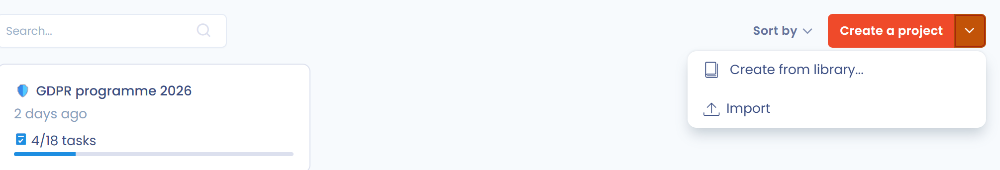

# Een project of een iteratie aanmaken of bewerken

In Dastra:

* groepeert een project taken, meestal rond een functioneel toepassingsgebied;
* groepeert een iteratie taken die binnen een bepaalde periode moeten worden uitgevoerd. In het Engels heet hetzelfde concept een sprint.

Een taak kan tot een project en tot een iteratie behoren: dit zijn de velden **Project** en **Iteratie** van het taakpaneel.

## Een project aanmaken of bewerken

1. Klik in het zijmenu op **Planning** en vervolgens op **Projecten**.
2. Klik op **Maak een project**. Vul de **Naam** van het project in, eventueel met een emoji, en een optionele beschrijving, en klik vervolgens op **Opslaan**.

Om een bestaand project te bewerken, klikt u op de drie puntjes op de kaart ervan en vervolgens op **Bewerken**.

<figure><figcaption>
De pagina Projecten
</figcaption></figure>

Elke projectkaart toont het aantal gesloten taken ten opzichte van het totale aantal taken. Klik op de naam van het project om de taken ervan op de pagina **Taken** weer te geven.

### Projectacties

Het drie-puntjesmenu van een kaart biedt:

* **Taken bekijken**: opent de pagina **Taken**, gefilterd op het project;
* **Het project dupliceren**: maakt een kopie van het project;
* **Bewerken**;
* **Verplaats naar de prullenbak**: verwijdert het project uit de lijst. Selecteer **Bekijk prullenbak** in de filters om het terug te vinden en klik vervolgens op **Herstellen** of **Verwijderen**;
* **Exporteren**: downloadt het project in het gekozen formaat (CSV, XLSX, JSON of MD).

<figure><figcaption>
Het menu van een project
</figcaption></figure>

### Een project importeren of op basis van een sjabloon aanmaken

De pijl van de knop **Maak een project** opent twee items:

* **Maak vanuit de bibliotheek**: maakt een project aan op basis van de bibliotheek met sjablonen;
* **Importeren**: opent het venster **Importeer een project**, waarin u projecten in JSON-formaat selecteert. Het bestand moet het projectsjabloon van Dastra volgen. Om dat te zien, exporteert u eerst een van uw projecten als JSON en opent u het bestand.

## Een iteratie aanmaken of bewerken

1. Klik in het zijmenu op **Planning** en vervolgens op **Iteraties**.
2. Klik op **Maak een iteratie**. Vul de **Naam van de iteratie**, de **Startdatum** en de **Einddatum** in en klik vervolgens op **Opslaan**.

Om een iteratie te bewerken, klikt u op de drie puntjes op de kaart ervan en vervolgens op **Bewerken**. Hetzelfde menu laat u de taken van de iteratie bekijken (**Taken bekijken**) of de iteratie verwijderen (**Verwijderen**). Een iteratie die loopt, toont de vermelding **Aan de gang**, een afgelopen iteratie de vermelding **Verleden**.

<figure><figcaption>
De pagina Iteraties
</figcaption></figure>

Vanaf de pagina **Taken** biedt het menu van de pijl van de knop **Taak maken** ook **Iteraties beheren**, dat deze pagina opent.

### De taken van de huidige iteratie bekijken

In het menu **Planning** toont de pagina **Huidige iteratie** alle taken van de iteratie die loopt.

<figure><figcaption>
De pagina Huidige iteratie
</figcaption></figure>

## Verder gaan


[Taken volgen, filteren of exporteren](export.md)

