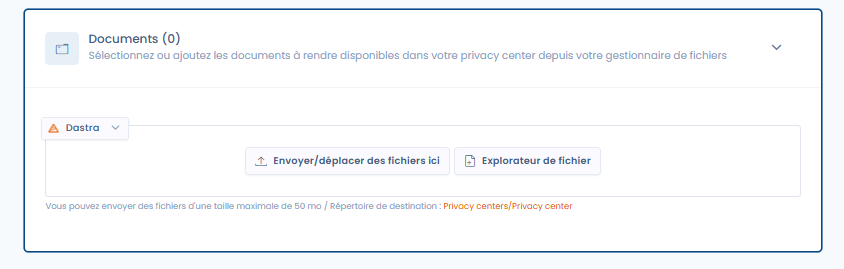

# Documenten

**De functie "Documenten" activeren in uw Trust Center**

Om de functie **Documenten** in uw Trust Center te activeren, raadpleegt u de sectie algemene configuratie waarmee u deze optie kunt activeren of deactiveren. Eenmaal geactiveerd, wordt er een nieuwe openbare pagina met de naam "Documenten" aan uw Trust Center toegevoegd.

<figure><figcaption>
Het configuratietabblad voor documenten
</figcaption></figure>

#### Documenten toevoegen aan uw Trust Center

Voeg bestanden toe in dit tabblad (door ze te uploaden of te selecteren uit uw bestaande bestanden in het documentbeheer) om ze openbaar beschikbaar te stellen in het tabblad Documenten van uw Trust Center (voor raadpleging en download).

[Meer informatie over documentbeheer in Dastra.](../../files/README.md)
