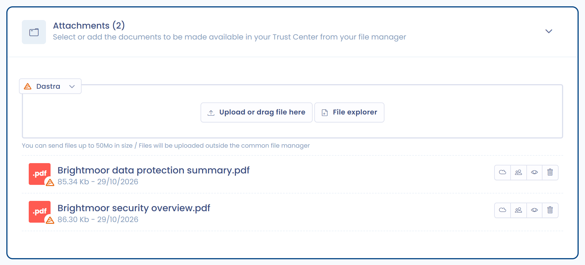

# Bijlagen

Deze pagina legt uit hoe u documenten beschikbaar stelt aan de bezoekers van uw Trust Center.

## De functie activeren

Vink **Bijlagen** aan in het onderdeel **Configuratie**, zoals uitgelegd in [Startpagina en algemene configuratie](home.md). Aan uw Trust Center wordt dan een openbare pagina **Bijlagen** toegevoegd en op de bewerkingspagina wordt het onderdeel **Documenten** ontgrendeld.

<figure><figcaption>
Het configuratieonderdeel voor bijlagen
</figcaption></figure>

## Bijlagen toevoegen aan uw Trust Center

Voeg in het onderdeel **Documenten** bestanden toe door ze te uploaden of door ze te selecteren uit de bestaande bestanden van het documentbeheer. Ze worden dan vermeld op de openbare pagina **Bijlagen** van uw Trust Center. Bestanden die vanuit dit onderdeel worden geüpload, worden opgeslagen in de map **Vertrouwenscentra** van het documentbeheer.

Standaard moet een bezoeker toegang tot een document aanvragen voordat het kan worden gedownload. Om dit gedrag te wijzigen, zie [Beveiliging](security.md).

[Meer informatie over documentbeheer in Dastra.](../../files/README.md)
