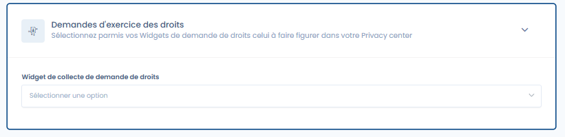

# Uitoefening van rechten

**De functie "Uitoefening van rechten" activeren in uw Trust Center**

Om de functie **Uitoefening van rechten** in uw Trust Center te activeren, raadpleegt u de sectie algemene configuratie waarmee u deze optie kunt activeren of deactiveren. Eenmaal geactiveerd, wordt er een nieuwe openbare pagina met de naam "Uitoefening van rechten" aan uw Trust Center toegevoegd.

<figure><figcaption>
Het configuratietabblad van de functie Uitoefening van rechten in uw Trust Center
</figcaption></figure>

#### Vereisten

Om een widget voor de uitoefening van rechten in uw Trust Center te kunnen weergeven, moet de module "Uitoefening van rechten" deel uitmaken van uw abonnement en moet u eerst [een verzamelwidget hebben geconfigureerd en gepubliceerd](../../gerer-les-exercices-des-droits/implementez-un-widget-dexercice-des-droits.md).

**Widget voor het verzamelen van verzoeken om rechten uit te oefenen**

In dit veld selecteert u het verzamelformulier voor verzoeken dat in uw Trust Center wordt weergegeven. Let op: per Trust Center kan slechts één verzamelformulier worden weergegeven.
