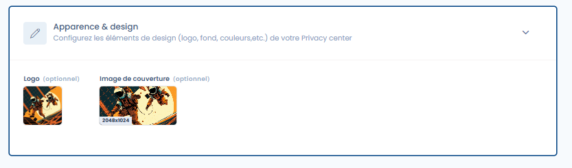

# Uiterlijk en ontwerp

<figure><figcaption>
Het tabblad waarmee u de ontwerpelementen van uw Trust Center configureert
</figcaption></figure>

#### Logo (optioneel)

U kunt een logo van uw keuze (vierkant formaat) aan uw Trust Center toevoegen. Dit logo wordt weergegeven in de koptekst van uw Trust Center, naast de naam ervan. Zonder logo wordt alleen de naam van uw Trust Center weergegeven.

#### Omslagafbeelding (optioneel)

U kunt een omslagafbeelding van uw keuze (rechthoekig formaat) aan uw Trust Center toevoegen. Indien opgegeven, wordt deze weergegeven in de koptekst van uw Trust Center, boven het logo en de titel ervan.
