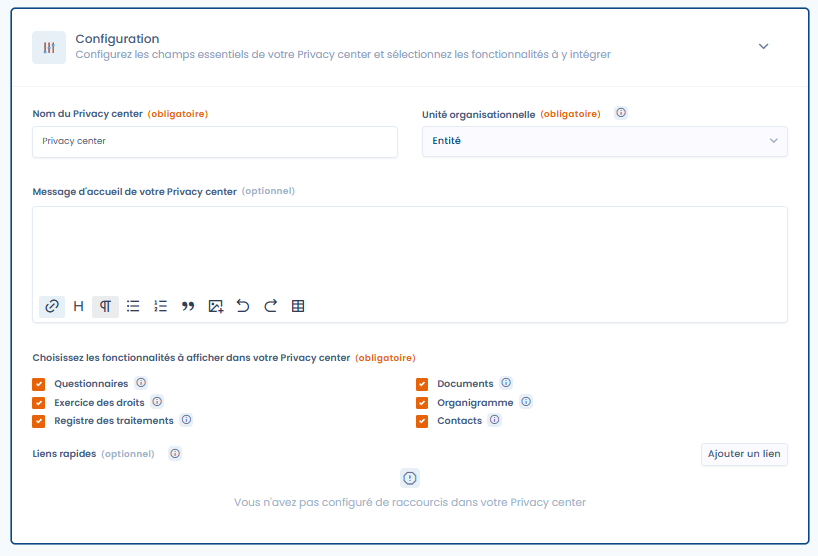

# Startpagina en algemene configuratie

Met het tabblad "Configuratie" op de bewerkingspagina van een Trust Center configureert u de essentiële opties van uw Trust Center.

<figure><figcaption></figcaption></figure>

#### Naam van het Trust Center

De naam van het Trust Center wordt weergegeven in de koptekst en op elke pagina van uw portaal.

#### Organisatorische eenheid

Het is essentieel om uw Trust Center aan een organisatorische eenheid te koppelen. Deze keuze heeft direct invloed op alle functies die in de hub zijn geactiveerd. Raadpleeg voor meer details over de impact van deze selectie de configuratiepagina van elke functie.

#### Welkomstbericht van uw Trust Center

Met dit tekstveld met opmaak (HTML) kunt u het welkomstbericht aanpassen met opmaakopties en er afbeeldingen of video's in opnemen. Dit bericht wordt weergegeven op de openbare startpagina van uw Trust Center.

#### Functies van het Trust Center

Selecteer in deze sectie de functies die u in uw Trust Center wilt activeren (afhankelijk van de opties in uw abonnement). Door het selectievakje van een functie aan te vinken, wordt deze beschikbaar in uw hub. Als er een specifieke configuratie vereist is, ontgrendelt het aangevinkte vakje een uitklapbare sectie met instellingen, zodat u de functie rechtstreeks vanaf de bewerkingspagina van de Privacy Hub kunt configureren. Raadpleeg de onderstaande documentatiepagina's voor de details van de configuratie van elke functie.

#### Snelle links

U kunt omleidingslinks aan uw Trust Center toevoegen door op de knop "Link toevoegen" te klikken. Elke link bestaat uit een emoji (optioneel), een naam en een doel-URL. Met deze functie kunt u snelkoppelingen naar externe bronnen buiten uw hub aanmaken. De links verschijnen in een zijmenu op de startpagina van uw Trust Center en worden in een nieuw venster geopend wanneer uw gebruikers erop klikken.
