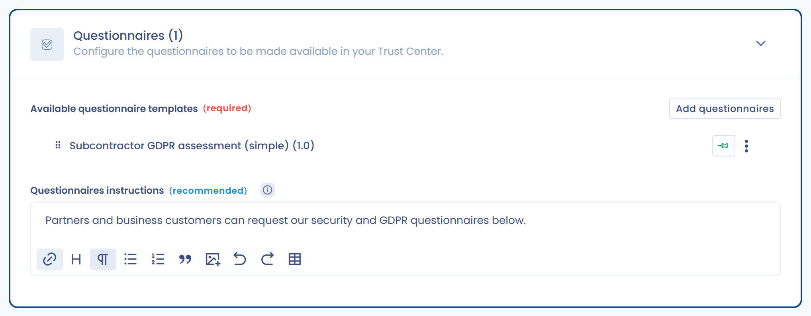

# Vragenlijsten

Deze pagina legt uit hoe u vragenlijsten beschikbaar stelt aan de bezoekers van uw Trust Center.

## De functie activeren

Vink **Vragenlijsten** aan in de sectie **Configuratie**, zoals uitgelegd in [Startpagina en algemene configuratie](home.md). Er wordt dan een openbare pagina **Vragenlijsten** aan uw Trust Center toegevoegd, en de sectie **Vragenlijsten** wordt ontgrendeld op de bewerkingspagina.

<figure><figcaption>
De configuratiesectie voor de vragenlijsten van uw Trust Center
</figcaption></figure>

## Een vragenlijst toevoegen

1. Klik in de sectie **Vragenlijsten** op **Vragenlijsten toevoegen**.
2. Kies in het selectievenster een of meer vragenlijsten. Dit zijn de vragenlijsten die u hebt geïnstalleerd in de module Vragenlijsten van deze werkruimte.
3. Klik op **Toevoegen** om te bevestigen.

<figure><figcaption>
Het selectievenster voor vragenlijsten
</figcaption></figure>

U kunt op elk moment vragenlijsten verwijderen of andere toevoegen. De toegevoegde vragenlijsten zijn zichtbaar op de openbare pagina **Vragenlijsten**.

## Instructies voor de vragenlijsten

Het veld **Vragenlijsten instructies** is een tekstveld met opmaak. Hiermee kunt u de tekst opmaken en er afbeeldingen of video's in opnemen. Het bericht wordt weergegeven op de openbare pagina **Vragenlijsten**, boven de lijst met vragenlijsten.

## Vragenlijsten hernoemen

Standaard hebben de vragenlijsten in uw Trust Center dezelfde naam als het geïnstalleerde sjabloon. Om de naam en beschrijving in het portaal te wijzigen zonder het oorspronkelijke sjabloon aan te passen, opent u het menu van de vragenlijst en klikt u op **Bewerk het vragenlijstlabel en de beschrijving**.

<figure><figcaption>
De in het Trust Center weer te geven naam en beschrijving wijzigen
</figcaption></figure>

## De weergavevolgorde wijzigen

Wijzig de volgorde van de vragenlijsten met slepen en neerzetten. De volgorde in het openbare portaal komt overeen met de volgorde op deze configuratiepagina.

## Vragenlijsten vastpinnen

Om een vragenlijst te benadrukken, klikt u op het speldpictogram. Vastgepinde vragenlijsten staan altijd bovenaan de lijst, ongeacht hun configuratievolgorde. Ze verschijnen ook in de zijbalk van de startpagina, wanneer de startpagina is geactiveerd.

<figure><figcaption>
Een vragenlijst vastpinnen
</figcaption></figure>

## Impact van de organisatorische eenheid op de antwoorden

De bezoekers van uw Trust Center kunnen alle vragenlijsten beantwoorden die voor hen beschikbaar zijn gesteld. De antwoorden worden opgeslagen in de module Vragenlijsten en gekoppeld aan de organisatorische eenheid van het Trust Center (zie [Startpagina en algemene configuratie](home.md)).


Om in een Trust Center te kunnen werken, moet voor een vragenlijst delen via een link zijn geactiveerd. Is dat niet het geval, dan wordt delen via een link automatisch geactiveerd wanneer u de vragenlijst toevoegt. Het kan niet meer worden gedeactiveerd zolang de vragenlijst in een Trust Center staat.

