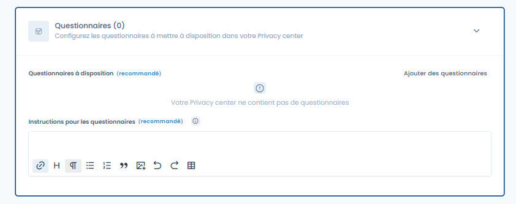
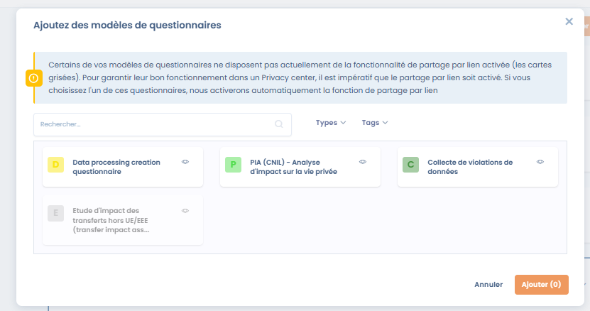
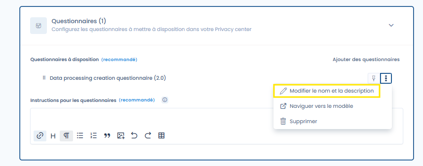
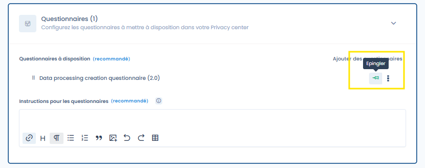

# Vragenlijsten

**De functie "Vragenlijsten" activeren in uw Trust Center**

Om de functie "Vragenlijsten" in uw Trust Center te activeren, raadpleegt u de sectie algemene configuratie waarmee u deze optie kunt activeren of deactiveren. Eenmaal geactiveerd, wordt er een nieuwe openbare pagina met de naam "Vragenlijsten" aan uw Trust Center toegevoegd.

<figure><figcaption>
Het configuratietabblad voor de vragenlijsten van uw Trust Center
</figcaption></figure>

#### Een vragenlijst toevoegen aan uw Trust Center

Om een vragenlijst toe te voegen, selecteert u de vragenlijsten die u in uw Trust Center wilt delen door op **Vragenlijsten toevoegen** te klikken. Er opent een selectievenster waarin u een of meer toe te voegen vragenlijsten kunt kiezen. Klik na uw selectie op **Toevoegen** om te bevestigen. De beschikbare vragenlijsten zijn die welke u hebt geïnstalleerd in de module Vragenlijsten van deze werkruimte.

<figure><figcaption></figcaption></figure>

U kunt op elk moment vragenlijsten uit uw Trust Center verwijderen of andere toevoegen. De toegevoegde vragenlijsten zijn zichtbaar op de pagina "Vragenlijsten" van uw Trust Center.

#### Instructies voor de vragenlijsten

Met dit tekstveld met opmaak (HTML) kunt u een bericht aanpassen met opmaakopties en er afbeeldingen of video's in opnemen. Dit bericht wordt weergegeven op de openbare pagina "Vragenlijsten" van uw Trust Center, boven de lijst met vragenlijsten die in uw portaal zijn geïnstalleerd.

#### Vragenlijsten hernoemen

Standaard hebben de vragenlijsten die in uw Trust Center worden weergegeven dezelfde naam als het geïnstalleerde model. U kunt echter de in het portaal weergegeven naam wijzigen, zonder de naam van het oorspronkelijke model te beïnvloeden, door op **Naam en beschrijving wijzigen** te klikken.

<figure><figcaption>
De in het Trust Center weer te geven naam en beschrijving wijzigen
</figcaption></figure>

#### De weergavevolgorde van de vragenlijsten wijzigen

Nadat u uw vragenlijsten hebt geselecteerd, kunt u hun weergavevolgorde wijzigen met slepen en neerzetten. De volgorde van de vragenlijsten in uw openbare Trust Center komt overeen met de volgorde die u op deze configuratiepagina hebt ingesteld.

#### Vragenlijsten vastpinnen

Om bepaalde vragenlijsten te benadrukken, klikt u op het speldpictogram. Vastgepinde vragenlijsten worden altijd bovenaan de lijst weergegeven, ongeacht hun configuratievolgorde. Bovendien zijn ze ook toegankelijk in de zijbalk van de startpagina van uw hub, naast de pagina met vragenlijsten.

<figure><figcaption>
Een vragenlijst vastpinnen
</figcaption></figure>

#### Impact van de keuze van de organisatorische eenheid op de antwoorden

De gebruikers van uw Trust Center kunnen alle vragenlijsten beantwoorden die op het portaal beschikbaar zijn gesteld. De antwoorden worden opgeslagen in de module Vragenlijsten en gekoppeld aan de organisatorische eenheid van uw Trust Center (zie de algemene configuratie van uw Trust Center).

**Belangrijke opmerking**: Om correct te werken in een Trust Center moet de optie voor delen via een link van een vragenlijst zijn geactiveerd. Als u een vragenlijst wilt toevoegen waarvoor deze optie niet is geactiveerd, wordt deze automatisch geactiveerd bij het toevoegen van de vragenlijst. Bovendien kan de optie voor delen via een link niet worden gedeactiveerd zolang de vragenlijst in uw Trust Center aanwezig is.
