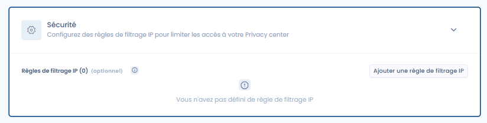

# Beveiliging

Het tabblad Beveiliging bundelt drie soorten configuratie: het beheer van de eigenaren van het Trust Center, de toegangscontrole tot documenten en het filteren op IP-adres.

## Eigenaren van het Trust Center

U kunt **een of meer eigenaren** van het Trust Center aanwijzen. De eigenaren ontvangen de toegangsverzoeken voor documenten en kunnen deze goedkeuren of weigeren via een speciaal scherm in de module Trust Center.

<figure><figcaption>
Instellen van de eigenaren en de toegangscontrole in het tabblad Beveiliging
</figcaption></figure>

## Toegangscontrole tot documenten

Standaard is een **toegangsbevestiging** vereist om de in het Trust Center gepubliceerde documenten te raadplegen. Dit gedrag kan worden geconfigureerd in de sectie Beveiliging.

Wanneer de toegangscontrole is geactiveerd:

1. Bezoekers zien de lijst met beschikbare documenten, maar moeten een **toegangsverzoek** indienen door hun e-mailadres en de reden van hun verzoek op te geven.
2. De eigenaren van het Trust Center ontvangen een e-mail en kunnen de **verzoeken beheren** via de beheerinterface van de module.
3. Als het verzoek wordt goedgekeurd, ontvangt de bezoeker een e-mail met een **downloadlink die 30 dagen geldig is**.


Als er geen eigenaar is aangewezen, kunnen toegangsverzoeken niet worden verwerkt. Zorg ervoor dat er altijd minstens één actieve eigenaar is.


## Filteren op IP-adres

In dit tabblad kunt u ook regels definiëren om de toegang tot uw Trust Center te beperken tot bepaalde IP-bereiken. Standaard, zonder dat u IP-filtering toevoegt, is uw Trust Center toegankelijk voor iedereen met de toegangslink, op voorwaarde dat het Trust Center is geactiveerd.


Deze filtering staat **los van** de [IP-filtering van de organisatie](../../settings/ip-filtering.md), die niet van toepassing is op het Trust Center.

