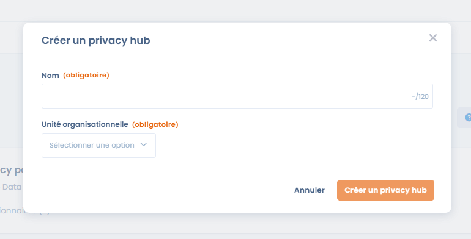
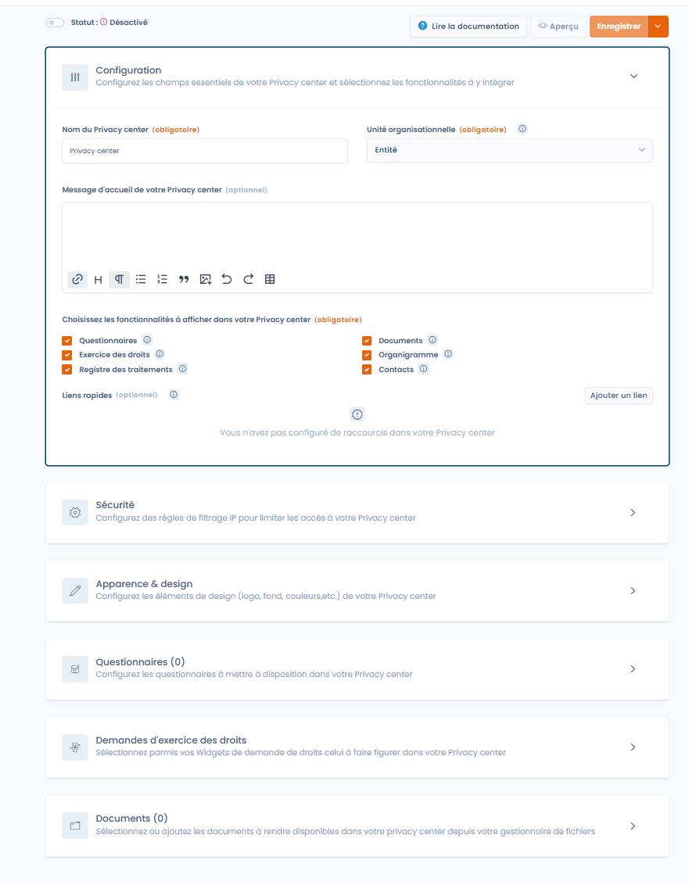

# Een Trust Center aanmaken

U kunt een Trust Center aanmaken vanaf de startpagina van de Trust Center-functie door op "Trust Center aanmaken" te klikken. Deze optie kan vergrendeld zijn als u het Trust Center-quotum van uw abonnement al hebt bereikt.

<figure><figcaption>
Een privacy hub aanmaken door op "privacy hub aanmaken" te klikken
</figcaption></figure>

U moet een naam en een organisatorische eenheid opgeven om het aanmaken van uw Trust Center af te ronden.

<figure><figcaption>
Een privacy hub aanmaken
</figcaption></figure>

Zodra het Trust Center is aangemaakt, wordt u doorgestuurd naar de bewerkingspagina van uw Trust Center.

<figure><figcaption>
De bewerkingspagina van een Trust Center
</figcaption></figure>
