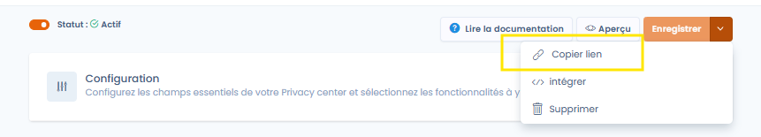
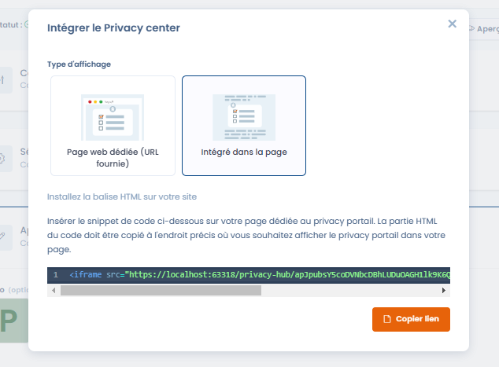

# Uw Trust Center bekijken en delen

### Een voorbeeld van uw Trust Center bekijken

U kunt op elk moment een voorbeeld van uw Trust Center bekijken door op de knop _**Voorbeeld**_ rechtsboven op de configuratiepagina te klikken (voor zover uw Trust Center is geactiveerd).

Als u wijzigingen aanbrengt op de configuratiepagina, moet u de voorbeeldpagina vernieuwen (of opnieuw openen) om uw wijzigingen te zien.

### Uw Trust Center delen

Zodra de configuratie is voltooid, kunt u de URL van uw Trust Center delen.

U kunt hiervoor rechtstreeks de URL van het voorbeeldvenster kopiëren, of op de optie _**Link kopiëren**_ in het menu van een Trust Center klikken.

<figure><figcaption></figcaption></figure>

#### Uw Trust Center insluiten in een iframe

U kunt uw Trust Center ook insluiten in een iframe. U kunt de iframe-code ophalen door op de optie _**Insluiten**_ in het menu van uw Trust Center te klikken.

<figure><figcaption>
Het Trust Center insluiten als iframe
</figcaption></figure>
