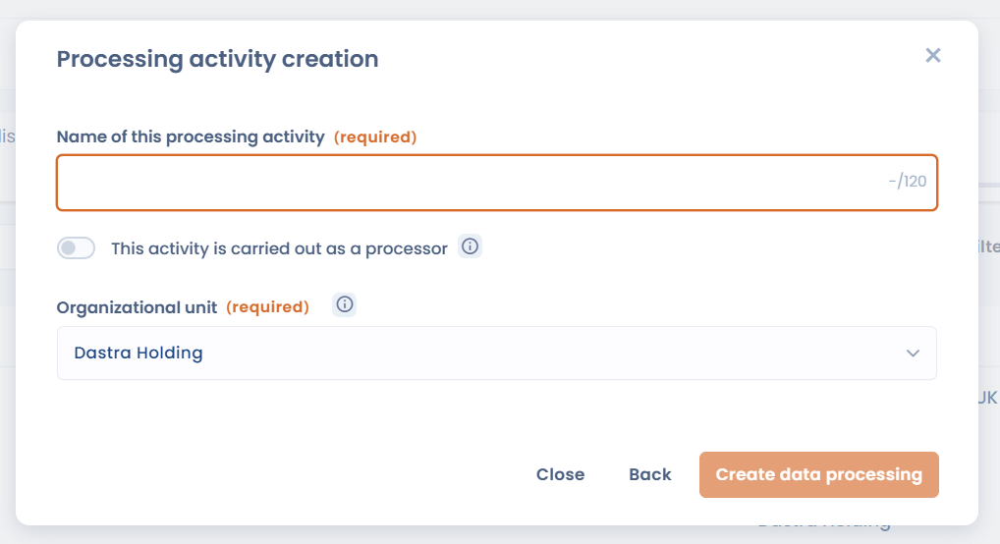

# Aan de slag in 5 minuten

Deze gids brengt u van uw eerste aanmelding naar uw eerste gedocumenteerde verwerkingsactiviteit in het Dastra-register.

***

## Stap 1: toegang krijgen tot Dastra

Om Dastra te gebruiken heeft uw organisatie een abonnement nodig.

* Gebruikt uw organisatie Dastra al, vraag dan een beheerder u uit te nodigen. U ontvangt een uitnodiging per e-mail.
* Neem anders contact op met het Dastra-team via het [demoaanvraagformulier](https://www.dastra.eu/en/contacts/demo).

Meld u daarna aan op [https://app.dastra.eu](https://app.dastra.eu).

***

## Stap 2: uw werkruimte aanmaken

Een werkruimte is de omgeving waarin u uw verwerkingsactiviteiten documenteert. Een werkruimte komt meestal overeen met één juridische entiteit of één conformiteitsperimeter.

Als u een bestaande werkruimte betreedt, ga dan naar stap 3. Alleen eigenaren van het account kunnen een werkruimte aanmaken.

1. Klik op de pagina met werkruimten op **Creëer werkruimte**.
2. Vul een naam in bij **Naam van de werkruimte** (bijvoorbeeld de naam van de juridische entiteit).
3. Klik op **Ga verder**.

Dastra opent daarna de gebruikerspagina van de nieuwe werkruimte, waar u de leden kunt toevoegen.

<figure><figcaption>
Geef uw werkruimte een naam
</figcaption></figure>


[Een werkruimte aanmaken en instellen](setup/workspace.md)


***

## Stap 3: uw eerste verwerkingsactiviteit toevoegen

Het verwerkingsregister vormt het hart van Dastra. Begin met een eenvoudige activiteit, zoals de salarisadministratie of de zakelijke e-mail.

1. Klik in het linkermenu op **Register voor gegevensverwerking**.
2. Klik op **Maak een gegevensverwerking**.
3. Kies hoe u de activiteit aanmaakt:

<figure><figcaption>
Kies hoe u uw eerste verwerkingsactiviteit aanmaakt
</figcaption></figure>

| Modus | Beschrijving |
| --- | --- |
| **Genereren met A.I.** | U beschrijft de activiteit in een paar woorden en de AI-assistent schrijft een eerste versie (als die in uw werkruimte is ingeschakeld) |
| **Voorgedefinieerd sjabloon** | U vertrekt van een Dastra-sjabloon (salarisadministratie, werving, camerabewaking enzovoort) |
| **Vanuit een actief** | U maakt de verwerkingsactiviteit aan op basis van een activum en de bijbehorende gegevens |
| **Blanco model** | U begint met een lege verwerkingsactiviteit |

Kies voor een eerste activiteit **Blanco model** of **Voorgedefinieerd sjabloon**.

4. Vul bij **Blanco model** de twee verplichte velden in:

<figure><figcaption>
De naam en de organisatorische eenheid zijn de enige verplichte velden bij het aanmaken
</figcaption></figure>

* **Naam gegevensverwerking** (bijvoorbeeld _Salarisadministratie_)
* **Organisatie-eenheid**: de entiteit of afdeling waartoe de activiteit behoort


De verwerkingsverantwoordelijke, zijn functionaris voor gegevensbescherming en zijn vertegenwoordiger worden overgenomen van de entiteit van de geselecteerde organisatorische eenheid.


5. Klik op **Maak een gegevensverwerking**.

De verwerkingsactiviteit wordt aan het register toegevoegd. U vult daarna de vragenlijst ervan in: doeleinden, datasets, ontvangers, beveiligingsmaatregelen enzovoort.


[Verwerkingsregister](../features/ropa/README.md)


***

## Stap 4: een collega uitnodigen

Nodig de mensen uit die met u in de werkruimte werken.

1. Ga naar **Instellingen voor werkruimte** > **Gebruikers**.
2. Klik op **Een gebruiker uitnodigen**.
3. Vul hun e-mailadres in en selecteer hun rollen.
4. Klik op **Verstuur een uitnodiging**.

De uitgenodigde persoon ontvangt per e-mail een toegangslink.


[Gebruikers uitnodigen](setup/users.md)


***

## Volgende stappen

Om verder te gaan:


[Handleiding](tutorial/README.md)



[Opzetten](setup/README.md)



[Verwerkingsregister](../features/ropa/README.md)



[AI-systemen](../features/ai-systems/README.md)

