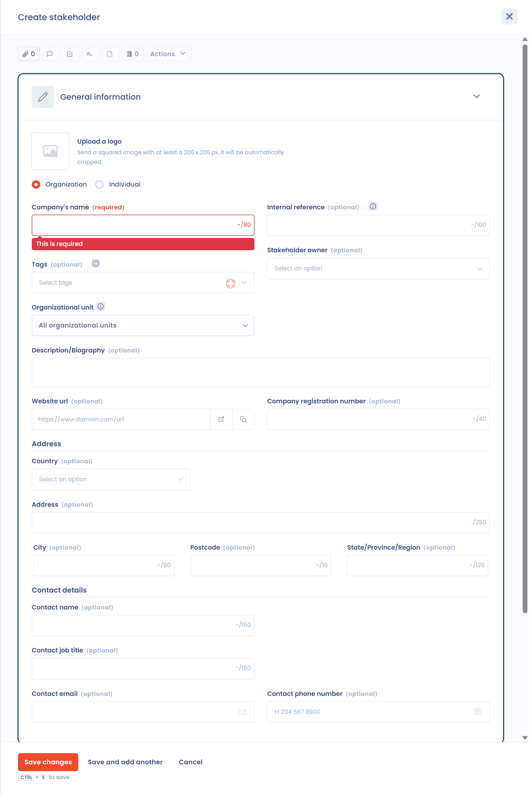

# Een functionaris voor gegevensbescherming aanwijzen

## Een functionaris voor gegevensbescherming aanwijzen

De functionaris voor gegevensbescherming (FG) is de spil van de naleving van de AVG.

Artikel 37, lid 1, van de AVG (Algemene Verordening Gegevensbescherming) verplicht tot de aanwijzing van een FG in drie situaties:

* wanneer de verwerking wordt verricht door een overheidsinstantie of overheidsorgaan;
* wanneer de kernactiviteiten van de verwerkingsverantwoordelijke of de verwerker bestaan uit verwerkingen die regelmatige en systematische observatie van betrokkenen op grote schaal vereisen;
* wanneer de kernactiviteiten van de verwerkingsverantwoordelijke of de verwerker bestaan uit grootschalige verwerking van bijzondere categorieën van persoonsgegevens of van persoonsgegevens met betrekking tot strafrechtelijke veroordelingen en strafbare feiten.

Meer over wanneer en hoe u een FG aanwijst, leest u in de [praktische gids van de CNIL over functionarissen voor gegevensbescherming](https://www.cnil.fr/sites/cnil/files/atoms/files/cnil-gdpr_practical_guide_data-protection-officers.pdf) (in het Engels). Die behandelt de rol van de FG en de aanwijzingsprocedure.

## Een FG toevoegen aan Dastra

Aan een entiteit is slechts één FG gekoppeld.

1. Klik in het linkermenu op **Instellingen voor werkruimte** en daarna op **Organisatorische eenheden**.
2. Klik op de drie puntjes rechts van de entiteit en daarna op **Bewerken**.
3. Selecteer de FG in het veld **Functionaris voor gegevensbescherming**.
4. Klik op **Opslaan**.

<figure><figcaption>
Het venster voor het bewerken van een entiteit
</figcaption></figure>

De FG is een stakeholder uit het adresboek. Is de FG een natuurlijke persoon, voeg die dan toe als natuurlijke persoon. Gaat het om een bedrijf, bijvoorbeeld een externe FG, voeg die dan toe als rechtspersoon: klik onderaan de lijst van het veld op **Nieuwe actor**.

<figure><figcaption>
Het formulier voor het toevoegen van een stakeholder
</figcaption></figure>

Vergeet niet de entiteit op te slaan. Om de FG te wijzigen, zie [Hoe wijzigt u de FG?](faq.md#hoe-wijzigt-u-de-fg).
