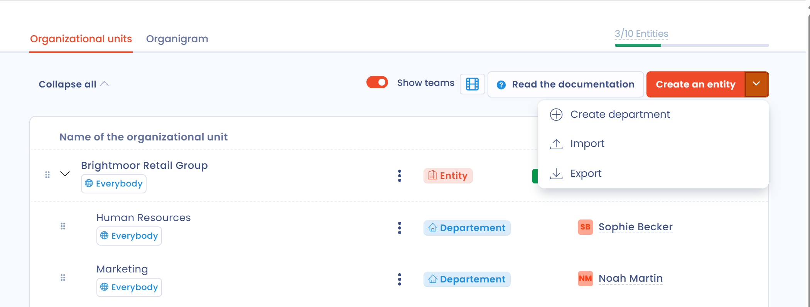

# Organisatorische eenheden aanmaken en instellen

## Inleiding

Organisatorische eenheden structureren uw werkruimte. U kunt twee soorten organisatorische eenheden aanmaken:

* entiteiten, die overeenkomen met juridische entiteiten en een verwerkingsverantwoordelijke vertegenwoordigen;
* afdelingen, die de entiteiten indelen.

In Dastra is een werkruimte geen juridische entiteit: een werkruimte kan verwijzen naar meerdere afzonderlijke juridische entiteiten, zoals in een bedrijvengroep. Per juridische entiteit kan er echter maar één wettelijke vertegenwoordiger zijn.


Elke entiteit in Dastra geldt als verwerkingsverantwoordelijke.


## Naar de organisatorische eenheden gaan

Klik in het linkermenu op **Instellingen voor werkruimte** en daarna op **Organisatorische eenheden**.

<figure><figcaption>
Het menu Instellingen voor werkruimte
</figcaption></figure>

Het scherm voor het aanmaken en instellen van organisatorische eenheden opent. Het heeft twee tabbladen: **Organisatorische eenheden** (de lijst) en **Organigram**.

<figure><figcaption>
De lijst van organisatorische eenheden
</figcaption></figure>

## Een entiteit aanmaken of bewerken

1. Klik op **Maak een entiteit (verwerkingsverantwoordelijke)**.
2. Vul de **Naam van de entiteit** en het **Land** in. Dat zijn verplichte velden. U kunt ook de verantwoordelijke (de wettelijke vertegenwoordiger), de functionaris voor gegevensbescherming en, indien van toepassing, de vertegenwoordiger in de Europese Unie opgeven.
3. Klik op **Opslaan**.

<figure><figcaption>
Het formulier voor het aanmaken van een entiteit
</figcaption></figure>


Anders dan bij afdelingen hangt het aantal entiteiten (verwerkingsverantwoordelijken) dat u kunt aanmaken af van een quotum dat aan uw abonnement is gekoppeld. Om het te verhogen, [neemt u contact op met het verkoopteam](https://www.dastra.eu/en/contacts).


Om een entiteit te bewerken, klikt u op de drie puntjes rechts van de entiteit en daarna op **Bewerken**. Breng uw wijzigingen aan en klik op **Opslaan**.

<figure><figcaption>
Het menu met drie puntjes van een organisatorische eenheid
</figcaption></figure>

## Een afdeling aanmaken of bewerken

Om een afdeling aan te maken, opent u het menu van de knop **Maak een entiteit (verwerkingsverantwoordelijke)**, klikt u op **Maak een afdeling** en vult u de velden in.

Om een afdeling te bewerken, klikt u op de drie puntjes rechts van de afdeling en daarna op **Bewerken**, brengt u uw wijzigingen aan en klikt u op **Opslaan**.

## Onderliggende eenheden toevoegen

Het menu met drie puntjes van een eenheid biedt ook:

* **Een onderliggende afdeling toevoegen**: maakt een afdeling onder de eenheid aan;
* **Een onderliggende entiteit toevoegen**: maakt een entiteit onder de eenheid aan, bijvoorbeeld om de dochteronderneming van een dochteronderneming weer te geven.

## Een organisatorische eenheid verwijderen en de gegevens overdragen

Een organisatorische eenheid kan niet worden verwijderd zolang er items aan gekoppeld zijn. Klik in het menu met drie puntjes op **Verwijderen**, klik daarna op de vermelde items en wijs ze toe aan een andere eenheid. U kunt ook op **Gegevens overdragen** klikken om de objecttypen van uw keuze naar een andere eenheid te verplaatsen zonder de eenheid te verwijderen.

<figure><figcaption>
Een organisatorische eenheid verwijderen
</figcaption></figure>


Het verwijderen van een organisatorische eenheid is definitief. De bijbehorende gegevens worden overgedragen aan de eenheid die u kiest.


## Organisatorische eenheden importeren en exporteren

Open het menu van de knop **Maak een entiteit (verwerkingsverantwoordelijke)**: het biedt **Importeren** en **Exporteren**.

Om te importeren klikt u op **Importeren** en daarna op **Het bestandssjabloon downloaden**. Vul het bestand in en sleep het naar het uploadvak. Het bestand kan de indeling CSV (UTF-8-codering, scheidingsteken `;`), TXT of XLSX hebben.

<figure><figcaption>
Het importvenster
</figcaption></figure>

Twee kolommen zijn verplicht:

* `Id`: de identificatie van de eenheid, een tekst die uniek is binnen het bestand (maximaal 80 tekens);
* `Label`: de naam van de eenheid (maximaal 80 tekens).

De andere kolommen zijn optioneel:

* `ParentId`: de `Id` van de bovenliggende eenheid, als die er is;
* `CountryCode`: het land, als code van 2 letters ([ISO 3166](https://www.iso.org/iso-3166-country-codes.html)). De standaardwaarde is `FR`;
* `Type`: `Entity` voor een entiteit of `Area` voor een afdeling. De standaardwaarde is `Entity`;
* `City`, `Address`, `ZipCode`, `MailAddress`, `PhoneNumber` en `ImmatriculationNumber`: de contactgegevens van de eenheid;
* `RepresentativeName` en `RepresentativeType`, `DpoName` en `DpoType`, `ReferentName` en `ReferentType`: de naam en het type van de stakeholder die als vertegenwoordiger, DPO of verantwoordelijke is gekoppeld;
* `OwnerEmail`: het e-mailadres van de eigenaar van de eenheid.


Beperk de hiërarchie tot 7 niveaus (relaties tussen bovenliggende en onderliggende eenheden), zodat de import correct wordt verwerkt.


Voorbeeld:

<table><thead><tr><th>Id</th><th>ParentId</th><th width="492">Label</th><th>CountryCode</th><th>Type</th></tr></thead><tbody><tr><td>20996</td><td></td><td>HOLDING</td><td>FR</td><td>Entity</td></tr><tr><td>21009</td><td>20996</td><td>IT</td><td>BE</td><td>Area</td></tr></tbody></table>

## Eenheden bekijken en instellen via het organigram

Het tabblad **Organigram** toont uw entiteiten en afdelingen in een grafiek. U kunt daar de meeste handelingen uitvoeren die ook in de lijst beschikbaar zijn.

<figure><figcaption>
De weergave Organigram
</figcaption></figure>

## Toegang tot de inhoud van een organisatorische eenheid beperken

U kunt teams van gebruikers gebruiken om de toegang tot de inhoud van een organisatorische eenheid te beperken. Koppel daarvoor teams aan de eenheid: klik in het menu met drie puntjes op **Machtigingen instellen voor** en voeg de gemachtigde gebruikers of teams toe.

Standaard erft een onderliggende eenheid de machtigingen van de bovenliggende eenheid. Zodra u machtigingen aan de onderliggende eenheid toevoegt, vervangen die de geërfde machtigingen.

### Beperkte toegang tot alleen een onderliggende entiteit

U kunt een gebruiker of een team alleen aan een onderliggende entiteit toevoegen, zonder toegang te geven tot de bovenliggende entiteiten. Ze hebben dan uitsluitend toegang tot de gegevens van die entiteit, niet tot de bovenliggende entiteiten en ook niet tot de entiteiten op hetzelfde niveau.

Deze modus is nuttig om het beheer van een dochteronderneming of een afdeling te delegeren aan lokale gebruikers zonder groepsgegevens bloot te stellen. Om dit in te stellen, opent u de machtigingen van de entiteit en voegt u de gebruiker of het team rechtstreeks aan die entiteit toe, zonder ze aan de bovenliggende entiteit te koppelen.


Anders dan in de standaardmodus geeft beperkte toegang tot een onderliggende entiteit geen toegang tot de gegevens van de bovenliggende entiteiten.


## Verder lezen


[Teams aanmaken en toewijzen](teams.md)

