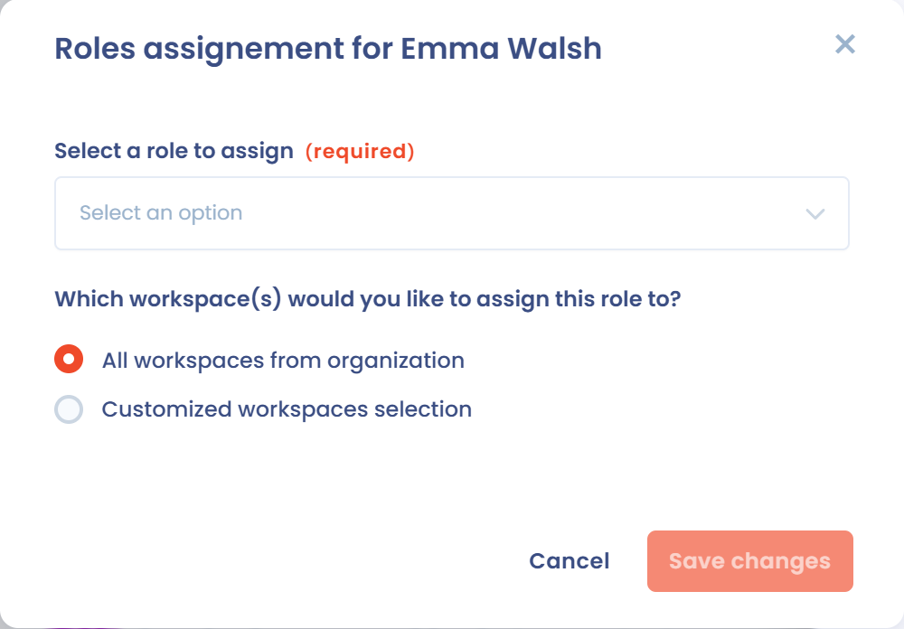
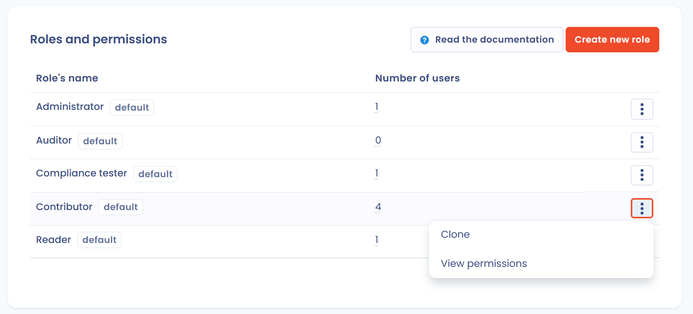

# Rollen en machtigingen beheren

Wanneer u een gebruiker uitnodigt, biedt Dastra standaard vijf rollen:

* Administrator: administrators hebben de rechten van een bijdrager en kunnen de instellingen van de werkruimte beheren. Alleen administrators kunnen een verwerkingsactiviteit de status "gepubliceerd" geven, organisatorische eenheden aanmaken en nieuwe gebruikers voor de werkruimte uitnodigen.
* Bijdrager: bijdragers kunnen de inhoud van de werkruimte lezen en bewerken. Ze kunnen items aanmaken en concepten wijzigen die nog niet zijn gepubliceerd. Ze kunnen de instellingen van de werkruimte niet wijzigen.
* Lezer: lezers kunnen de inhoud van de werkruimte alleen bekijken. Ze kunnen de inhoud niet bewerken en de instellingen van de werkruimte niet wijzigen.
* Auditor: rol van de module Conformiteit. Ze geeft leestoegang tot bestanden en bijlagen en laat u uw eigen items van de conformiteitsaudit bewerken.
* Conformiteitstester: rol van de module Conformiteit. Ze geeft lees- en schrijftoegang tot bestanden en bijlagen en laat u uw eigen operationele conformiteitsitems bewerken.


Alleen eigenaars kunnen de instellingen van het organisatieaccount wijzigen en werkruimten aanmaken.


## Een rol aan een gebruiker toewijzen

In Dastra kan een gebruiker meerdere rollen hebben. U wijst ze toe vanaf twee plaatsen.

### In de huidige werkruimte

1. Klik in het linkermenu op **Instellingen voor werkruimte** en daarna op **Gebruikers**.
2. Open het menu van de rij van de gebruiker en klik op **Rollen toewijzen**. Het getal tussen haakjes is het aantal rollen dat de gebruiker al heeft.
3. Selecteer de rol of rollen die u wilt toewijzen.

### In meerdere werkruimten tegelijk

Alleen de eigenaars van de organisatie kunnen deze methode gebruiken.

1. Klik rechtsboven op het scherm op uw profielpictogram, daarna op **Instelling van de organisatie** en vervolgens op **Gebruikers**.
2. Open het menu van de rij van de gebruiker en klik op **Rollen en werkplekken**.
3. Klik op **Toewijzen**, selecteer de rol en kies het bereik: **Alle werkplekken van organisatie** of **Specifieke workspaces**.

<figure><figcaption>
Een rol toewijzen aan alle werkruimten of aan een selectie
</figcaption></figure>

U kunt ook aangepaste rollen aanmaken, die mogelijk beter bij uw organisatie passen.

## Een aangepaste rol aanmaken

Om een aangepaste rol aan te maken, moet u eigenaar van de organisatie zijn.

1. Klik rechtsboven op het scherm op uw profielpictogram en daarna op **Instelling van de organisatie**.
2. Klik in het configuratiepaneel op **Rollen en machtigingen**.

<figure><figcaption>
Het profielmenu
</figcaption></figure>

<figure><figcaption>
Het configuratiepaneel van de organisatie
</figcaption></figure>

De lijst van rollen en machtigingen verschijnt.

<figure><figcaption>
De lijst van rollen, met voorbeelden van aangepaste rollen
</figcaption></figure>


Alleen de eigenaars van de organisatie hebben toegang tot het scherm voor het beheer van rollen en machtigingen.


3. Klik op **Nieuwe rol** en geef de rol een naam.
4. Vink de machtigingen aan die bij elke functie horen (**Lezing**, **Schrijven**, **Create**, **Importeren**, **Exporteren** enzovoort). In de modules die het aanbieden, staat de machtiging **Create** het aanmaken van nieuwe items toe, los van de machtiging **Schrijven**, die het wijzigen ervan toestaat (zie [Rollen en machtigingen](../../features/settings/roles.md)).
5. Klik onderaan het scherm op **Opslaan**.

Om van een bestaande rol te vertrekken, klikt u ernaast op **Klonen**. **Bekijk de machtigingen** toont de machtigingen van een rol zonder die te wijzigen.


Om van kracht te worden, moet de nieuwe rol aan een of meer gebruikers worden toegewezen, vanaf de hierboven beschreven pagina **Gebruikers**.


U kunt nu de handleiding volgen of de functies van Dastra zelf verkennen.


[Handleiding](../tutorial/README.md)

