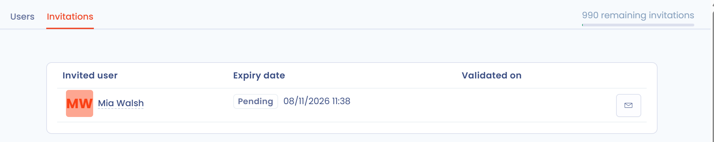

# Gebruikers uitnodigen

## Een gebruiker uitnodigen

U kunt iemand uitnodigen om samen te werken in uw werkruimten door die persoon uit te nodigen voor de organisatie waartoe de werkruimte behoort.

1. Klik in het linkermenu op **Instellingen voor werkruimte** en daarna op **Gebruikers**.
2. Klik op **Een gebruiker uitnodigen**.
3. Voer het e-mailadres van de persoon in. Is dit adres nog niet aan de organisatie gekoppeld, klik er dan op om verder te gaan.
4. Vul het uitnodigingsformulier in (zie de onderstaande tabel) en klik op **Verstuur een uitnodiging per e-mail**.

<figure><figcaption>
De pagina Gebruikers in de werkruimte-instellingen
</figcaption></figure>

<figure><figcaption>
Het uitnodigingsformulier
</figcaption></figure>

| Veld | Beschrijving |
| --- | --- |
| **Voornaam** en **Naam** | Identiteit van de uitgenodigde persoon |
| **Taal van de interface** | Taal waarin de persoon Dastra ziet |
| **Uitnodigen voor alle werkruimten** | Schakelaar: zonder deze optie kiest u de betrokken werkruimte |
| **Selecteer gebruikersrol(len)** | Zie [Rollen en machtigingen beheren](roles.md) |
| **Selecteer gebruikersteams** | Zie [Teams aanmaken en toewijzen](teams.md) |
| **Standaard verbindingsmodus** | Lokaal account (aanmeldnaam en wachtwoord) of SSO, wanneer een SSO is geconfigureerd |
| **Welkomstbericht** | Tekst die aan de uitnodigingsmail wordt toegevoegd |

U kunt ook onderaan de linkerzijbalk op **Invite a member** klikken: dat opent hetzelfde formulier.

De uitgenodigde persoon ontvangt een e-mail met een link die toegang geeft tot de werkruimte. U ontvangt een melding per e-mail wanneer de persoon op de link klikt. De uitnodigingslink verloopt na 10 dagen.

In plaats van de e-mail te versturen, kunt u op **Een uitnodigingslink genereren** klikken: Dastra toont een link die u zelf aan de persoon doorgeeft.

### De openstaande uitnodigingen vinden

U beheert openstaande uitnodigingen op het tabblad **Uitnodigingen** van de pagina **Gebruikers**.

<figure><figcaption>
Het tabblad Uitnodigingen
</figcaption></figure>


Uw abonnement beperkt het aantal gebruikers. Het quotum telt de actieve gebruikers en de gebruikers die aan een openstaande of verlopen uitnodiging zijn gekoppeld: verwijder de gebruiker van een uitnodiging die u niet meer nodig hebt om een plaats vrij te maken. Is de limiet bereikt, dan toont Dastra **U heeft de limiet van uw gebruikers bereikt** en kunt u contact opnemen met het Dastra-team om ze te verhogen.


### Een uitnodigingslink opnieuw versturen

Heeft de uitgenodigde persoon niet op de link geklikt en is die verlopen, klik dan naast de uitnodiging op **Opnieuw verzenden** en bevestig.

### Teams aanmaken en toewijzen

In Dastra worden gebruikers in teams gegroepeerd. Teams worden daarna toegewezen aan entiteiten of afdelingen, zodat u rollen en verantwoordelijkheden nauwkeurig beheert. Zie [Teams aanmaken en toewijzen](teams.md).

### Standaardrollen

Dastra biedt vijf basisrollen. Hun gedetailleerde machtigingen worden beschreven in [Rollen en machtigingen beheren](roles.md).

| Rol | Identificatie |
| --- | --- |
| Administrator | 1 |
| Bijdrager | 2 |
| Lezer | 3 |
| Auditor | 11000 |
| Conformiteitstester | 11500 |


Eigenaar van de organisatie en FG zijn geen rollen. Om een al uitgenodigde gebruiker de status van eigenaar van de organisatie te geven, zie [Hoe voegt u een eigenaar van de organisatie toe?](faq.md#hoe-voegt-u-een-eigenaar-van-de-organisatie-toe). Om de FG te wijzigen, zie [Hoe wijzigt u de FG?](faq.md#hoe-wijzigt-u-de-fg).


## Een grote lijst gebruikers importeren

Voor het importeren van een grote lijst gebruikers (50 of meer) gaat u via het Dastra-team. U kunt de import van een lijst van maximaal 200 gebruikers aanvragen, binnen de grens van de beschikbare gebruikers.

Te volgen stappen:

1. Open [https://app.dastra.eu/general-settings/users](https://app.dastra.eu/general-settings/users), klik op de pijl rechts van de knop **Een gebruiker uitnodigen** en daarna op **Importeren**.

<figure><figcaption>
Het importmenu in de instellingen van de organisatie
</figcaption></figure>

2. Maak per werkruimte een bestand in CSV-indeling met de volgende kolommen, gescheiden door komma's.

Verplicht:

* `Email`: het e-mailadres van de gebruiker;
* `GivenName`: de voornaam;
* `FamilyName`: de achternaam;
* `Roles`: de identificaties van de rollen in Dastra, gescheiden door `|`;
* `Teams`: de identificaties van de teams in Dastra, gescheiden door `|`.

Optioneel:

* `SSOConfigurationId`: de identificatie van de SSO-aanmelding, indien van toepassing.

Hier is een voorbeeldbestand om te downloaden en in te vullen:


Sjabloon van het importbestand


### Identificaties van rollen

De basisrollen hebben de identificaties uit de bovenstaande tabel. Voor de aangepaste rollen die u hebt aangemaakt, ziet u de identificatie in de ontwikkelaarsconsole van uw browser, op het tabblad Network. Rollen moeten vóór de import zijn aangemaakt.


De console openen in Chrome: Cmd + Option + C (Mac) of Ctrl + Shift + J (Windows).

De console openen in Firefox: Cmd + Option + K (Mac) of Ctrl + Shift + J (Windows).

De console openen in Microsoft Edge: Ctrl + Shift + I.


### Identificaties van teams

Teams worden geïdentificeerd met hun identificatienummer. Om dat te vinden, opent u het team in Dastra met de knop **Bewerken**: het nummer staat in de titel van het venster.

<figure><figcaption>
In dit voorbeeld is de identificatie van het team Test 8019
</figcaption></figure>

Teams zijn in Dastra niet verplicht. De teams die u in het bestand gebruikt, moeten vooraf in de werkruimte zijn aangemaakt.

### Identificatie van de SSO-configuratie

De kolom `SSOConfigurationId` is optioneel: vul die alleen in als u wilt dat de geïmporteerde gebruikers worden gekoppeld aan een SSO-aanmelding die al in uw organisatie is geconfigureerd. Laat de kolom leeg voor een standaardaanmelding met e-mailadres en wachtwoord.

Net als bij aangepaste rollen haalt u deze identificatie op in de ontwikkelaarsconsole van uw browser, op het tabblad Network:

1. Open [de configuratiepagina van de SSO-aanmeldingen](https://app.dastra.eu/general-settings/sso) (u moet eigenaar van de organisatie zijn).
2. Open de ontwikkelaarsconsole (zie de sneltoetsen hierboven) en ga naar het tabblad Network.
3. Klik op het potloodpictogram van de betreffende SSO-aanmelding om het venster **SSO-login bewerken** te openen. Dit is een modaal venster: de URL van de pagina blijft `https://app.dastra.eu/general-settings/sso`.
4. Open op het tabblad Network het verzoek dat wordt geactiveerd wanneer het venster opent en noteer de waarde van het veld `scheme` (het is ook het einde van de URL van het verzoek, na `ssoConfiguration/`): dat is de waarde die u invoert in de kolom `SSOConfigurationId`.


De SSO-aanmelding moet vooraf zijn geconfigureerd. Zie [Single Sign On (SSO)](../../features/settings/sso/README.md).


3. Sla uw bestand op in de indeling CSV UTF-8. Kies in Excel het bestandstype CSV UTF-8 (door komma's gescheiden).
4. Laat ons weten in welke werkruimte u de gebruikers wilt importeren en sleep het bestand naar de uploadinterface.

<figure><figcaption>
De uploadinterface voor het bestand
</figcaption></figure>

Het Dastra-team ontvangt uw aanvraag en neemt contact met u op.
