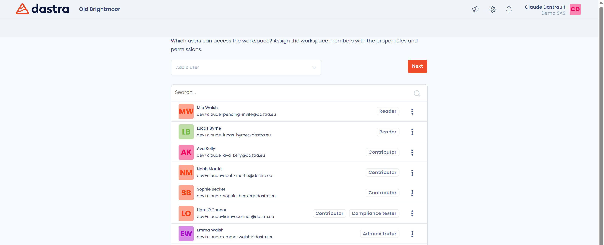
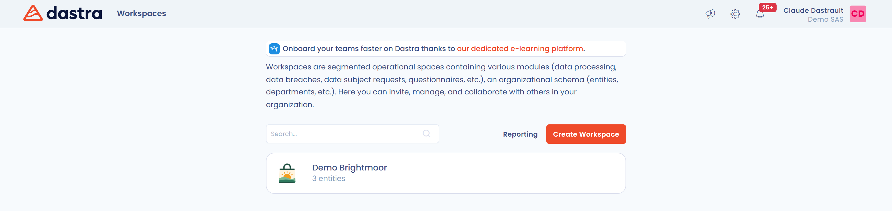

# Een werkruimte aanmaken en instellen

Deze pagina legt uit hoe u een werkruimte aanmaakt, de eerste gebruikers uitnodigt, uw eerste entiteit declareert en tussen uw werkruimten wisselt.

## Aanmelden bij Dastra

Begin met aanmelden op [app.dastra.eu](https://app.dastra.eu). Hebt u nog geen account, vraag dan een beheerder van uw organisatie u uit te nodigen. Gebruikt uw organisatie Dastra nog niet, [vraag dan een demo aan](https://www.dastra.eu/en/contacts/demo).

## Werkruimte

Een werkruimte is een organisatie die één of meer verwerkingsregisters bevat. U kunt per register, per juridische entiteit of per vestiging een werkruimte aanmaken, zoals u verkiest. Voor de definities van de andere begrippen (organisatie, organisatorische eenheid, entiteit, afdeling), zie [Belangrijkste begrippen](key-concepts.md).


Een werkruimte is een omgeving waarvan de gegevens volledig gescheiden zijn: de registers van een werkruimte (verwerkingsactiviteiten, activa, verzoeken enzovoort) zijn nooit toegankelijk vanuit de context van een andere werkruimte. U kunt wel geconsolideerde statistieken over al uw werkruimten bekijken in het werkruimteoverschrijdende dashboard (zie [Statistieken over meerdere werkruimten](workspace.md#statistieken-over-meerdere-werkruimten)) en items (verwerkingsactiviteiten, activa enzovoort) van de ene werkruimte naar de andere dupliceren.


## Een werkruimte aanmaken

Alleen eigenaars van de organisatie kunnen een werkruimte aanmaken.

1. Klik op de pagina met uw werkruimten op **Creëer werkruimte**.
2. Vul **Naam van de werkruimte** in. Dat veld is verplicht.
3. Voeg eventueel het **Logo** van de werkruimte toe: een vierkante afbeelding van minstens 200 x 200 px, die automatisch wordt bijgesneden.
4. Kies de taal in de lijst **Selecteer de taal die in deze werkruimte wordt gebruikt**.
5. Klik op **Ga verder**.

<figure><figcaption>
Het formulier voor het aanmaken van een werkruimte
</figcaption></figure>

Om te vertrekken van de configuratie van een bestaande werkruimte, vinkt u **Kloon instellingen vanuit een andere werkruimte** aan, kiest u de **Bronwerkruimte** en vinkt u zo nodig **Voeg toegewezen gebruikers en teams toe** aan. De taalkeuze verdwijnt: de nieuwe werkruimte gebruikt de taal van de bronwerkruimte.


Zodra de werkruimte is aangemaakt, kunt u de organisatorische eenheden instellen en gebruikers uitnodigen.


### De eerste gebruikers uitnodigen

Na het aanmaken opent Dastra de pagina Gebruikers van de nieuwe werkruimte. U kunt bestaande gebruikers van de organisatie toevoegen of nieuwe gebruikers uitnodigen met **Een gebruiker uitnodigen**.

<figure><figcaption>
De stap voor het uitnodigen van gebruikers
</figcaption></figure>

Wijs elke gebruiker de rol van uw keuze toe en klik daarna op **Volgende**. Voor de details van de uitnodigingsvelden, zie [Gebruikers uitnodigen](users.md).

### De eerste entiteit aanmaken

In Dastra is een werkruimte geen juridische entiteit: ze kan er meerdere groeperen, zoals in een bedrijvengroep. Elke entiteit komt overeen met een verwerkingsverantwoordelijke en een entiteit heeft maar één wettelijke vertegenwoordiger.

Om de eerste entiteit aan te maken, vult u de **Naam van de entiteit** en het **Land** in: dat zijn de twee verplichte velden. U kunt ook de vertegenwoordigers opgeven (de verantwoordelijke en de wettelijke vertegenwoordiger) en, indien aangewezen, de functionaris voor gegevensbescherming.

<figure><figcaption>
Het formulier voor het aanmaken van de eerste entiteit
</figcaption></figure>

Klik op **Ga verder** om uw werkruimte te openen. U kunt ook op **Sla deze stap over** klikken en uw entiteiten later aanmaken.

### Andere entiteiten en afdelingen aanmaken

Zodra uw werkruimte is geopend, vult u de andere juridische entiteiten en de afdelingen zo snel mogelijk in. Dat vergemakkelijkt later het beheer van verwerkingsactiviteiten en de toewijzing van gebruikersrechten.

1. Klik in het linkermenu op **Instellingen voor werkruimte** en daarna op **Organisatorische eenheden**.
2. Klik op **Maak een entiteit (verwerkingsverantwoordelijke)** om een juridische entiteit toe te voegen, of open het menu van de knop om **Maak een afdeling** te kiezen.
3. Herhaal dit tot het organigram van uw structuur in Dastra is weergegeven.

<figure><figcaption>
De weergave Organigram
</figcaption></figure>

Voor onderliggende afdelingen, onderliggende entiteiten, import en verwijdering, zie [Organisatorische eenheden aanmaken en instellen](organizational-units.md).

## Naar een werkruimte gaan

1. Meld u aan bij de toepassing met uw gebruikersaccount.
2. Klik in de lijst die verschijnt op de tegel van uw werkruimte.

<figure><figcaption>
De lijst van werkruimten
</figcaption></figure>

U bevindt zich nu in uw werkruimte. Om op elk moment van werkruimte te wisselen, klikt u op de werkruimteselector bovenaan de linkerzijbalk.

<figure><figcaption>
De werkruimteselector
</figcaption></figure>

## Statistieken over meerdere werkruimten

Het werkruimteoverschrijdende dashboard brengt de belangrijkste indicatoren van al uw werkruimten samen in één overzicht. Eigenaars openen het met de knop **Rapportage** in de lijst van werkruimten.

<figure><figcaption>
De knop Rapportage opent vanuit de lijst van werkruimten het werkruimteoverschrijdende dashboard
</figcaption></figure>

Het consolideert de indicatoren van de belangrijkste modules: verwerkingsregister, verzoeken van betrokkenen, incidenten, vragenlijsten, AI-systemen en taken. De gegevens worden weergegeven als widgets en grafieken.

<figure><figcaption>
Geconsolideerde indicatoren van het verwerkingsregister en de verzoeken van betrokkenen over alle werkruimten
</figcaption></figure>

Met dynamische filters verfijnt u de analyse per werkruimte, per organisatorische eenheid en per type. Met de knop **Kies een periode** beperkt u de indicatoren tot een periode: selecteer een vooraf gedefinieerde periode (Vandaag, Huidige week, Huidige maand, Huidig jaar enzovoort) of een begindatum en een einddatum in de kalender en klik op **Toepassen**. Is er geen periode geselecteerd, dan omvatten de indicatoren alle gegevens. Met de knop **Reset** verwijdert u de geselecteerde periode. Het dashboard kan worden afgedrukt en geëxporteerd.

## Verder lezen

Volg de onderstaande handleiding of begin Dastra zelf te verkennen.


[Handleiding](../tutorial/README.md)

