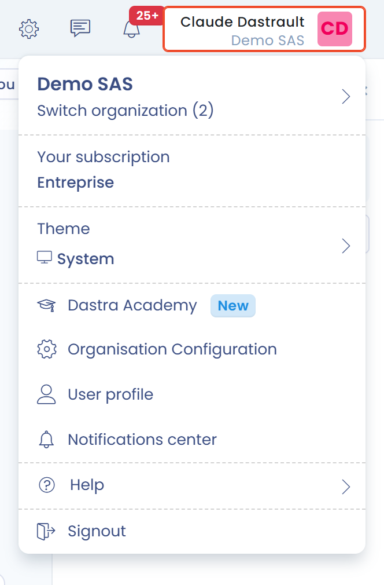

# Online help

De online help van Dastra is op elk moment beschikbaar in uw werkruimte via het profielmenu: klik rechtsboven op uw naam en daarna op **Hulpmiddelen**. Er opent een submenu met alle opties.

<figure><figcaption>
Het profielmenu, met het item Hulpmiddelen
</figcaption></figure>

| Item | Wat het opent |
| --- | --- |
| **Contact opnemen met support** | Het formulier voor ondersteuningsverzoeken (zie [Ondersteuning aanvragen](request.md)) |
| **Praat met ons in de chat** | De ondersteuningschat |
| **Documentatie** | Deze documentatie |
| **Kennisbank** | De bronnen en gidsen op de website van Dastra |
| **Dastra Academy** | De opleidingen van Dastra |
| **Webinars** | De webinars van Dastra |
| **Mijn abonnement** | De pagina van uw abonnement |
| **Kaartjes** | De geschiedenis van uw ondersteuningsverzoeken |

Onderaan het submenu vindt u de pagina's **Over**, **Pricing**, **Privacybeleid** en **Algemene gebruiksvoorwaarden**.

## De rondleidingen

Dastra biedt rondleidingen die een functie in enkele stappen voorstellen. U kunt ze op elk moment opnieuw starten:

* Rondleiding van Dastra AI: klik in het paneel van Dastra AI bovenaan op het informatiepictogram (**Gids tonen**). Op het dashboard klikt u ook op de badge **Dastra AI** boven het invoerveld. De AI-functie moet beschikbaar zijn in uw organisatie.
* Rondleiding van een module: klik op de pagina's met een rondleiding op de informatieknop (**Gids tonen**) om die opnieuw te starten.
