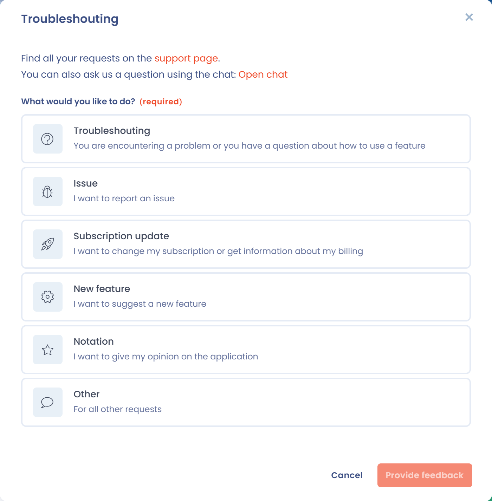

# Ondersteuning aanvragen

Soms kunt u een probleem niet oplossen met deze documentatie, de chat of de online help.

In dat geval kunt u rechtstreeks vanuit de toepassing contact met ons opnemen: via de chat, rechtsonder in beeld, voor functionele vragen aan uw eigen Privacy Success Manager, of via het formulier voor ondersteuningsverzoeken, rechtsboven in beeld, voor technische problemen.

<figure><figcaption>
De chatknop rechtsonder in beeld
</figcaption></figure>

<figure><figcaption>
De knop Nieuw verzoek rechtsboven in beeld
</figcaption></figure>


Om het formulier voor ondersteuningsverzoeken of de chat te gebruiken, hebt u een account nodig en moet u zijn aangemeld in de toepassing.


## De chat

Met de chat praat u met uw eigen Privacy Success Manager over het gebruik van het platform, of om hulp te krijgen bij het begrijpen van de functies.

## Het formulier voor ondersteuningsverzoeken

Met dit formulier meldt u bugs, stelt u ideeën voor nieuwe functies voor of stelt u technische vragen aan het supportteam.

1. Klik rechtsboven op de knop **Nieuw verzoek** (megafoonpictogram). Er opent een venster.
2. Kies een van de zes soorten verzoeken:

   | Soort | Wanneer u het kiest |
   | --- | --- |
   | **Oplossen van problemen** | U hebt een probleem of een vraag over het gebruik van een functie. Eerst wordt een zoekopdracht in de documentatie aangeboden: beantwoordt die uw vraag niet, klik dan op **Een ticket aanmaken**. |
   | **Bug-rapport** | U wilt een storing in de toepassing melden. |
   | **Update van het abonnement** | U wilt uw abonnement wijzigen of informatie krijgen over uw facturering. |
   | **Functioneel idee** | U wilt een nieuwe functie voorstellen. |
   | **Kennisgeving** | U wilt uw mening over de toepassing geven. |
   | **Ander verzoek** | Voor alle andere verzoeken. |

3. Beschrijf uw verzoek in detail en klik op **Vraag verzenden**.

<figure><figcaption>
Het soort verzoek kiezen
</figcaption></figure>

Bij een storing en bij het oplossen van problemen biedt het venster twee selectievakjes:

* **Ik geef de supportteams van Dastra toestemming om verbinding te maken met mijn ruimte en de nodige tests uit te voeren om dit probleem te identificeren**: uw gegevens worden niet gewijzigd en alle handelingen van de teams worden geannuleerd;
* **Ik geef Dastra toestemming om diagnostische gegevens van mijn browser te verzamelen**: consolefout en type browser. Dit vakje is standaard aangevinkt.

<figure><figcaption>
De selectievakjes voor toestemming bij een storingsmelding
</figcaption></figure>

Als u deze vakjes aangevinkt laat, kan het team sneller en doeltreffender op uw verzoek reageren.

Zodra het verzoek is verzonden, antwoordt het team zo snel mogelijk. Het formulier is op elk moment beschikbaar en houdt een overzicht van uw verzoeken bij.

## Telefoon

Voor problemen met de toegang tot de toepassing of bij ernstige noodgevallen:\
[+33 1 76 31 05 47](tel:+33176310547) (bereikbaar van 9:00 tot 18:00 uur, GMT+2)

## Andere verzoeken

Wilt u een ander soort verzoek indienen, of hebt u nog geen Dastra-account, schrijf dan naar [support@dastra.eu](mailto:support@dastra.eu). Zo worden alle verzoeken gecentraliseerd en behandeld volgens het officiële ondersteuningsproces.
