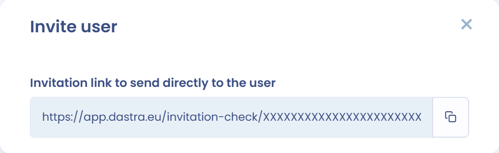

# Bekende problemen

Deze pagina behandelt de problemen die elke gebruiker kunnen treffen. Voor de authenticatieproblemen van SSO, zie [Bekende problemen van SSO](../features/settings/sso/known-problems.md).

## De uitgenodigde gebruiker ontvangt de uitnodigingsmails niet

Controleer eerst het volgende:

* Het e-mailadres van de gebruiker (domein, naam enzovoort) is correct. Is het onjuist, dan geeft de interface geen foutmelding.
* De mailbox van de persoon is niet vol.
* De e-mail staat niet in de map met ongewenste e-mail. In zeldzame gevallen blokkeert de spamfilter van de mailserver van de ontvanger de e-mail die Dastra verstuurt.

Komt de e-mail nog steeds niet aan, genereer dan een uitnodigingslink:

1. Klik in de lijst met gebruikers op **Een gebruiker uitnodigen** en volg de stappen.
2. Selecteer in de stap waarin u kiest hoe u uitnodigt **Een uitnodigingslink genereren** en klik daarna op de knop **Een uitnodigingslink genereren**.

   <figure><figcaption>
De uitnodigingslink kiezen
</figcaption></figure>
3. Kopieer de link die onder **Uitnodigingslink om rechtstreeks naar de gebruiker te verzenden** wordt weergegeven.

   <figure><figcaption>
Gegenereerde uitnodigingslink
</figcaption></figure>

Stuur de link daarna naar de gebruiker via de chat van uw bedrijf of vanuit uw mailbox.


De gebruiker moet zijn e-mailadres nog steeds valideren om toegang te krijgen tot uw werkruimte.


## Problemen met de cache van uw browser oplossen

De browser gebruikt een cache en cookies om informatie van websites op te slaan. Door die te verwijderen worden sommige problemen opgelost, zoals problemen met het laden van toepassingen zoals Dastra.

Probeer de volgende oplossingen in deze volgorde:

1. **Ververs de pagina zonder de cache te gebruiken**, met Ctrl + F5 (Windows) of Cmd + Shift + R (Mac).
2. Blijft het probleem bestaan, **stel dan uw voorkeursgegevens opnieuw in**. Deze actie verwijdert de cookies die Dastra heeft geplaatst, wist de items die in uw lokale opslag zijn bewaard en stelt uw weergavevoorkeuren in Dastra opnieuw in. Zo kunnen sommige weergaveproblemen worden opgelost.

Om dit uit te voeren, opent u rechtsboven uw profielmenu, klikt u op **Gebruikersprofiel** en daarna op **Voorkeursgegevens opnieuw instellen**.

<figure><figcaption>
De voorkeursgegevens opnieuw instellen
</figcaption></figure>


Deze actie verwijdert uw kolominstellingen in alle tabellen van Dastra en geeft de tutorials in alle modules opnieuw weer.


Lossen deze twee acties uw probleem niet op, neem dan vanuit de toepassing contact op met support: open uw profielmenu en kies **Hulpmiddelen** > **Contact opnemen met support** of **Praat met ons in de chat**.

## Fout 401 tijdens het aanmelden

**Scenario**: u maakt verbinding met Dastra via https://app.dastra.eu, u voert uw inloggegevens in en er verschijnt een foutpagina. De titel ervan is **Toegang geweigerd (401)**.

<figure><figcaption>
Foutpagina 401
</figcaption></figure>

**Oplossingen**:

1. **Controleer de klokinstellingen van uw computer.** Schakel tijdsynchronisatie met internet in. De vervaltijden van uw identificatietokens worden vergeleken met de tijd van uw machine: is die niet gesynchroniseerd met de tijd van de server, dan krijgt u deze fout. Zie de volgende links om uw klok in te stellen:
   * [Mac](https://support.apple.com/en-ca/guide/mac-help/mchlp2996/mac)
   * [PC](https://support.microsoft.com/en-us/windows/how-to-set-your-time-and-time-zone-dfaa7122-479f-5b98-2a7b-fa0b6e01b261)
2. **Gebruik https://app.dastra.eu om Dastra te openen.** U kunt dit adres aan uw favorieten toevoegen. Het probleem kan optreden wanneer u Dastra opent via adressen van het domein account.dastra.eu, die browsers vaak automatisch opslaan in hun adressuggesties.
3. **Wis de sitegegevens en cookies van uw browser.**

## Fout 403: toegang geweigerd

De melding **Onbereikbare bron (403)** betekent dat u probeert een onderdeel van Dastra te openen zonder de nodige machtiging. Een beheerder heeft de toegang tot bepaalde items of modules in uw werkruimte beperkt op basis van uw rol of de rechten van uw team.

Om het probleem op te lossen:

* Controleer of u de nodige rechten hebt voor de module of het item.
* Neem contact op met een van de beheerders van uw werkruimte om uw toegangsrechten te controleren of te wijzigen.

## Fout 404: item niet gevonden

De melding **Fout 404** betekent dat het item dat u probeert te openen niet kan worden gevonden. Het kan door een andere gebruiker of door uzelf zijn gewijzigd, verplaatst of verwijderd.

Om het probleem op te lossen:

* Controleer het adres (URL).
* Zoek het item opnieuw op in de lijst van zijn module.

## Fout 500

Deze fout kan zich af en toe voordoen. Ze wordt vaak veroorzaakt door:

* verbindingsproblemen;
* problemen met uw omgeving (browser, extensie enzovoort);
* meerdere personen die tegelijk aan hetzelfde item werken;
* een actie die veel serverresources vereist.

In de meeste gevallen is het probleem tijdelijk: wacht een paar minuten voordat u het opnieuw probeert.

Blijft het probleem bestaan, stuur dan een bugmelding via **Hulpmiddelen** > **Contact opnemen met support** in uw profielmenu, zodat onze teams het kunnen onderzoeken.
