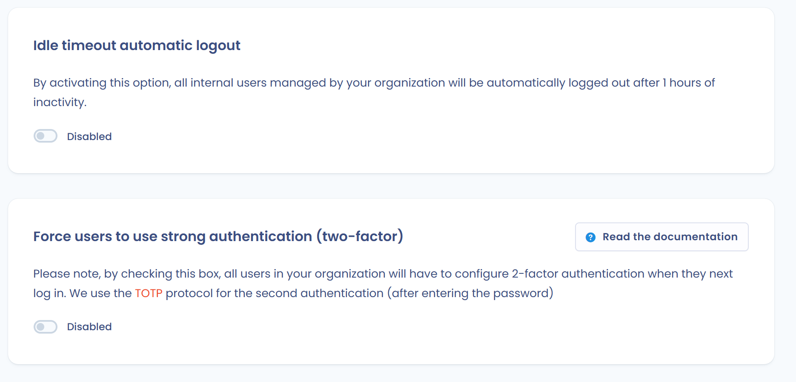

# Sterke authenticatie

Dastra gebruikt [TOTP](https://en.wikipedia.org/wiki/Time-based_One-time_Password_algorithm)-technologie om de [meerfactorauthenticatie](https://en.wikipedia.org/wiki/Multi-factor_authentication) van gebruikers te beheren. Gebruikers melden zich aan met hun gebruikelijke wachtwoord en een code van 6 cijfers die een authenticator-app levert, zoals Microsoft Authenticator of Google Authenticator.

Deze pagina legt uit hoe u sterke authenticatie inschakelt voor uw account en hoe u ze vervolgens verplicht stelt voor de gebruikers van uw organisatie.

## Sterke authenticatie inschakelen voor uw account

1. Open het profielmenu rechtsboven, klik op **Gebruikersprofiel** en klik vervolgens in het linkermenu op **Beveiliging**. U kunt ook rechtstreeks naar [https://app.dastra.eu/general-settings/account-security](https://app.dastra.eu/general-settings/account-security) gaan.
2. Klik in het blok **Bescherm je account met tweestapsverificatie** op **Sterke authenticatie inschakelen**.

<figure><figcaption>
Het blok voor tweefactorauthenticatie in de accountbeveiliging
</figcaption></figure>

3. Installeer op het scherm **Sterke authenticatie instellen** een authenticator-app op uw telefoon als u er nog geen hebt.
4. Scan de QR-code met de app. Kan de app de code niet scannen, voer dan de code in die onder de tekst staat.

<figure><figcaption>
Het installatiescherm: de QR-code die u met uw app scant
</figcaption></figure>

5. Klik op **Ga verder**. Dastra toont dan uw herstelcode: bewaar die op een veilige plaats.
6. Voer bij elke aanmelding uw wachtwoord in en vervolgens de **6-cijferige code** die uw app levert.

<figure><figcaption>
Voorbeeld van een authenticator-app
</figcaption></figure>


Bewaar de herstelcode veilig. Als u uw authenticator-app kwijtraakt, kunt u er sterke authenticatie mee opnieuw instellen: klik op het scherm waar u de code invoert op **Kan je geen verbinding maken?**. Zonder deze code blijft uw account vergrendeld: neem contact op met de eigenaar van uw organisatie, zodat die de sterke authenticatie van uw account opnieuw instelt.


## Sterke authenticatie verplicht stellen

Organisatie-eigenaren kunnen alle interne gebruikers, dat wil zeggen de gebruikers die door de organisatie worden beheerd, verplichten om sterke authenticatie te gebruiken. Deze optie maakt deel uit van de beveiligingsinstellingen van de organisatie, die zijn voorbehouden aan het Enterprise-abonnement.

1. Open het profielmenu, klik op **Organisatie-instellingen** en klik vervolgens in het linkermenu op **Beveiliging**. U kunt ook rechtstreeks naar [https://app.dastra.eu/general-settings/security](https://app.dastra.eu/general-settings/security) gaan.
2. Zet in het blok **Gebruikers dwingen sterke verificatie te gebruiken (twee-factor)** de schakelaar aan: die verandert in **Actief**.

<figure><figcaption>
Het blok waarmee sterke authenticatie verplicht wordt
</figcaption></figure>


Bij hun volgende aanmelding krijgen de betrokken gebruikers pas toegang tot de applicatie nadat ze sterke authenticatie hebben ingesteld. Waarschuw uw team en herinner iedereen eraan hoe de herstelcode veilig wordt bewaard. Een aanmelding met een [passkey](passkey.md) met gebruikersverificatie telt al als twee factoren: ze vraagt geen code van 6 cijfers.

